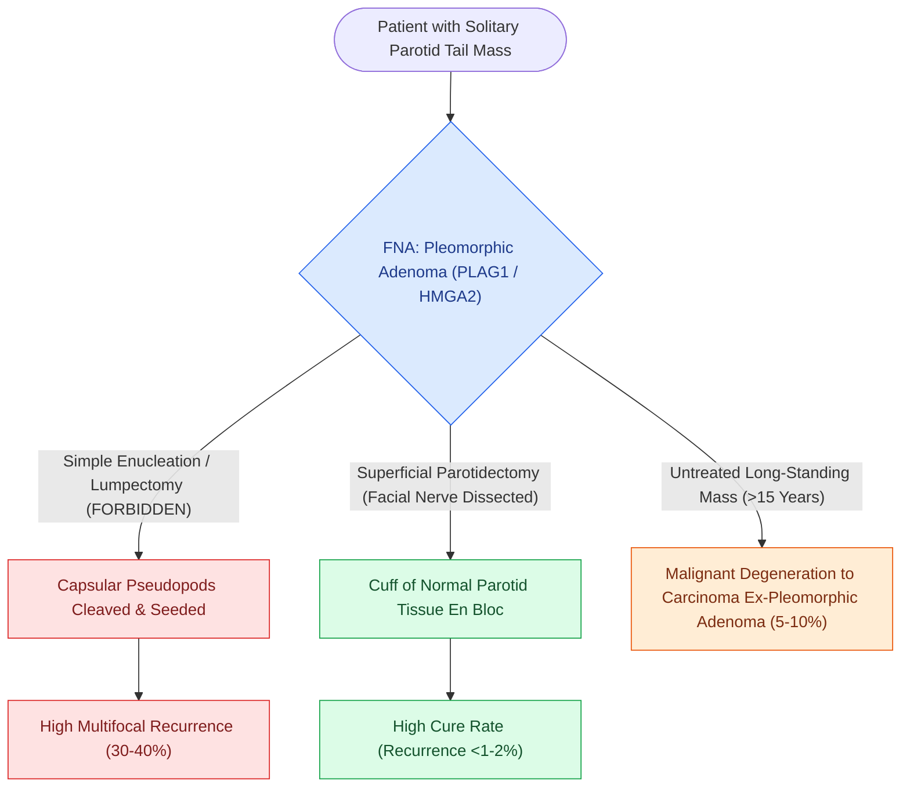

# Pleomorphic adenoma requires superficial parotidectomy with a cuff of normal tissue to prevent pseudopod recurrence

## Active Recall

> [!question]- Why is simple enucleation ('lumpectomy') contraindicated for pleomorphic adenoma of the parotid gland?
> *Answer / Clinical Rationale*: Because microscopic **capsular pseudopodia** project into surrounding normal parenchyma; enucleation cuts through these projections, causing multifocal recurrence in $30\text{–}40\%$ of cases.

> [!question]- What percentage of untreated pleomorphic adenomas undergo malignant transformation to Carcinoma Ex-Pleomorphic Adenoma?
> *Answer / Clinical Rationale*: Approximately **$5\text{ to }10\%$** over 15–20 years.

## Core Clinical & Mechanistic Principles
**Pleomorphic Adenoma (Benign Mixed Tumor)** is the most common neoplasm of the salivary glands ($70\text{–}80\%$ of all benign parotid tumors):
- **Histopathological Architecture**:
  - Biphasic tumor composed of **epithelial/myoepithelial cells** arranged in ductal, trabecular, or sheet patterns embedded within a **chondromyxoid, hyaline, or mucoid stroma**.
  - Driven by translocations involving **PLAG1** (8q12) or **HMGA2** (12q14).
- **The Pseudopod Hazard & Enucleation Contraindication**:
  - The fibrous capsule of a pleomorphic adenoma is delicate, incomplete, and variable in thickness.
  - Microscopic finger-like extensions of tumor (**pseudopodia**) project through the capsule into adjacent normal parotid parenchyma.
  - **Simple enucleation ('lumpectomy')** severs these pseudopodia, seeding the surgical bed with multiple microscopic tumor rests and leading to high multifocal recurrence rates ($30\text{–}40\%$).
- **Surgical Mandate**: **Superficial [[The facial nerve main trunk is localized using the tragal pointer, tympanomastoid suture, and digastric ridge|parotidectomy]] with facial nerve dissection** (or formal extracapsular dissection with a documented $\ge 2\text{–}3\text{ mm}$ margin of normal parotid tissue).

### Surgical Technique & Critical Safety Checks
- **Carcinoma Ex-Pleomorphic Adenoma**: Untreated long-standing pleomorphic adenomas carry a **$5\text{–}10\%$ risk of malignant transformation** over 15–20 years into high-grade adenocarcinoma or undifferentiated carcinoma.

## Connected Concepts & Graph Traversal
- **Superficial Parotidectomy**: [[Superficial parotidectomy dissects the facial nerve branches to resect the lateral salivary lobe|Superficial Parotidectomy]]
- **Warthin Tumor**: [[Warthin tumor presents as a cystic parotid neoplasm associated with smoking and bilateral occurrence|Warthin Tumor]]
- **Mucoepidermoid Carcinoma**: [[Mucoepidermoid carcinoma is graded by AFIP Brandwein criteria and driven by CRTC1-MAML2 translocation|Mucoepidermoid Carcinoma]]
- **Anatomical Foundation**: [[AJCC 8th edition incorporates depth of invasion into oral cavity T-staging]]
- **Surgical Lymphadenectomy**: [[Levels II through IV internal jugular chain dissection mobilizes the carotid sheath packet]]
- **Oncologic Resection & Margins**: [[Buccal mucosa carcinoma exhibits high rates of local recurrence and Stensen duct involvement]]
- **Aerodigestive / Pharyngolaryngeal**: [[Postcricoid hypopharyngeal carcinoma frequently invades the cervical esophagus and bilateral RLNs]]
- **Malignant Transformation**: [[Carcinoma ex pleomorphic adenoma arises from longstanding benign mixed tumors and is stratified by capsular invasion into noninvasive, minimally invasive, and widely invasive subtypes|Carcinoma ex Pleomorphic Adenoma]]
