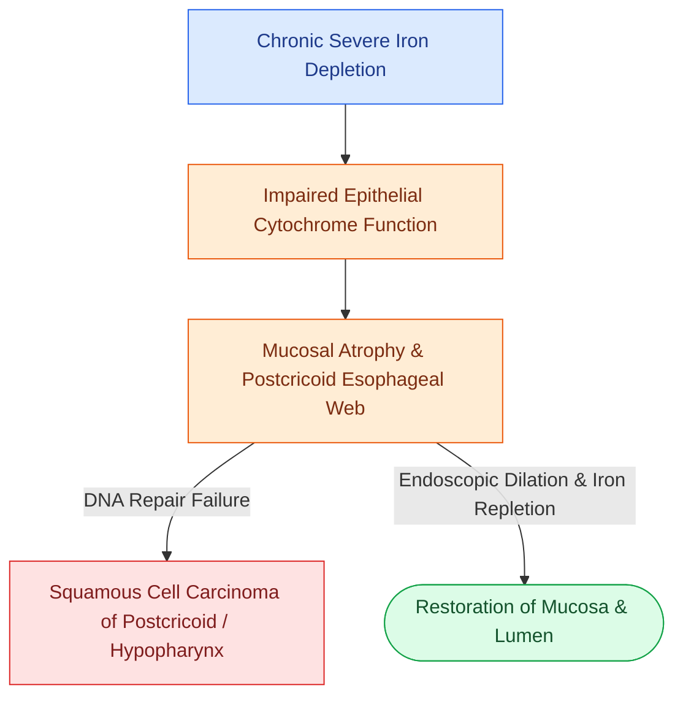

# Plummer-Vinson syndrome combines iron deficiency anemia, postcricoid esophageal webs, and mucosal atrophy with malignant potential

## Active Recall

> [!question]- What is the classic clinical triad of Plummer-Vinson (Paterson-Kelly) syndrome, and what demographic group is predominantly affected?
> *Answer / Clinical Rationale*: The classic triad consists of: (1) **microcytic hypochromic iron deficiency anemia**, (2) **painless, progressive solid-food dysphagia secondary to a cervical/postcricoid esophageal web**, and (3) **atrophic oral/esophageal mucosal changes** (glossitis, angular cheilitis, koilonychia/spoon nails). It predominantly affects **middle-aged Caucasian females (female-to-male ratio ~9:1 to 10:1)**, classically of northern European descent.

> [!question]- What specific upper aerodigestive tract malignancy is associated with untreated Plummer-Vinson syndrome, and what is the primary diagnostic and therapeutic regimen?
> *Answer / Clinical Rationale*: Patients with Plummer-Vinson syndrome have a marked predisposition (3%–15%) for developing **squamous cell carcinoma of the postcricoid hypopharynx and upper cervical esophagus**. Primary management involves **high-dose oral or intravenous iron replacement therapy** (which can reverse mucosal atrophy and early webs) combined with **endoscopic esophageal dilation (bougie or balloon)** for persistent fibrous webs, followed by lifelong endoscopic surveillance.

## Core Clinical & Mechanistic Principles
**Plummer-Vinson syndrome** (also termed Paterson-Brown Kelly syndrome or sideropenic dysphagia) is an uncommon condition where severe, chronic cellular iron deficiency leads to oxidative stress, mucosal epithelial atrophy, mitochondrial dysfunction, and defective repair in rapidly dividing aerodigestive mucosa. This manifests structurally as thin, eccentric membranous webs in the anterior postcricoid hypopharynx and upper cervical esophagus.

### Diagnostic Workup & Anatomic Features
1. **Barium Esophagram**:
   - The diagnostic imaging test of choice; demonstrates a **thin, horizontal, shelf-like radiolucent projection** arising predominantly from the **anterior wall of the postcricoid cervical esophagus** (at or just inferior to the cricopharyngeus muscle, C5–C6 level).
    - In contrast to concentric [[High-resolution manometry classifies achalasia and esophageal motility disorders by the Chicago criteria|Schatzki rings]] of the distal esophagus, Plummer-Vinson webs are asymmetric, proximal, and purely mucosal.
2. **Laboratory Evaluation**:
   - Complete blood count showing microcytic hypochromic anemia (low Hb/Hct, low MCV).
   - Iron panel: severely depressed serum ferritin, low serum iron, and elevated total iron-binding capacity (TIBC).
3. **Upper Aerodigestive Endoscopy**:
   - Flexible or rigid esophagoscopy confirms a pale, friable, thin mucosal web. Care must be taken upon initial scope insertion through the upper esophageal sphincter to avoid blind perforation of the postcricoid pouch above the web.
4. **Oncologic Surveillance**:
   - Because of the increased relative risk of [[Posterior pharyngeal wall carcinoma metastasizes early to retropharyngeal and level II to IV lymph nodes|hypopharyngeal and cervical esophageal squamous cell carcinoma]], long-term periodic endoscopic surveillance is mandatory even after successful dilation.

## Connected Concepts & Graph Traversal
- **Malignancy Risk**: [[Posterior pharyngeal wall carcinoma metastasizes early to retropharyngeal and level II to IV lymph nodes|Hypopharyngeal & Postcricoid Carcinoma]]
- **Dysphagia Evaluation**: [[FEES assesses pharyngeal secretions and aspiration under direct vision|FEES & Barium Swallowing Evaluation]]
- **Differential Esophageal Web**: [[High-resolution manometry classifies achalasia and esophageal motility disorders by the Chicago criteria|Esophageal Motility & Stricture Differentiation]]
- **Adjacent Anatomy**: [[The carotid sheath is composed of all three layers of deep cervical fascia and forms a vertical neurovascular conduit|Cervical Esophageal Visceral Compartment]]
- **Muscular Boundary**: [[Broyles' ligament anchors the vocal ligament to thyroid cartilage|Laryngeal Framework Landmarks]]
