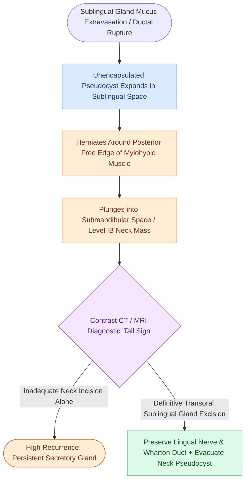

# Plunging ranula is a sublingual mucus extravasation pseudocyst herniating around the mylohyoid free edge

## Active Recall

> [!question]- Why does treating the neck collection without the sublingual gland fail?
> *Answer / Clinical Rationale*: The pseudocyst is a leak, not a cyst — the secreting gland refills any drained space; source-gland excision is the cure.

> [!question]- What imaging feature identifies a plunging ranula among cystic neck masses?
> *Answer / Clinical Rationale*: The tail sign: a tract from the submandibular collection to the sublingual space around mylohyoid's free edge.

## Core Clinical & Mechanistic Principles
- Pathology: **mucus extravasation pseudocyst** (no epithelial lining) from a disrupted sublingual gland — the gland is a continuous mucus secretor without a dominant duct, which is why it, uniquely, produces ranulas.
- 'Plunging' is anatomy, not biology: the pseudocyst herniates **around the posterior free edge of mylohyoid** (or through a dehiscence) into the submandibular space — a soft neck mass whose engine remains on the floor of the mouth.
- Imaging tell: the **tail sign** — a tract connecting the neck collection back to the sublingual space on CT/MRI names the diagnosis.
- Differential of the cystic submandibular mass: lymphatic malformation, dermoid, thyroglossal (midline), and second-arch cysts — the tail sign and floor-of-mouth component separate the ranula.

### Management & Critical Safety Checks
- Definitive treatment is **excision of the sublingual gland** (transoral) with evacuation of the pseudocyst; draining or marsupializing the neck component alone invites recurrence because the leak persists.
- Wharton's duct and the lingual nerve cross the operative field — the [[Submandibular gland excision requires preservation of the marginal mandibular, lingual, and hypoglossal nerves|submandibular triangle]] relationships govern the dissection.

## Connected Concepts & Graph Traversal
- **Submandibular Resection Landmarks**: [[Submandibular gland excision requires preservation of the marginal mandibular, lingual, and hypoglossal nerves|Submandibular Gland Surgery]]
- **Ductal Obstruction Context**: [[Wharton duct sialolithiasis is managed with transoral sialodochoplasty or sialendoscopy|Wharton Duct Anatomy]]
- **Cystic Congenital Differential**: [[Lymphatic malformations are slow-flow vascular anomalies classified into macrocystic and microcystic lesions|Lymphatic Malformation Differential]]
- **Midline Cyst Differential**: [[Sistrunk procedure resects the thyroglossal duct cyst with the central body of the hyoid bone and foramen cecum core|Thyroglossal Duct Cyst]]
- **Deep Fascial Compartments**: [[Deep neck space infections spread along cervical fascial planes between the pharynx, mediastinum, and skull base|Sublingual and Submandibular Spaces]]
