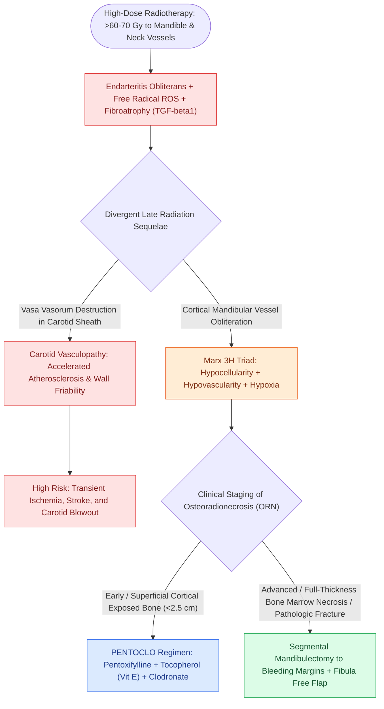

# Post-radiation carotid vasculopathy and osteoradionecrosis represent severe late radiotherapy sequelae

## Active Recall

> [!question]- What are the three components of Marx's classic pathophysiological triad of osteoradionecrosis?
> *Answer / Clinical Rationale*: **Hypovascularity, Hypocellularity, and Hypoxia** (the '3H' model).

> [!question]- What medical therapy combination (PENTOCLO) is used to treat early-to-moderate osteoradionecrosis?
> *Answer / Clinical Rationale*: **Pentoxifylline**, **Tocopherol (Vitamin E)**, and **Clodronate**.

## Core Clinical & Mechanistic Principles
Radiotherapy ($>60\text{–}70\text{ Gy}$) causes progressive microvascular and cellular damage:
- **Marx 3H Principle of Osteoradionecrosis (ORN)**:
  - Endarteritis obliterans and osteocyte loss produce **Hypovascularity, Hypocellularity, and Hypoxia**.
  - Minor trauma (dental extraction) or mucosal breakdown leads to chronic non-healing exposed bone.
  - *Delanian Theory*: Fibroatrophic process driven by free radicals and TGF-beta1.
- **Post-Radiation Carotid Vasculopathy**:
  - Vasa vasorum destruction induces adventitial fibrosis, accelerated atherosclerosis, and medial thinning.
  - High risk of **carotid stenosis, stroke**, and **[[Carotid blowout syndrome is classified into threatened, impending, and acute hemorrhage|carotid blowout syndrome]]**.

### Surgical Technique & Critical Safety Checks
- **Medical ORN Protocol (PENTOCLO)**: Pentoxifylline + Tocopherol (Vitamin E) + Clodronate.
- **Surgical Management of Advanced ORN**: [[Segmental mandibulectomy resects full-thickness bone for medullary invasion and irradiated bone recurrence|Segmental mandibulectomy]] back to bleeding bone, followed by microvascular **Fibula osteocutaneous free flap** reconstruction.

## Connected Concepts & Graph Traversal
- **Definitive Chemoradiotherapy**: [[Intensity-modulated radiation therapy and cisplatin radiosensitization form the standard definitive chemoradiation regimen|Definitive CRT Regimens]]
- **Vascularized Bone Transfer**: [[The fibula osteocutaneous free flap provides up to twenty-five centimeters of vascularized bone for mandible reconstruction|Fibula Free Flap Reconstruction]]
- **Carotid Blowout Emergency**: [[Carotid blowout syndrome is classified into threatened, impending, and acute hemorrhage|Carotid Blowout Staging]]
- **Segmental Mandibulectomy**: [[Segmental mandibulectomy resects full-thickness bone for medullary invasion and irradiated bone recurrence|Segmental Mandibulectomy Indications]]
- **Rigid Bicortical Plating**: [[Mandibular reconstruction plates require rigid bicortical screw fixation to withstand masticatory load|Mandibular Reconstruction Plates]]
- **Medication-Related Bone Necrosis Differential**: [[Medication-related osteonecrosis of the jaw is staged by the AAOMS system to direct antiresorptive conservative and surgical therapy|MRONJ Staging & Management]]
- **Irradiated Field Vascular Risk**: [[Neck dissection incision design balances surgical exposure against carotid coverage and vascular compromise in irradiated tissue|Neck Dissection Incisions in Irradiated Necks]]
