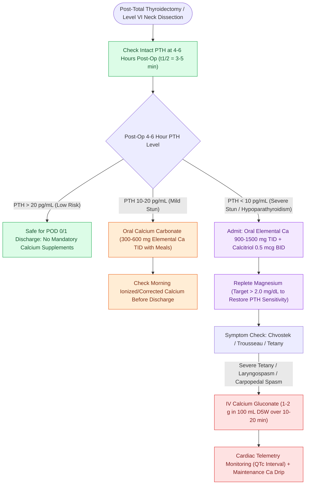

# Post-thyroidectomy hypocalcemia is managed with oral calcium, calcitriol, and intravenous calcium gluconate

## Active Recall

> [!question]- Why must serum magnesium be checked and corrected in patients with refractory post-thyroidectomy hypocalcemia?
> *Answer / Clinical Rationale*: Severe **hypomagnesemia inhibits PTH secretion from parathyroid chief cells** and induces skeletal and renal end-organ resistance to PTH, preventing calcium normalization until magnesium is repleted.

> [!question]- Why does hyperventilation induce acute carpopedal spasm and numbness in a postoperative thyroidectomy patient?
> *Answer / Clinical Rationale*: Respiratory alkalosis increases the negative charge on serum albumin, **dramatically increasing protein binding of calcium** and dropping biologically active ionized calcium by $\approx 0.36\text{ mmol/L}$ per 1 unit increase in pH.

> [!question]- Why must calcium chloride be administered exclusively through a central venous catheter, whereas calcium gluconate can be given peripherally?
> *Answer / Clinical Rationale*: Calcium chloride is significantly more concentrated and hyperosmolar; **peripheral extravasation causes devastating ischemic skin sloughing and tissue necrosis**.

## Core Clinical & Mechanistic Principles
**Transient post-thyroidectomy hypocalcemia** occurs in $15\text{–}30\%$ of patients (permanent in $<1\text{–}3\%$) following total thyroidectomy or central neck dissection due to parathyroid gland devascularization, venous congestion, thermal injury, or accidental resection:

- **Calcium Physiology & Serum Dynamics**:
  - *Distribution*: **$45\%$ ionized** (biologically active), **$50\%$ protein-bound** (primarily to albumin), and **$5\%$ complexed** to phosphate/citrate.
  - *The Corrected Calcium Formula*: For every $1.0\text{ g/dL}$ decrease in serum albumin below $4.0\text{ g/dL}$, total calcium decreases by $0.8\text{ mg/dL}$:
    $$\text{Corrected Calcium (mg/dL)} = \text{Total Calcium} + 0.8 \times (4.0 - \text{Serum Albumin})$$
  - *The pH Binding Shift*: Alkalosis increases the negative charge on albumin, driving calcium-albumin binding and precipitating acute symptomatic hypocalcemia despite a normal total calcium (**ionized Ca decreases by $0.36\text{ mmol/L}$ per 1.0 unit increase in pH**).
  - *Magnesium Co-Dependence*: **Hypomagnesemia ($<1.8\text{ mg/dL}$)** impairs both parathyroid hormone (PTH) release from chief cells and peripheral tissue responsiveness to PTH. *Clinical Axiom*: Refractory hypocalcemia will not correct until hypomagnesemia is repleted.
  - *Citrate Toxicity*: Citrate in packed red blood cells chelates ionized calcium during massive transfusion, triggering rapid hypocalcemia.

- **Postoperative PTH-Stratified Inpatient/Outpatient Protocol (PACU & POD 1)**:
  - Intact PTH has a **half-life of only $3\text{–}5\text{ minutes}$**, making a 4- to 6-hour postoperative PTH level the most accurate predictor of parathyroid viability:
  - *PTH $>20\text{ pg/mL}$*: Safe for same-day discharge or standard discharge on POD 1 with no mandatory supplements.
  - *PTH $15\text{–}20\text{ pg/mL}$*: Discharge on oral calcium carbonate ($300\text{ mg}$ elemental Ca TID with meals); check morning calcium.
  - *PTH $10\text{–}15\text{ pg/mL}$*: Overnight observation; oral calcium carbonate ($600\text{ mg}$ elemental Ca TID); recheck AM calcium and PTH.
  - *PTH $<10\text{ pg/mL}$*: High-risk parathyroid stun; admit for overnight observation; initiate high-dose oral calcium ($900\text{ mg}$ elemental Ca TID) + **Calcitriol ($0.5\text{ mcg}$ BID)**; check magnesium and serial calcium every 6 hours.
  - *Alternative Yale Protocol*: For PTH $<15\text{ pg/mL}$, prescribe calcium carbonate $1,500\text{ mg}$ BID + calcitriol $0.25\text{ mcg}$ BID for 2 weeks.

- **Symptomatic Management & IV Rescue Guidelines**:
  - *Mild / Moderate Symptoms* (Perioral numbness, paresthesias, positive Chvostek sign): Escalate oral calcium carbonate to $1,000\text{–}2,000\text{ mg}$ elemental Ca TID with calcitriol $0.5\text{ mcg}$ BID.
  - *Severe Symptoms / Tetany / Stridor / Positive Trousseau Sign*: Administer **IV Calcium Gluconate (1–2 g in $100\text{ mL}$ D5W infused over 10–20 minutes)** under continuous cardiac telemetry (watching for QTc prolongation/arrhythmias), followed by a maintenance drip ($1\text{ mg/kg/hr}$ elemental Ca).
  - *Peripheral vs Central Line Rule*: Calcium gluconate can be infused safely through a peripheral IV; **Calcium chloride is hyperosmolar and causes severe tissue necrosis/extravasation gangrene**, mandating central venous access only.

### Surgical Technique & Critical Safety Checks
- **Parathyroid Autotransplantation**: If a parathyroid gland is completely devascularized or found on the resected specimen, perform frozen section confirmation, mince into $1\text{-mm}$ fragments, and reimplant into individual pockets in the sternocleidomastoid (SCM) or brachioradialis muscle, marking the pocket with nonabsorbable clips (see [[The 2025 ATA guidelines establish active surveillance criteria and lobectomy preference for low-risk differentiated thyroid cancer|2025 ATA Guidelines & Lobectomy]]).

## Connected Concepts & Graph Traversal
- **2025 ATA Surgical De-escalation**: [[The 2025 ATA guidelines establish active surveillance criteria and lobectomy preference for low-risk differentiated thyroid cancer|2025 ATA Guidelines & Lobectomy]]
- **Parathyroid Anatomy & P3/P4**: [[Superior and inferior parathyroid glands maintain constant anatomical relationships to the RLN and ITA|Parathyroid Anatomy & RLN Plane]]
- **Parathyroid Autotransplantation**: [[Devascularized parathyroid glands require confirmation biopsy and autotransplantation into the SCM|Parathyroid Autotransplantation Craft]]
- **Primary Hyperparathyroidism**: [[Primary hyperparathyroidism is caused by single adenomas, multigland hyperplasia, or parathyroid carcinoma|Primary Hyperparathyroidism Workup]]
- **RLN Preservation**: [[The recurrent laryngeal nerve is identified within Simon's triangle and followed through Berry's ligament|RLN Identification in Simon's Triangle]]
- **Central Compartment Neck Dissection**: [[Central compartment neck dissection clears level VI nodes between the carotid sheaths and suprasternal notch|Level VI Central Dissection]]

## References
1. Shindo, M.L. (2013). Hyperparathyroidism: Evaluation and Surgery. In Johnson, J.J., Rosen, C.A. (Eds.), *Bailey’s Head and Neck Surgery-Otolaryngology* 5e (pp. 2131-2146). Baltimore, MD: Lippincott Williams & Wilkins.
2. Kakava, K., Tournis, S., Papadakis, G., et al. (2016). Postsurgical hypoparathyroidism: A systematic review. *In Vivo*, 30(3):171-179.
3. Khan, M.I., Waguespack, S.G., Hu, M.I. (2011). Medical management of postsurgical hypoparathyroidism. *Endocr Pract*, 17 Suppl 1:18-25.
4. Witteveen, J.E., van Thiel, S., Romijn, J.A., et al. (2013). Hungry bone syndrome: Still a challenge in the post-operative management of primary hyperparathyroidism. *Eur J Endocrinol*, 168(3):R45-R53.
