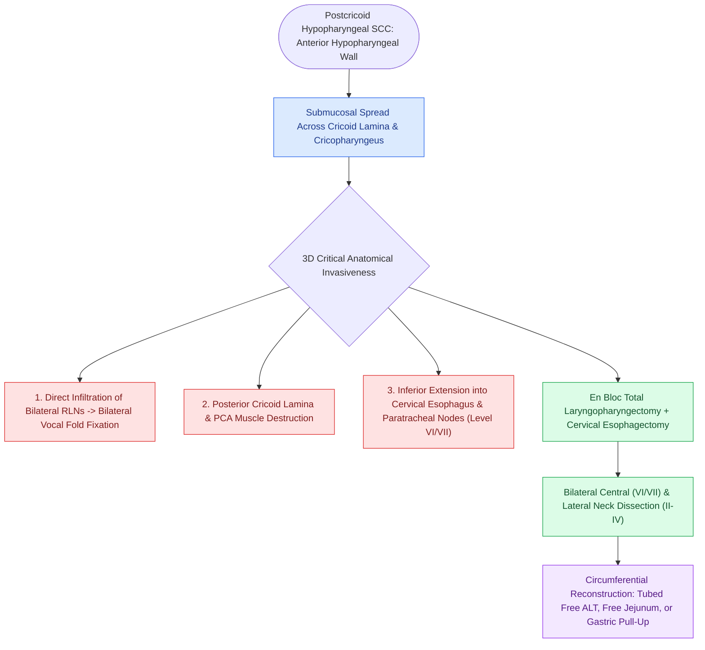

# Postcricoid hypopharyngeal carcinoma frequently invades the cervical esophagus and bilateral RLNs

## Active Recall

> [!question]- What clinical syndrome characterized by iron deficiency anemia, esophageal webs, and spoon nails is associated with postcricoid carcinoma?
> *Answer / Clinical Rationale*: **Plummer-Vinson (Paterson-Kelly) syndrome**.

> [!question]- Why does postcricoid carcinoma cause vocal cord paralysis even before cartilage destruction?
> *Answer / Clinical Rationale*: Because it directly invades the **bilateral recurrent laryngeal nerves** as they enter the larynx behind the cricothyroid joint.

## Core Clinical & Mechanistic Principles
Carcinoma of the **postcricoid region** (the anterior wall of the hypopharynx overlying the posterior cricoid cartilage lamina):
- **Clinical Characteristics**:
  - High association with nutritional deficiencies, iron deficiency anemia (**Plummer-Vinson / Paterson-Kelly syndrome**), and female predominance in certain populations.
  - Presents with progressive dysphagia, weight loss, and hoarseness.
- **Anatomical Invasiveness**:
  1. Directly invades the **posterior cricoid cartilage** and posterior cricoarytenoid (PCA) muscles.
  2. Infiltrates the **bilateral recurrent laryngeal nerves (RLNs)** entering the larynx beneath the inferior constrictor, causing bilateral vocal cord paralysis and airway compromise.
  3. Extends inferiorly across the cricopharyngeus into the **cervical esophagus**.
- **Surgical Mandate**: Total laryngopharyngectomy with cervical esophagectomy, bilateral central (Level VI) and lateral (Levels II–IV) neck dissections, and microvascular reconstruction.

### Surgical Technique & Critical Safety Checks
- **High Mediastinal Extension**: Often requires mediastinal paratracheal dissection (Level VII) and possible sternotomy for distal margin clearance (see [[Circumferential laryngopharyngectomy requires tubed microvascular or visceral flap reconstruction|Circumferential Reconstruction Strategies]]).

## Connected Concepts & Graph Traversal
- **Circumferential Resection**: [[Circumferential laryngopharyngectomy requires tubed microvascular or visceral flap reconstruction|Circumferential Reconstruction Strategies]]
- **Total Laryngectomy**: [[Total laryngectomy achieves en bloc laryngeal resection with permanent end-stoma|Total Laryngectomy Standards]]
- **Central Compartment Neck Dissection**: [[Central compartment neck dissection clears level VI nodes between the carotid sheaths and suprasternal notch|Level VI Central Dissection]]
- **Posterior Pharyngeal Wall Malignancy**: [[Posterior pharyngeal wall carcinoma metastasizes early to retropharyngeal and level II to IV lymph nodes|Posterior Pharyngeal Wall Carcinoma]]
- **Piriform Sinus Carcinoma**: [[Hypopharyngeal piriform sinus carcinoma requires partial or total laryngopharyngectomy|Piriform Sinus Resection]]
- **Recurrent Laryngeal Nerve Craft**: [[The recurrent laryngeal nerve is identified within Simon's triangle and followed through Berry's ligament|RLN Anatomy and Preservation]]
