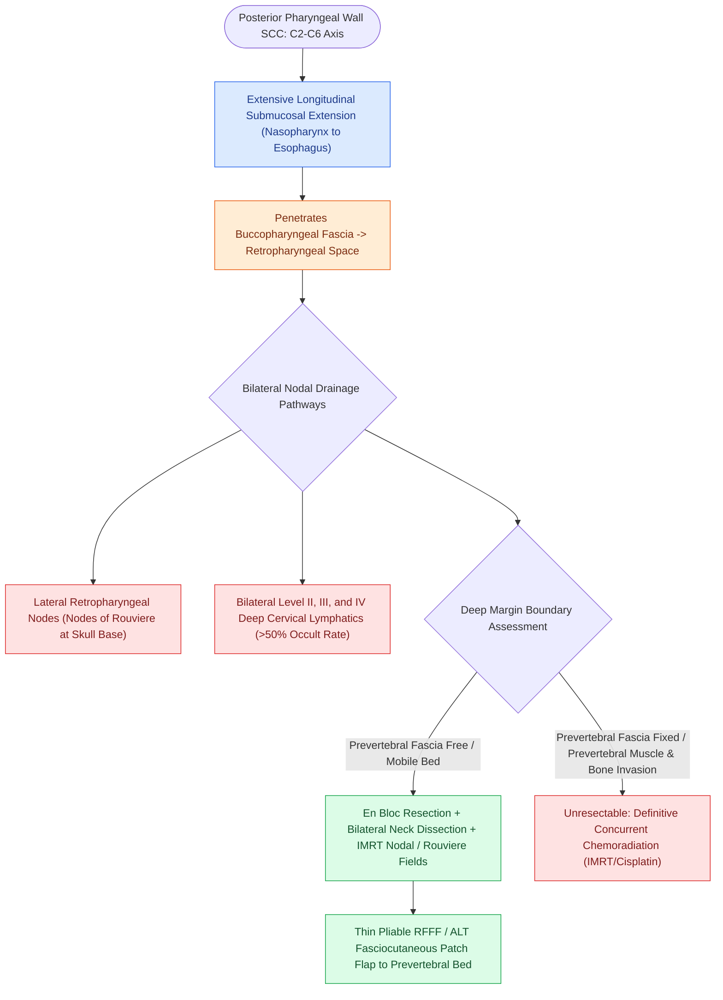

# Posterior pharyngeal wall carcinoma metastasizes early to retropharyngeal and level II to IV lymph nodes

## Active Recall

> [!question]- What specific nodal basin must be treated in posterior pharyngeal wall carcinoma that is not part of standard neck dissection?
> *Answer / Clinical Rationale*: The **retropharyngeal lymph nodes (nodes of Rouvière)**.

> [!question]- What anatomical layer serves as the deep surgical margin for posterior pharyngeal wall resections?
> *Answer / Clinical Rationale*: The **prevertebral fascia**.

## Core Clinical & Mechanistic Principles
Squamous cell carcinoma of the **posterior pharyngeal wall (PPW)** spans the oropharynx and hypopharynx:
- **Anatomical Characteristics**:
  - Overlies the buccopharyngeal fascia, [[Deep neck space infections spread along cervical fascial planes between the pharynx, mediastinum, and skull base|retropharyngeal space]], and deep prevertebral fascia directly in front of the cervical vertebrae (C2–C6).
  - High tendency for **extensive longitudinal submucosal spread** superiorly toward the nasopharynx and inferiorly into the esophagus.
- **Bilateral & Retropharyngeal Nodal Metastasis**:
  - Drains directly to the **lateral retropharyngeal nodes (nodes of Rouvière)** as well as bilaterally to **Levels II, III, and IV**.
  - [[Elective neck dissection is indicated for oral cavity squamous cell carcinoma with depth of invasion exceeding four millimeters|Occult nodal metastasis]] rate exceeds $50\text{–}60\%$, requiring bilateral elective neck dissection and coverage of the retropharyngeal basins.
- **Surgical Approach**:
  - Transoral / [[Transoral robotic surgery TORS achieves en bloc resection of tonsillar and base of tongue neoplasms|TORS]] for small, early T1 lesions.
  - Lateral pharyngotomy or mandibulotomy for larger lesions.
  - Prevertebral fascia serves as the deep margin; if vertebral periosteum is invaded, tumor is unresectable.

### Surgical Technique & Critical Safety Checks
- **Reconstruction**: Reconstruct with a thin **RFFF or ALT patch flap** sutured to the prevertebral fascia.

## Connected Concepts & Graph Traversal
- **Retropharyngeal Topography**: [[The retropharyngeal space extends from skull base to tracheal bifurcation and contains lymph nodes draining the nasopharynx|Retropharyngeal Space Boundaries]]
- **Circumferential Resection**: [[Circumferential laryngopharyngectomy requires tubed microvascular or visceral flap reconstruction|Circumferential Reconstruction]]
- **Thin Patch Flap Reconstruction**: [[The radial forearm free flap provides thin, pliable fasciocutaneous tissue for oral and pharyngeal defects|Radial Forearm Free Flap Donor]]
- **Postcricoid Infiltration**: [[Postcricoid hypopharyngeal carcinoma frequently invades the cervical esophagus and bilateral RLNs|Postcricoid Carcinoma]]
- **Piriform Sinus Resection**: [[Hypopharyngeal piriform sinus carcinoma requires partial or total laryngopharyngectomy|Piriform Sinus Carcinoma]]
- **Definitive Chemoradiation**: [[Intensity-modulated radiation therapy and cisplatin radiosensitization form the standard definitive chemoradiation regimen|Definitive CRT Regimens]]
