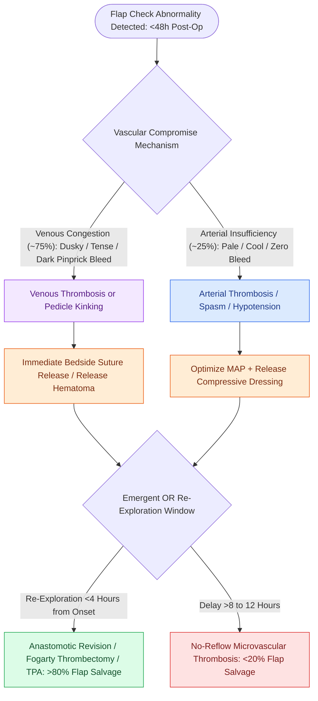

# Postoperative free flap compromise within forty-eight hours requires emergent surgical re-exploration for pedicle salvage

## Active Recall

> [!question]- What physical examination and pinprick findings distinguish acute venous congestion from arterial insufficiency in a free flap skin paddle?
> *Answer / Clinical Rationale*: **Venous congestion** displays a **dusky/purple, swollen, tense skin paddle** with rapid capillary refill and **immediate dark purple/black bleeding upon 20-gauge needle pinprick**. In contrast, **arterial insufficiency** presents with a **pale, cool, flaccid, collapsed skin paddle** with prolonged/absent capillary refill and **complete absence of bleeding upon needle pinprick**.

> [!question]- What specific antibiotic prophylaxis is mandatory whenever medicinal leech therapy (Hirudo medicinalis) is used for flap salvage?
> *Answer / Clinical Rationale*: **Ciprofloxacin** (or an antipseudomonal fluoroquinolone/3rd generation cephalosporin). *Aeromonas hydrophila* is an obligate enteric symbiote residing within the gut of the medicinal leech, essential for blood digestion; without targeted antibiotic prophylaxis, *A. hydrophila* infection produces aggressive flap cellulitis, necrotizing fasciitis, and graft loss.

## Core Clinical & Mechanistic Principles

**Microvascular free tissue transfer** achieves success rates exceeding 95% in head and neck reconstruction. However, approximately **5% to 10%** of free flaps experience acute microvascular pedicle compromise. More than **80% of vascular pedicle failures occur within the first 48 hours postoperatively**, during which the microvascular anastomosis is exquisitely susceptible to platelet activation, thrombosis, mechanical kinking, or compression.

Pedicle compromise divides into **[[Microvascular venous thrombosis presents with violaceous congestion and rapid dark bleeding on pinprick|venous thrombosis]]/congestion** (~70–80% of compromised cases) and **[[Microvascular arterial thrombosis presents with a pale, flat flap and requires immediate surgical exploration|arterial thrombosis]]/insufficiency** (~20–30%):
- **Venous Congestion**: Triggered by venous anastomotic microthrombi, pedicle torsion/kinking, tight neck skin closure, or [[Postoperative neck hematoma after thyroidectomy or neck dissection requires emergent bedside wound opening for airway decompression|postoperative compressive neck hematoma]]. Clinical signs include a **violaceous, dusky, or dark purple hue**, brisk capillary refill (<1 second), **tense/edematous skin turgor**, a high-pitched or absent venous Doppler signal, and rapid extravasation of **dark, venous, purple blood upon 20-gauge needle pinprick testing**.
- **Arterial Insufficiency**: Triggered by intimal dissection, anastomotic spasm, arterial thrombosis, or severe systemic hypotension. Clinical signs include a **pale, cool, or mottled skin paddle**, sluggish or absent capillary refill (>3 seconds), **flaccid loss of turgor**, loss of arterial Doppler signal, and **complete absence of bleeding upon needle pinprick**.

The time window from onset of pedicle occlusion to irreversible microvascular no-reflow phenomenon (endothelial breakdown and microcapillary thrombosis) is **4 to 6 hours**. Salvage rates exceed **80% if re-exploration occurs within 4 hours** of onset, but plummet to <20% if delayed beyond 8–12 hours.

### Key Consultation Supplies
- Coaxial headlight
- Handheld 8-MHz pencil Doppler ultrasound probe with acoustic gel
- 20-gauge and 25-gauge sterile needles (for dermis pinprick bleeding assessment)
- Suture removal kit (fine iris scissors and Adson tissue forceps)
- Sterile bedside suture line exploration kit
- Anticoagulation / antiplatelet therapy orders (aspirin, heparin protocol)
- Leech therapy kit: *Hirudo medicinalis*, 3 mL syringe barrels, sterile gauze, oral/IV ciprofloxacin prophylaxis
- Emergency Operating Room notification order for microvascular re-exploration

## References
1. Chepeha, D.B. (2013). Reconstructive Microsurgery of the Head and Neck. In Johnson, J.J., Rosen, C.A. (Eds.), *Bailey’s Head and Neck Surgery-Otolaryngology* 5e (pp. 2824-2848). Baltimore, MD: Lippincott Williams & Wilkins.
2. Novakovic, D., Patel, R.S., Goldstein, D.P., et al. (2009). Salvage of failed free flaps used in head and neck reconstruction. *Head Neck Oncol*, 1:33.
3. Başaran, B., Ünsaler, S., Kesimli, M.C., et al. (2021). Free flap reconstruction of the head and neck region: A series of 127 flaps performed by otolaryngologists. *Turk Arch Otorhinolaryngol*, 59(2):103-110.

## Connected Concepts & Graph Traversal

- **Diagnostic Monitoring Modalities**: [[Postoperative free flap monitoring includes Doppler ultrasound, pinprick bleeding, and capillary refill checks|Free Flap Monitoring Protocols]]
- **Compressive Etiology**: [[Postoperative neck hematoma after thyroidectomy or neck dissection requires emergent bedside wound opening for airway decompression|Postoperative Neck Hematoma]]
- **Fasciocutaneous Donor Flap**: [[The radial forearm free flap provides thin, pliable fasciocutaneous tissue for oral and pharyngeal defects|Radial Forearm Free Flap]]
- **Bulky Soft Tissue Flap**: [[The anterolateral thigh free flap provides versatile soft tissue volume based on the LCFA|Anterolateral Thigh Free Flap]]
- **Osteocutaneous Reconstruction**: [[The fibula osteocutaneous free flap provides up to twenty-five centimeters of vascularized bone for mandible reconstruction|Fibula Free Flap]]
