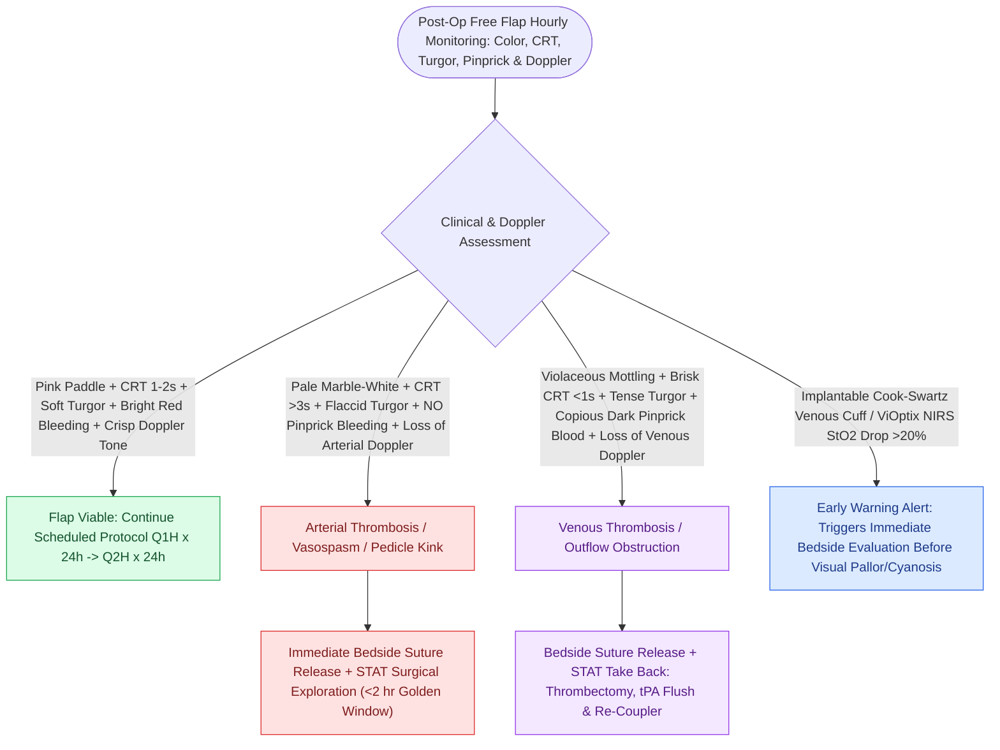

# Postoperative free flap monitoring includes Doppler ultrasound, pinprick bleeding, and capillary refill checks

## Active Recall

> [!question]- What are the physical examination findings of acute venous thrombosis in a free flap?
> *Answer / Clinical Rationale*: **Violaceous/purple discoloration**, **rapid capillary refill ($<1\text{ sec}$)**, **tense turgor**, and **immediate dark purplish bleeding upon needle pinprick**.

> [!question]- How does an implantable Cook-Swartz Doppler probe monitor free flap viability?
> *Answer / Clinical Rationale*: It is attached directly around the **venous anastomosis**, providing continuous acoustic Doppler monitoring of venous outflow.

## Core Clinical & Mechanistic Principles
Meticulous postoperative microvascular monitoring detects early vascular compromise before irreversible microcirculatory thrombosis occurs:
- **Physical Examination Parameters (Hourly for 24h, Q2H for 24h, Q4H for 48h)**:
  1. **Flap Color**: Normal pink flesh tone vs. pale/white (arterial ischemia) vs. blue/violaceous (venous congestion).
  2. **Capillary Refill Time (CRT)**: Normal is **$1.0\text{–}2.0\text{ seconds}$**; $>3\text{ seconds}$ indicates arterial insufficiency; $<1\text{ second}$ (brisk refill) indicates venous congestion.
  3. **Tissue Turgor**: Soft and pliable vs. flat/flaccid (arterial) vs. tense, turgid, and swollen (venous).
  4. **Pinprick Bleeding Test (20-Gauge Needle)**:
     - *Normal*: Bright red bleeding within 1–2 seconds.
     - *Arterial Failure*: No bleeding or delayed slow serous exudate.
     - *Venous Failure*: Immediate rapid flow of dark, purplish venous blood.
- **Technological Adjuncts**:
  - **Implantable Doppler Probe (Cook-Swartz Doppler)**: 20-MHz piezoelectric crystal cuff placed directly around the [[Microvascular venous couplers achieve rapid and reliable end-to-end and end-to-side anastomoses|venous anastomosis]]; continuous audio signal; sudden loss of signal provides the earliest alert of venous occlusion.

### Surgical Technique & Critical Safety Checks
- **Other Technologies**: Near-infrared spectroscopy (NIRS / ViOptix, tissue $\text{StO}_2 < 50\%$ or drop $>20\%$ indicates ischemia), laser Doppler flowmetry.

## Connected Concepts & Graph Traversal
- **Arterial Thrombosis Recognition**: [[Microvascular arterial thrombosis presents with a pale, flat flap and requires immediate surgical exploration|Arterial Thrombosis Management]]
- **Venous Thrombosis Recognition**: [[Microvascular venous thrombosis presents with violaceous congestion and rapid dark bleeding on pinprick|Venous Outflow Failure]]
- **Flap Salvage Protocols**: [[Postoperative free flap compromise within forty-eight hours requires emergent surgical re-exploration for pedicle salvage|Free Flap Re-Exploration Protocols]]
- **Venous Anastomotic Couplers**: [[Microvascular venous couplers achieve rapid and reliable end-to-end and end-to-side anastomoses|Venous Anastomotic Couplers]]
- **Thin Fasciocutaneous Flap**: [[The radial forearm free flap provides thin, pliable fasciocutaneous tissue for oral and pharyngeal defects|Radial Forearm Free Flap]]
- **Leech Therapy Decongestion**: [[Leech therapy with Hirudo medicinalis decompresses venous congested flaps with ciprofloxacin prophylaxis for Aeromonas hydrophila|Hirudinotherapy Decongestion]]
