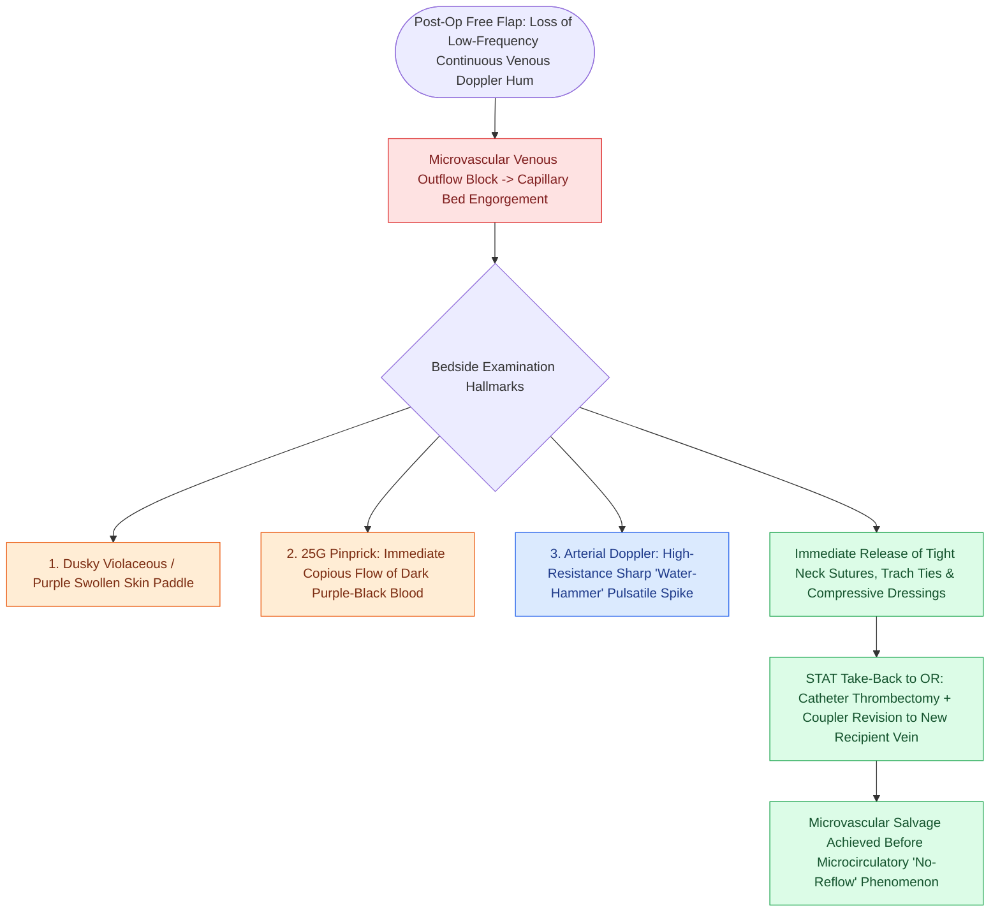

# Postoperative free flap venous congestion presents with purple discoloration, rapid pinprick dark bleeding, and hyperdynamic Doppler signals

## Active Recall

> [!question]- Why does an arterial Doppler examination paradoxicaly sound high-pitched and sharp ("water-hammer") during acute venous outflow obstruction?
> *Answer / Clinical Rationale*: When the venous outflow is completely blocked, intra-flap vascular resistance spikes dramatically. The arterial inflow encounters a rigid, non-compliant vascular bed, resulting in a high-velocity, abrupt systolic spike followed by immediate cessation or reversal of diastolic flow, creating an acoustic "water-hammer" Doppler sound.

> [!question]- What does instantaneous dark purple blood on a 25-gauge needle prick test indicate regarding flap microcirculation?
> *Answer / Clinical Rationale*: It indicates severe **venous congestion**. Hydrostatic back-pressure forces deoxygenated, desaturated blood to pool under high tension in the capillary beds, causing it to shoot or well immediately upon breaking the epidermal barrier.

## Core Clinical & Mechanistic Principles
[[Microvascular venous thrombosis presents with violaceous congestion and rapid dark bleeding on pinprick|Venous thrombosis]] or mechanical outflow obstruction accounts for approximately **70% to 80% of microvascular free flap failures**, outnumbering arterial compromise by more than 3-fold. In [[Postoperative free flap compromise within forty-eight hours requires emergent surgical re-exploration for pedicle salvage|microvascular free tissue transfer]], interruption of venous outflow causes rapid backward hydrostatic engorgement of the capillary bed. This elevates intravascular pressure, provokes extensive microcirculatory transudation, and causes severe interstitial edema and tissue swelling within the flap skin paddle.

Left uncorrected, rising venous pressure halts capillary perfusion (the "no-reflow" phenomenon), precipitating progressive [[Microvascular arterial thrombosis presents with a pale, flat flap and requires immediate surgical exploration|arterial thrombosis]], tissue ischemia, and irreversible flap necrosis within 4 to 8 hours. Recognizing the classic physical, Doppler, and pinprick hallmarks of venous congestion is critical for emergent return to the operating room for pedicle revision and microvascular salvage.

### Bedside Examination & Diagnostic Maneuvers
1. **Visual & Palpation Inspection**:
   - *Color*: Progressive dusky, bluish-purple, or violaceous hue across the skin paddle.
   - *Turgor & Temperature*: Skin paddle becomes visibly swollen, tense, and non-compressible ("boggy" tissue turgor) compared to baseline.
   - *Capillary Refill Time (CRT)*: Rapid (<1 second) early due to venous pooling, later progressing to mottled non-blanching stasis.
2. **Puncture (Pinprick / Scratch) Test**:
   - Prick the dermal periphery of the skin paddle with a 25-gauge or 27-gauge needle (or light 15-blade scratch).
   - *Venous Congestion*: Produces **instantaneous, brisk welling of dark, deoxygenated purple-black blood**.
   - *Arterial Insufficiency*: Produces complete absence of bleeding or only dry straw-colored interstitial fluid.
3. **Doppler Ultrasound Evaluation**:
   - Handheld 8-MHz pencil Doppler or implantable Cook-Swartz flow probe:
   - Loss of the normal continuous, low-frequency respiratory-phasic "venous hum."
   - High-resistance, sharp, abrupt arterial waveform ("water-hammer" pulse) as blood attempts to pump against high downstream back-pressure.
4. **Immediate Emergency Action**:
   - Release any tight circumferential neck dressings, tracheostomy collars, or compressive skin sutures overlying the vascular pedicle.
   - Position the patient flat (or head-up $15^\circ$) with the neck in neutral alignment.
   - Activate the operating room and microvascular team immediately for surgical exploration, thrombectomy, and venous revision.

## References
1. Chepeha, D.B. (2013). Reconstructive Microsurgery of the Head and Neck. In Johnson, J.J., Rosen, C.A. (Eds.), *Bailey’s Head and Neck Surgery-Otolaryngology* 5e (pp. 2824-2848). Baltimore, MD: Lippincott Williams & Wilkins.
2. Novakovic, D., Patel, R.S., Goldstein, D.P., et al. (2009). Salvage of failed free flaps used in head and neck reconstruction. *Head Neck Oncol*, 1:33.
3. Başaran, B., Ünsaler, S., Kesimli, M.C., et al. (2021). Free flap reconstruction of the head and neck region: A series of 127 flaps performed by otolaryngologists. *Turk Arch Otorhinolaryngol*, 59(2):103-110.

## Connected Concepts & Graph Traversal
- **Physiological Basis**: [[Postoperative free flap monitoring includes Doppler ultrasound, pinprick bleeding, and capillary refill checks|Flap Monitoring & Doppler Signals]]
- **Emergent Re-exploration**: [[Postoperative free flap compromise within forty-eight hours requires emergent surgical re-exploration for pedicle salvage|Free Flap Surgical Salvage]]
- **Adjunctive Leech Protocol**: [[Leech therapy with Hirudo medicinalis decompresses venous congested flaps with ciprofloxacin prophylaxis for Aeromonas hydrophila|Leech Therapy Protocol]]
- **Workhorse Flap**: [[The radial forearm free flap provides thin, pliable fasciocutaneous tissue for oral and pharyngeal defects|Radial Forearm Free Flap]]
- **Neck Hematoma Safety**: [[Postoperative neck hematoma after thyroidectomy or neck dissection requires emergent bedside wound opening for airway decompression|Postoperative Cervical Hematoma Decompression]]
