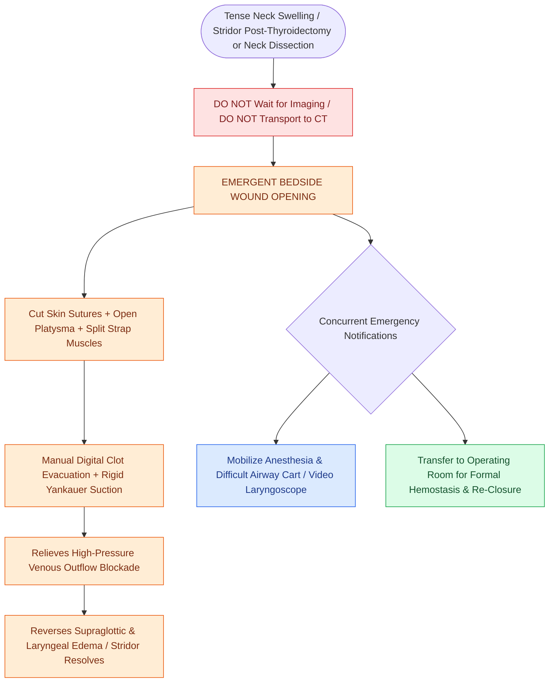

# Postoperative neck hematoma after thyroidectomy or neck dissection requires emergent bedside wound opening for airway decompression

## Active Recall

> [!question]- What is the primary pathophysiologic mechanism causing acute airway obstruction in a tense post-thyroidectomy neck hematoma?
> *Answer / Clinical Rationale*: **Severe laryngeal and supraglottic mucosal edema** secondary to high tissue compartment pressure in the visceral neck space obstructing low-pressure venous and lymphatic drainage through the internal jugular system, rather than direct mechanical collapse of the rigid cartilaginous trachea alone.

> [!question]- Why is absence of blood output in a surgical Jackson-Pratt (JP) drain misleading in the setting of an expanding neck hematoma?
> *Answer / Clinical Rationale*: Rapid arterial or brisk venous hemorrhage rapidly clots in the wound bed, **plugging the narrow drain perforations with organized fibrin and blood clots**, rendering drain output completely absent despite the rapid accumulation of a high-pressure, life-threatening hematoma.

## Core Clinical & Mechanistic Principles

**Expanding neck hematoma** is a life-threatening complication occurring in **0.5% to 2.5%** of patients following [[The recurrent laryngeal nerve is identified within Simon's triangle and followed through Berry's ligament|thyroidectomy]], parathyroidectomy, carotid endarterectomy, or [[Selective neck dissection targets high-risk nodal basins while sparing low-risk cervical levels|cervical lymphadenectomy]]. The peak incidence is within the **first 6 to 24 hours postoperatively**, frequently triggered by acute post-extubation hypertension, coughing/Valsalva, or failure of vascular clip/cautery hemostasis on branches of the superior or inferior thyroid vessels.

The pathophysiology of airway compromise from a cervical hematoma is often misunderstood: **airway obstruction is primarily caused by supraglottic and laryngeal venous/lymphatic congestion**, rather than simple external tracheal compression. Because the [[Deep cervical fascia divides into superficial, middle, and deep layers that define surgical planes|deep cervical fascia]] encloses the visceral compartment, an expanding blood collection creates high tissue compartment pressure. This high pressure occludes low-pressure internal jugular venous and lymphatic drainage from the larynx, causing massive **supraglottic and arytenoid mucosal edema** that rapidly occludes the glottic aperture.

Clinically, an expanding hematoma presents with:
- Rapidly progressive **asymmetric cervical swelling** and a "woody" or tense neck wound.
- Sensation of choking, severe neck tightness, or dysphagia.
- **Stridor**, tachypnea, cyanosis, and respiratory distress.
- Tracheal deviation on physical exam.
- **Drain output is unreliable**: Drains are frequently occluded by organized clotted blood and may show zero output despite a massive expanding hematoma.

### Surgical Technique & Craft Nuance: Bedside Decompression & Operative Control

### Key Consultation Supplies
- Coaxial surgical headlight
- Bedside stitch cutter / suture removal kit / staple remover
- Sterile laceration / bedside exploration tray with scalpel (#15 blade), curved Kelly and Mayo scissors, and tissue forceps
- Rigid Yankauer suction tip with functional wall suction
- Sterile saline bottles with 60 mL piston syringe or bulb syringe for irrigation
- Sterile gauze fluffs, lap sponges, and kidney basin
- 1% lidocaine with 1:100,000 epinephrine
- Difficult airway cart / video laryngoscope (GlideScope) / endotracheal intubation supplies
- Emergency tracheotomy tray

> [!example]- **Operative Note Template: Emergent bedside wound opening and evacuation of postoperative neck hematoma**
> **PROCEDURE**: Emergent bedside wound opening and evacuation of postoperative neck hematoma
> **PRE-PROCEDURAL DIAGNOSIS**: Expanding post-thyroidectomy neck hematoma with acute impending airway compromise
> **POST-PROCEDURAL DIAGNOSIS**: Expanding post-thyroidectomy neck hematoma status-post bedside decompression and clot evacuation
> **SURGEON**: [Surgeon Name, MD]
> **ASSISTANT**: [Resident/Fellow Name, MD]
>
> **PROCEDURE IN DETAIL**:
> The patient developed sudden tense anterior neck swelling, stridor, and severe subjective sensation of choking in the PACU/inpatient unit following thyroidectomy. Immediate bedside emergency decompression was initiated without delay for imaging.
>
> Under sterile gloved technique and coaxial headlight illumination, all cutaneous sutures along the cervical incision were rapidly transected and removed. The platysma and subcutaneous tissues were spread wide open using fingers and curved scissors. The midline re-approximated strap muscles were bluntly divided, instantly exposing a high-pressure, tensely expanding hematoma in the visceral compartment.
>
> Large organized blood clots (approximately [e.g., 100 mL]) were manually evacuated and cleared from the thyroid bed using digital sweeping and rigid Yankauer suction. Decompression resulted in immediate relief of laryngeal venous congestion, resolution of stridor, and normalization of respiratory mechanics. Hemostasis was maintained with light sterile moist lap gauze packing while the operating room was immediately mobilized for formal re-exploration, definitive hemostasis, and re-closure under general anesthesia. The patient remained hemodynamically stable.

## References
1. Mydlarz, W.K., Eisele, D.W. (2020). Complications of Neck Surgery. In Flint, P.W., et al. (Eds.), *Cummings Otolaryngology: Head and Neck Surgery* 7e (pp. 1831-1839). Philadelphia, PA: Elsevier.
2. Zhang, I., DeMauro-Jablonski, S., Ferris, R.L. (2013). Treatment of Thyroid Neoplasms. In Johnson, J.J., Rosen, C.A. (Eds.), *Bailey’s Head and Neck Surgery-Otolaryngology* 5e (pp. 2115-2130). Baltimore, MD: Lippincott Williams & Wilkins.
3. Campbell, M.J., et al. (2017). Postoperative hematoma after thyroid and parathyroid surgery: A review of 12,000 operations. *Surgery*, 162(4):811-817.

## Connected Concepts & Graph Traversal

- **Critical Free Flap Impact**: [[Postoperative free flap compromise within forty-eight hours requires emergent surgical re-exploration for pedicle salvage|Free Flap Compromise & Hematoma]]
- **Post-Thyroidectomy Endocrine Emergency**: [[Post-thyroidectomy hypocalcemia is managed with oral calcium, calcitriol, and intravenous calcium gluconate|Post-Thyroidectomy Hypocalcemia]]
- **Anatomical Nerve Protection**: [[Intraoperative neuromonitoring of the RLN and EBSLN verifies nerve integrity and aids nerve identification|RLN & EBSLN Monitoring]]
- **Deep Fascial Compartments**: [[Deep neck space infections spread along cervical fascial planes between the pharynx, mediastinum, and skull base|Cervical Fascial Layers]]
- **Traumatic Hematoma Counterpart**: [[The no-zone approach to penetrating neck trauma triages stable patients with CTA based on hard and soft signs|Penetrating Neck Trauma]]
