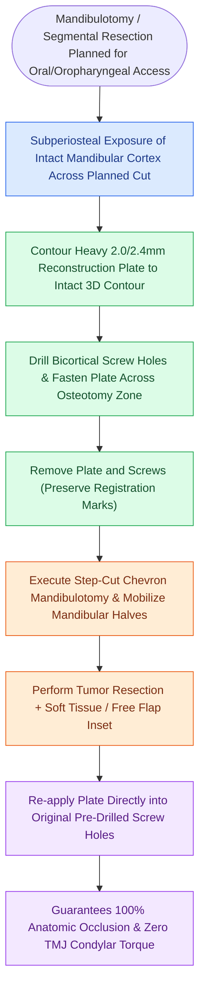

# Pre-plating the intact mandible before osteotomy preserves accurate dental occlusion and contour

## Active Recall

> [!question]- Why is pre-plating performed before dividing the mandible in a mandibulotomy?
> *Answer / Clinical Rationale*: To ensure that the patient's **exact pre-morbid dental occlusion and 3D mandibular arch contour** are restored during closure.

> [!question]- What complication occurs if a reconstruction plate is contoured to an already-divided, displaced mandible?
> *Answer / Clinical Rationale*: Severe **malocclusion, dental cross-bite, and TMJ pain/dysfunction** from asymmetric condylar seating.

## Core Clinical & Mechanistic Principles
**Pre-plating** the mandible is an essential surgical craft maneuver performed prior to making a mandibulotomy or segmental resection cut:
- **Rationale**: Once the mandible is divided, the bilateral mandibular segments displace unpredictably due to unequal muscle pull from the pterygomasseteric sling and digastric muscles. Attempting to bend a plate to a divided mandible risks severe malocclusion, cross-bite, and temporomandibular joint (TMJ) torque.
- **Surgical Execution**:
  1. Expose the anterior and lateral surface of the mandibular cortex subperiosteally.
  2. Contour a 2.0-mm or 2.4-mm titanium plate precisely to the outer cortical curvature.
  3. Drill and place all screws across the planned osteotomy line.
  4. **Remove the plate and screws** and store them safely.
  5. Perform the [[Step-cut chevron mandibulotomy maximizes bone surface contact and rotational stability|step-cut mandibulotomy]] or tumor resection.
  6. Upon completion of intraoral resection and reconstruction, replace the plate into the identical pre-drilled screw holes to restore perfect pre-morbid occlusion.

### Surgical Technique & Critical Safety Checks
- **Virtual Surgical Planning (VSP) Alternative**: In segmental resections, pre-fabricated 3D-printed cutting guides and patient-specific pre-bent plates replace manual pre-plating.

## Connected Concepts & Graph Traversal
- **Exposure Approach**: [[Lip-split paramedian mandibulotomy provides wide exposure for posterior oral cavity and oropharyngeal tumors|Lip-Split Paramedian Mandibulotomy]]
- **Osteotomy Geometry**: [[Step-cut chevron mandibulotomy maximizes bone surface contact and rotational stability|Step-Cut Chevron Mandibulotomy]]
- **Virtual CAD/CAM Planning**: [[Virtual surgical planning and 3D cutting guides optimize fibula contouring and dental implant rehabilitation|Virtual Surgical Planning & Guides]]
- **Rigid Fixation Principles**: [[Mandibular reconstruction plates require rigid bicortical screw fixation to withstand masticatory load|Mandibular Reconstruction Plates]]
- **Marginal Mandibulectomy**: [[Marginal mandibulectomy preserves basilar bone height when tumor abuts but does not invade marrow|Marginal vs Segmental Mandibulectomy]]
- **Floor of Mouth Infiltration**: [[Floor of mouth carcinoma requires sublingual gland excision and Wharton duct relocation|Floor of Mouth Resection]]
