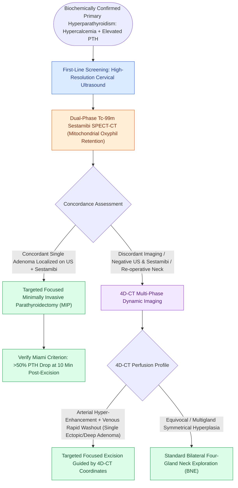

# Preoperative sestamibi SPECT and 4D-CT localize hyperfunctioning parathyroid glands

## Active Recall

> [!question]- What is the characteristic enhancement profile of a parathyroid adenoma on 4D-CT?
> *Answer / Clinical Rationale*: **Intense peak hyper-enhancement on the arterial phase** with **rapid contrast washout on the delayed venous phase**.

> [!question]- How does Tc-99m Sestamibi scintigraphy differentiate a parathyroid adenoma from normal thyroid tissue?
> *Answer / Clinical Rationale*: Sestamibi washes out rapidly from normal thyroid tissue but is **retained prolonged in the mitochondria-rich oxyphil cells of parathyroid adenomas**.

## Core Clinical & Mechanistic Principles
Preoperative imaging localization enables **Minimally Invasive Parathyroidectomy (MIP)** with high cure rates ($>95\text{–}98\%$):
- **Technetium-99m Sestamibi Scintigraphy / SPECT-CT**:
  - *Mechanism*: Sestamibi concentrates in mitochondria of both thyroid and parathyroid tissue; clears rapidly from normal thyroid but is **retained in hyperfunctioning parathyroid oxyphil cells**.
  - Dual-phase imaging (early 15 min vs. delayed 2–3 hr) and SPECT-CT provide precise 3D anatomical localization.
- **Four-Dimensional CT (4D-CT)**:
  - *Mechanism*: Multi-phase contrast CT (non-contrast, arterial phase, venous delayed phase) exploiting parathyroid vascular kinetics.
  - *Classic 4D-CT Profile*: **Hyper-attenuating on arterial phase** (due to high vascularity) with **rapid contrast washout on venous phase**.
  - Superior sensitivity ($>85\text{–}90\%$) for re-operative necks, multigland disease, and ectopic adenomas.
- **High-Resolution Ultrasound**: Identifies hypoechoic, hypervascular oval glands situated posterior to the thyroid lobe.

### Surgical Technique & Critical Safety Checks
- **Discordant Imaging Strategy**: When Sestamibi and US disagree, 4D-CT is the definitive tie-breaker before committing to targeted surgery vs. bilateral neck exploration (see [[Primary hyperparathyroidism is caused by single adenomas, multigland hyperplasia, or parathyroid carcinoma|Primary Hyperparathyroidism Workup]]).

## Connected Concepts & Graph Traversal
- **Biochemical Diagnosis**: [[Primary hyperparathyroidism is caused by single adenomas, multigland hyperplasia, or parathyroid carcinoma|Primary Hyperparathyroidism Workup]]
- **Intraoperative PTH Monitoring**: [[The Miami criterion requires a fifty percent intraoperative PTH drop at ten minutes post-excision|Miami Criterion & Kinetic Assays]]
- **3D Parathyroid Topography**: [[Superior and inferior parathyroid glands maintain constant anatomical relationships to the RLN and ITA|Parathyroid Embryology & Anatomy]]
- **Autotransplantation Craft**: [[Devascularized parathyroid glands require confirmation biopsy and autotransplantation into the SCM|Parathyroid Autotransplantation]]
- **Post-Thyroidectomy Calcium Management**: [[Post-thyroidectomy hypocalcemia is managed with oral calcium, calcitriol, and intravenous calcium gluconate|Postoperative Hypocalcemia Protocols]]
- **RLN Localization in Simon's Triangle**: [[The recurrent laryngeal nerve is identified within Simon's triangle and followed through Berry's ligament|RLN Identification Craft]]
- **Dual Imaging for Reoperation**: [[Reoperative parathyroidectomy for persistent or recurrent hyperparathyroidism requires dual imaging concordance and a lateral backdoor approach to minimize nerve injury|Reoperative Parathyroidectomy]]
