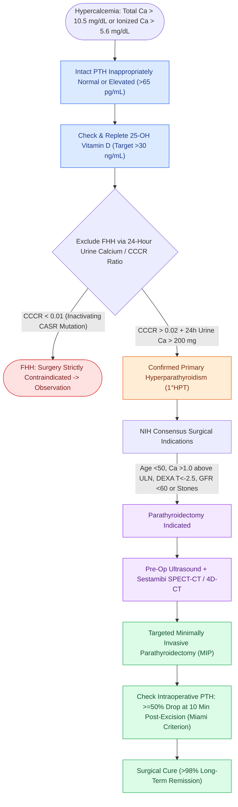

# Primary hyperparathyroidism is caused by single adenomas, multigland hyperplasia, or parathyroid carcinoma

## Active Recall

> [!question]- Why must Familial Hypocalciuric Hypercalcemia (FHH) be excluded with a 24-hour urine calcium and CCCR before parathyroidectomy?
> *Answer / Clinical Rationale*: FHH is caused by an inactivating mutation in the *CASR* gene; **parathyroidectomy does not correct the hypercalcemia** and puts the patient at risk for lifelong iatrogenic hypoparathyroidism. A $\text{CCCR} < 0.01$ rules in FHH.

> [!question]- What is the Miami Criterion for intraoperative PTH monitoring during parathyroidectomy?
> *Answer / Clinical Rationale*: A drop of **$\ge 50\%$ from the baseline PTH level at 10 minutes post-adenoma excision**, confirming successful resection of all hyperfunctioning parathyroid tissue with $>98\%$ cure rate.

> [!question]- Why must 25-hydroxyvitamin D deficiency be corrected before finalizing the diagnosis of primary hyperparathyroidism?
> *Answer / Clinical Rationale*: Low vitamin D triggers compensatory secondary hyperparathyroidism, **falsely inflating baseline PTH levels** and confounding disease assessment.

## Core Clinical & Mechanistic Principles
**Primary Hyperparathyroidism (1°HPT)** results from autonomous parathyroid hormone (PTH) hypersecretion overriding negative feedback from ionized calcium:

- **Etiological Breakdown**:
  - **Solitary Parathyroid Adenoma**: Accounts for **$80\text{–}85\%$** of cases.
  - **Multigland Hyperplasia (Four-Gland Disease)**: Accounts for **$10\text{–}15\%$** (hallmark of MEN 1 and MEN 2A).
  - **Double Adenomas**: Accounts for $2\text{–}5\%$.
  - **Parathyroid Carcinoma**: Rare ($<1\%$), presents with marked hypercalcemia ($>14\text{ mg/dL}$), palpable neck mass, extreme PTH elevations ($>5\text{–}10\times$ normal), and local capsular invasion (requires en bloc parathyroidectomy with ipsilateral thyroid lobectomy).

- **Biochemical Confirmation & Diagnostic Traps**:
  1. **Serum Labs**: Hypercalcemia (total $>10.5\text{ mg/dL}$ or ionized $>5.6\text{ mg/dL}$) with **elevated or inappropriately normal intact PTH** ($>65\text{ pg/mL}$ or $20\text{–}65\text{ pg/mL}$ in the setting of hypercalcemia).
  2. **25-Hydroxyvitamin D Repletion Rule**:
     - *Diagnostic Trap*: Vitamin D deficiency ($<20\text{ ng/mL}$) stimulates secondary chief cell hypersecretion, **falsely exaggerating PTH levels**.
     - *Clinical Standard*: Replete vitamin D to $>30\text{ ng/mL}$ with oral cholecalciferol/ergocalciferol and recheck serum calcium and PTH 3 months later before scheduling surgery.
  3. **Familial Hypocalciuric Hypercalcemia (FHH) Exclusion (The CCCR Test)**:
     - FHH is an autosomal dominant inactivating mutation in the calcium-sensing receptor gene (*CASR*), causing lifelong benign hypercalcemia with low renal calcium clearance.
     - *The Calcium-to-Creatinine Clearance Ratio (CCCR)*:
       $$\text{CCCR} = \frac{\text{24-hr Urine Calcium (mg/dL)} \times \text{Serum Creatinine (mg/dL)}}{\text{Serum Calcium (mg/dL)} \times \text{24-hr Urine Creatinine (mg/dL)}}$$
     - **$\text{CCCR} < 0.01$**: Confirms **FHH**. *Surgical Red Line*: Parathyroidectomy is strictly contraindicated (parathyroidectomy will not correct hypercalcemia and causes permanent hypoparathyroidism).
     - **$\text{CCCR} > 0.02$**: Diagnostic of primary hyperparathyroidism.

- **NIH Consensus Indications for Surgery in Asymptomatic 1°HPT**:
  - Serum calcium **$>1.0\text{ mg/dL}$ above the upper limit of normal** ($>11.5\text{ mg/dL}$).
  - Skeletal: Bone mineral density T-score **$<-2.5$ on DEXA** (lumbar spine, hip, or $33\%$ distal radius) or prior fragility fracture.
  - Renal: **eGFR $<60\text{ mL/min}$**, 24-hour urine calcium **$>400\text{ mg/day}$**, or nephrolithiasis / nephrocalcinosis on renal ultrasound/CT.
  - Age: **$<50\text{ years}$** (regardless of biochemical parameters).

- **Intraoperative PTH Monitoring & The Miami Criterion**:
  - Intact PTH has an in vivo **half-life of only $3\text{–}5\text{ minutes}$**.
  - *The Miami Criterion*: A drop of **$\ge 50\%$ from the baseline (pre-incision or pre-excision) PTH level measured at 10 minutes post-adenoma excision** predicts surgical cure in $>98\%$ of patients, confirming that no hyperfunctioning tissue remains.

### Surgical Technique & Critical Safety Checks
- **Hungry Bone Syndrome**: Patients with severe preoperative bone disease (elevated alkaline phosphatase) experience dramatic calcium and phosphate influx into remineralizing bone postoperatively, requiring aggressive prophylactic oral calcium ($3\text{–}4\text{ g/day}$) and calcitriol (see [[Preoperative sestamibi SPECT and 4D-CT localize hyperfunctioning parathyroid glands|Sestamibi SPECT & 4D-CT Localization]]).

## Connected Concepts & Graph Traversal
- **Localization Modalities**: [[Preoperative sestamibi SPECT and 4D-CT localize hyperfunctioning parathyroid glands|Sestamibi SPECT & 4D-CT Localization]]
- **Parathyroid Relational Anatomy**: [[Superior and inferior parathyroid glands maintain constant anatomical relationships to the RLN and ITA|Parathyroid Embryology & RLN Relationship]]
- **Autotransplantation Technique**: [[Devascularized parathyroid glands require confirmation biopsy and autotransplantation into the SCM|Parathyroid Autotransplantation Protocol]]
- **Postoperative Hypocalcemia**: [[Post-thyroidectomy hypocalcemia is managed with oral calcium, calcitriol, and intravenous calcium gluconate|Post-Surgical Hypocalcemia Management]]
- **2025 ATA Thyroid Guidelines**: [[The 2025 ATA guidelines establish active surveillance criteria and lobectomy preference for low-risk differentiated thyroid cancer|2025 ATA Differentiated Thyroid Cancer Guidelines]]
- **Medullary Thyroid Cancer / MEN 2**: [[Medullary thyroid carcinoma arises from parafollicular C cells and mandates RET testing with calcitonin surveillance|Medullary Thyroid Carcinoma & RET Mutation]]
- **Reoperative Surgical Approach**: [[Reoperative parathyroidectomy for persistent or recurrent hyperparathyroidism requires dual imaging concordance and a lateral backdoor approach to minimize nerve injury|Reoperative Parathyroidectomy]]
