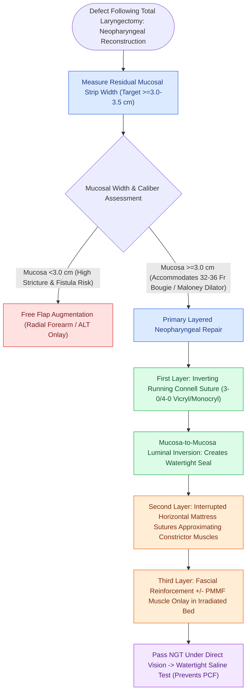

# Primary pharyngeal closure after total laryngectomy utilizes an inverting Connell technique

## Active Recall

> [!question]- What is the function of the inverting Connell suture in pharyngeal reconstruction?
> *Answer / Clinical Rationale*: It **inverts the mucosal edges into the pharyngeal lumen**, ensuring serosa-to-serosa (or submucosa-to-submucosa) apposition and creating a watertight, leak-resistant seal.

> [!question]- What minimum flat mucosal width is required to perform a primary pharyngeal closure without causing stenosis?
> *Answer / Clinical Rationale*: At least **$3.0\text{ to }3.5\text{ cm}$** of residual pharyngeal mucosal width.

## Core Clinical & Mechanistic Principles
Meticulous water-tight closure of the neopharynx following total laryngectomy is critical to prevent pharyngocutaneous salivary fistula:
- **Closure Configurations**:
  - **Vertical Linear Closure**: Preferred when adequate mucosal circumference remains ($\ge 3.0\text{–}3.5\text{ cm}$).
  - **T-Shaped or Y-Shaped Closure**: Utilized when tension is excessive vertically, though the central trifurcation point represents a high-risk site for fistula breakdown.
- **Suture Technique & Suture Choice**:
  - **First Layer (Mucosal / Submucosal)**: Continuous inverting **Connell suture** (or Gambee / extramucosal running suture) using **3-0 or 4-0 absorbable suture (Vicryl or Monocryl)**. The needle enters serosa-to-mucosa on one side, travels submucosally, and exits mucosa-to-serosa, inverting the mucosal edges into the pharyngeal lumen.
  - **Second Layer (Muscular)**: Interrupted horizontal mattress sutures approximating the inferior and middle pharyngeal constrictor muscles over the mucosal closure.
  - **Third Layer**: Fascial reinforcement over the muscular repair.

### Surgical Technique & Critical Safety Checks
- **Minimum Lumen Circumference**: The neopharynx must comfortably accommodate a **32-Fr to 36-Fr Hurst / Maloney bougie** (minimum flat mucosal width of $3.0\text{ cm}$); if residual mucosa is $<3\text{ cm}$, primary closure will cause stricture, mandating flap augmentation (ALT or [[The radial forearm free flap provides thin, pliable fasciocutaneous tissue for oral and pharyngeal defects|RFFF]]).

## Connected Concepts & Graph Traversal
- **Total Laryngectomy Standards**: [[Total laryngectomy achieves en bloc laryngeal resection with permanent end-stoma|Total Laryngectomy Craft]]
- **Pectoralis Flap Reinforcement**: [[Pectoralis major muscle flap reinforcement prevents pharyngocutaneous fistula in salvage laryngectomy|PMMF Onlay Protection]]
- **Fistula Rescue Protocols**: [[Pharyngocutaneous fistula is managed with wound care, nutritional support, and surgical flap closure|Pharyngocutaneous Fistula Management]]
- **Circumferential Resection**: [[Circumferential laryngopharyngectomy requires tubed microvascular or visceral flap reconstruction|Circumferential Pharyngeal Reconstruction]]
- **Postcricoid Infiltration**: [[Postcricoid hypopharyngeal carcinoma frequently invades the cervical esophagus and bilateral RLNs|Postcricoid Carcinoma Resection]]
- **Alaryngeal Voice Restoration**: [[Tracheoesophageal puncture TEP and voice prosthesis restore pulmonary-driven alaryngeal speech|TEP Voice Prosthesis Craft]]
