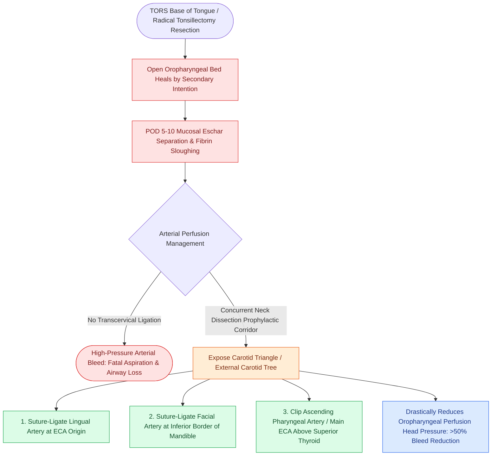

# Prophylactic transcervical external carotid ligation reduces fatal secondary hemorrhage after TORS

## Active Recall

> [!question]- Why do secondary hemorrhages after TORS typically occur between postoperative days 5 and 10?
> *Answer / Clinical Rationale*: Because this coincides with **mucosal eschar separation and fibrin clot sloughing** in the warm, moist oropharyngeal environment.

> [!question]- Which specific arterial branches are ligated in the neck during concurrent neck dissection to protect against TORS hemorrhage?
> *Answer / Clinical Rationale*: The **lingual artery**, **facial artery**, and **ascending pharyngeal artery** (or the external carotid artery above the superior thyroid artery).

## Core Clinical & Mechanistic Principles
Postoperative hemorrhage is the most serious and potentially fatal complication of [[Transoral robotic surgery TORS achieves en bloc resection of tonsillar and base of tongue neoplasms|TORS]], occurring in **$3\text{–}8\%$ of patients**:
- **Timing & Mechanism**: Typically occurs between **postoperative days 5 and 10**, coinciding with mucosal sloughing, fibrinolytic clot breakdown, and eschar separation in the oropharynx.
- **Why Secondary Oropharyngeal Bleeds are Fatal**: High-pressure arterial bleeding into the posterior oropharynx of an awake, extubated patient with post-surgical neck and pharyngeal edema rapidly causes fatal blood aspiration and acute airway obstruction.
- **The Prophylactic Ligation Strategy**:
  - During concurrent neck dissection, perform **transcervical ligation of the ipsilateral external carotid artery branches**:
    1. **Lingual Artery** (at its origin off the ECA).
    2. **Facial Artery**.
    3. **Ascending Pharyngeal Artery**.
  - In high-risk resections (large BOT tumors, salvage TORS, extensive tonsillar beds), ligating the main ECA trunk above the superior thyroid artery drastically reduces arterial perfusion pressure to the oropharyngeal wound.

### Surgical Technique & Critical Safety Checks
- **Clinical Evidence**: Studies demonstrate a $>50\%$ reduction in severe bleeding episodes and near-complete elimination of fatal bleeds when prophylactic arterial ligation is performed.

## Connected Concepts & Graph Traversal
- **TORS Tonsillar Safety**: [[TORS radical tonsillectomy requires careful identification of the internal carotid artery posterolaterally|TORS Tonsillectomy & ICA Proximity]]
- **TORS Lingual Hemostasis**: [[Lingual artery branches require clip ligation during TORS base of tongue resection|TORS Lingual Artery Hemostasis]]
- **TORS Resection Standards**: [[Transoral robotic surgery TORS achieves en bloc resection of tonsillar and base of tongue neoplasms|TORS Resection Craft]]
- **Carotid Blowout Emergency**: [[Carotid blowout syndrome is classified into threatened, impending, and acute hemorrhage|Carotid Blowout Staging]]
- **HPV Oropharynx Staging**: [[HPV-positive oropharyngeal squamous cell carcinoma exhibits distinct biological behavior and staging|HPV Oropharynx SCC]]
- **Level I Dissection Topography**: [[Level I dissection requires facial vessel ligation and preservation of the lingual and hypoglossal nerves|Level I Facial Vessel Ligation]]
