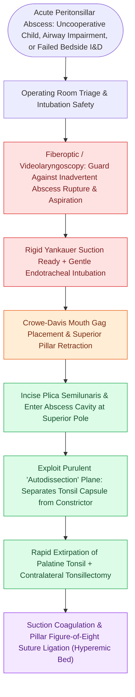

# Quinsy tonsillectomy provides immediate abscess drainage and definitive tonsillar extirpation for refractory peritonsillar infection

## Active Recall

> [!question]- How does the presence of a mature peritonsillar abscess paradoxicaly aid the dissection plane during a quinsy tonsillectomy?
> *Answer / Clinical Rationale*: The accumulation of purulent fluid directly within the potential loose areolar peritonsillar space creates an "autodissection" effect, hydraulically separating the fibrous tonsil capsule from the underlying superior pharyngeal constrictor muscle and opening the anatomical surgical plane.

> [!question]- What are the primary intraoperative and postoperative risks of quinsy tonsillectomy compared to elective interval tonsillectomy?
> *Answer / Clinical Rationale*: Intense acute inflammatory tissue friability and hypervascularity lead to increased intraoperative blood loss, difficulty in obtaining suture purchase for pillar ligation, and a slightly higher incidence of secondary [[Post-tonsillectomy hemorrhage bedside management requires ice water gargling, oxymetazoline compression, and silver nitrate cautery|post-tonsillectomy hemorrhage]].

## Core Clinical & Mechanistic Principles
A **quinsy tonsillectomy** (abscess tonsillectomy or immediate acute tonsillectomy) involves urgent surgical extirpation of the palatine tonsils during an active, acute [[Peritonsillar abscess needle aspiration and incision and drainage require superior pole local anesthetic and landmark-guided needle guard protection|peritonsillar abscess (PTA)]] or phlegmon episode. In contrast to interval tonsillectomy performed 6 to 12 weeks after infection resolution, quinsy tonsillectomy provides simultaneous definitive abscess decompression and elimination of recurrent disease risk in a single operating room encounter.

Mechanistically, while inflammatory hyperemia and fragile granulation tissue increase intraoperative capillary oozing, the purulent collection in the peritonsillar space frequently performs an **"autodissection"** of the surgical plane, lifting the tonsillar capsule away from the superior pharyngeal constrictor muscle bed and facilitating rapid blunt capsular separation.

### Indications, Anesthetic Nuances & Surgical Craft
1. **Specific Clinical Indications**:
   - *Pediatric or uncooperative patients*: Young children or anxious adults with acute PTA who cannot safely cooperate with awake bedside needle aspiration or incision.
   - *Refractory / Loculated disease*: Failure of adequate purulent evacuation following multiple bedside aspirations and formal I&D.
   - *Severe airway obstruction*: Impending upper airway compromise secondary to concomitant severe bilateral tonsillitis and unilateral PTA.
   - *Strong prior indication for tonsillectomy*: Patients with a documented history of recurrent tonsillitis meeting Paradise criteria or previous peritonsillar abscesses.
2. **Anesthetic & Airway Considerations**:
   - Extreme care during endotracheal intubation: Trismus and supratonsillar palatal swelling narrow the oropharynx.
   - Guard against inadvertent abscess rupture during laryngoscopy with rigid suction ready to prevent massive purulent bronchopulmonary aspiration.
3. **Operative Dissection Technique**:
   - Retract the anterior pillar with a tonsil clamp. Incise the plica triangularis at the superior pole, entering the abscess cavity directly. Follow the autodissection plane between the capsule and superior constrictor down to the inferior pole, achieving complete extirpation followed by careful suction cautery and figure-of-eight pillar ligation.

## References
1. Christian, J.M., Felts, C.B., Beckman, N.A., et al. (2020). Deep Neck and Odontogenic Infections. In Flint, P.W., et al. (Eds.), *Cummings Otolaryngology Head and Neck Surgery* 7e (pp. 141-154). Philadelphia, PA: Elsevier.
2. Jeyakumar, A., Miller, S., Mitchell, R.B. (2013). Adenotonsillar Disease in Children. In Johnson, J.J., Rosen, C.A. (Eds.), *Bailey’s Head and Neck Surgery-Otolaryngology* 5e (pp. 1430-1444). Baltimore, MD: Lippincott Williams & Wilkins.
3. Mitchell, R.B., Archer, S.M., Ishman, S.L., et al. (2019). Clinical Practice Guideline: Tonsillectomy in Children (Update). *Otolaryngol Head Neck Surg*, 160(1_suppl):S1-S42.

## Connected Concepts & Graph Traversal
- **Physiological Basis**: [[Peritonsillar abscess needle aspiration and incision and drainage require superior pole local anesthetic and landmark-guided needle guard protection|Bedside PTA Drainage Protocol]]
- **Non-Operative Precursor**: [[Peritonsillar phlegmon is managed with intravenous ampicillin-sulbactam and corticosteroids without operative incisional drainage|Peritonsillar Phlegmon]]
- **Hemorrhage Complication**: [[Operative post-tonsillectomy hemorrhage control employs suction cautery, pillar suturing, and orogastric suctioning|Operative Post-Tonsillectomy Hemorrhage]]
- **Deep Space Infection**: [[The parapharyngeal space is an inverted pyramid connecting peritonsillar, masticator, parotid, and retropharyngeal spaces|Parapharyngeal Space Infection]]
- **Pediatric Tonsillitis**: [[Pediatric acute bacterial tonsillitis is differentiated from viral pharyngitis using modified Centor criteria|Pediatric Centor Criteria]]
