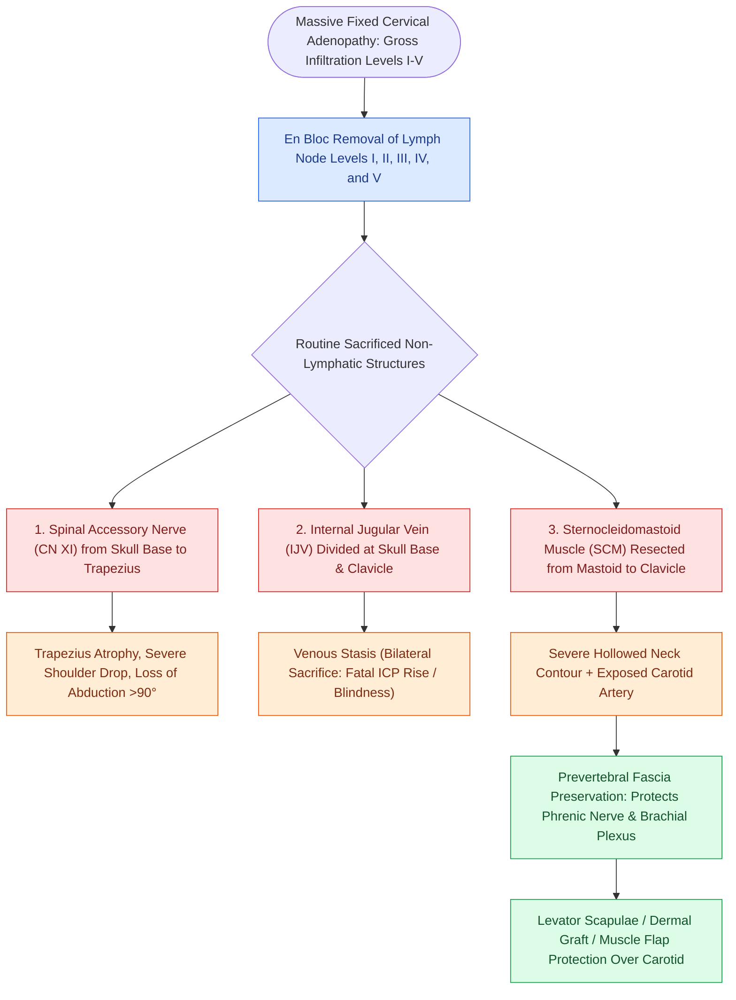

# Radical neck dissection removes levels I through V while sacrificing CN XI, the IJV, and the SCM

## Active Recall

> [!question]- What three non-lymphatic structures are routinely sacrificed in a classic Radical Neck Dissection?
> *Answer / Clinical Rationale*: The **Spinal Accessory Nerve (CN XI)**, **Internal Jugular Vein (IJV)**, and **Sternocleidomastoid Muscle (SCM)**.

> [!question]- What disabling functional deficit results from sacrificing the Spinal Accessory Nerve (CN XI)?
> *Answer / Clinical Rationale*: **Trapezius muscle denervation ('shoulder syndrome')**, causing shoulder drop, winged scapula, chronic neuropathic pain, and loss of arm abduction above 90 degrees.

## Core Clinical & Mechanistic Principles
The classic **Radical Neck Dissection (RND)** (described by George Crile in 1906 and standardized by Hayes [[Subplatysmal flap elevation and Martin's maneuver protect the marginal mandibular nerve|Martin]]) is the historic standard for comprehensive cervical lymphadenectomy:
- **Lymphatic Extent**: Complete en bloc removal of **Levels I through V** (submental, submandibular, upper/mid/lower jugular, and posterior triangle).
- **Non-Lymphatic Structures Sacrificed**:
  1. **Spinal Accessory Nerve (CN XI)**: Causes permanent trapezius denervation, severe shoulder drop, chronic neuropathic pain, and inability to abduct the arm past 90 degrees (shoulder syndrome).
  2. **Internal Jugular Vein (IJV)**: Sacrificed from the skull base to the clavicle. Bilateral simultaneous sacrifice carries a high risk of acute intracranial hypertension, cerebral edema, and blindness.
  3. **Sternocleidomastoid Muscle (SCM)**: Sacrificed from mastoid to clavicular/sternal heads, producing a hollowed neck contour.
- **Modern Indications**: Reserved for massive, fixed nodal disease invading all three non-lymphatic structures or salvage surgery with gross extracapsular invasion.

### Surgical Technique & Critical Safety Checks
- **Surgical Landmarks & Protection**: Dissecting over the prevertebral fascia protects the phrenic nerve and brachial plexus.
- **Carotid Artery Exposure**: With the SCM and IJV removed, the carotid artery is exposed; dermal graft coverage or levator scapulae muscle transposition is considered in irradiated necks to prevent carotid blowout.

## Connected Concepts & Graph Traversal
- **Modified Functional Alternative**: [[Modified radical neck dissection types I, II, and III preserve non-lymphatic structures|MRND Types I, II, and III]]
- **Selective Nodal Dissection**: [[Selective neck dissection targets high-risk nodal basins while sparing low-risk cervical levels|Selective Neck Dissection]]
- **Spinal Accessory Topography**: [[The spinal accessory nerve is identified at the Erb point and anterior border of the SCM|CN XI Identification & Shoulder Morbidity]]
- **Internal Jugular Mobilization**: [[Levels II through IV internal jugular chain dissection mobilizes the carotid sheath packet|Carotid Sheath Packet Dissection]]
- **Level V Posterior Triangle**: [[Level V dissection requires skeletonization of the prevertebral fascia while protecting the phrenic nerve|Level V Dissection & Phrenic Protection]]
- **Carotid Blowout Staging**: [[Carotid blowout syndrome is classified into threatened, impending, and acute hemorrhage|Carotid Blowout Emergency]]
- **Incision Design Principles**: [[Neck dissection incision design balances surgical exposure against carotid coverage and vascular compromise in irradiated tissue|Neck Dissection Incision Design]]
