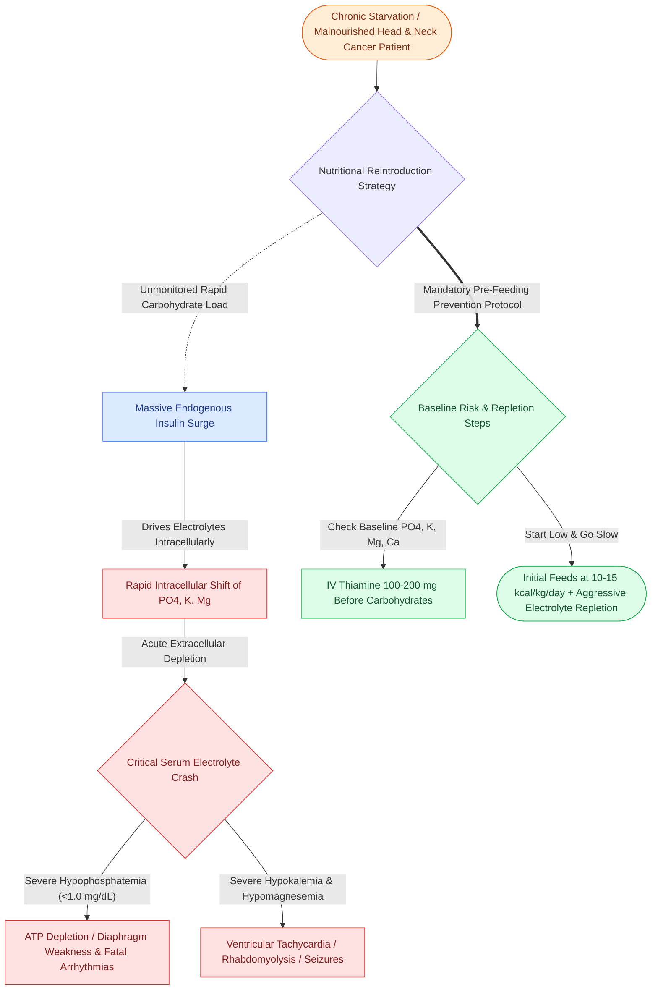

# Refeeding syndrome causes life-threatening hypophosphatemia, hypokalemia, and hypomagnesemia upon reintroducing carbohydrates

## Active Recall

> [!question]- What is the cellular and metabolic trigger that precipitates refeeding syndrome in severely malnourished head and neck cancer patients?
> *Answer / Clinical Rationale*: Chronic starvation induces a prolonged catabolic state where energy is derived from ketone and fatty acid oxidation, depleting total body phosphate, potassium, and magnesium stores. Reintroducing **carbohydrates** triggers a rapid **surge in endogenous insulin**, which drives glucose, phosphate, potassium, and magnesium into the intracellular compartment for glycolysis and ATP synthesis. This causes profound, sudden **extracellular depletion (severe hypophosphatemia, hypokalemia, hypomagnesemia)** and sodium/water retention.

> [!question]- What are the life-threatening clinical consequences of severe hypophosphatemia ($<1.0\text{ mg/dL}$)?
> *Answer / Clinical Rationale*: - **Cardiovascular**: Myocardial contractile failure, acute congestive heart failure, and fatal ventricular arrhythmias. - **Respiratory**: Diaphragmatic weakness, hypoventilation, and failure to wean from mechanical ventilation (due to acute ATP and 2,3-DPG depletion). - **Neuromuscular & Hematologic**: Encephalopathy, seizures, rhabdomyolysis, acute hemolytic anemia, and leukocyte dysfunction.

> [!question]- What is the mandatory prevention and repletion protocol before initiating enteral or parenteral nutrition in high-risk patients?
> *Answer / Clinical Rationale*: 1. Check baseline serum **phosphate, potassium, magnesium, calcium, and sodium**. 2. Pre-supplement with **IV Thiamine ($100\text{–}200\text{ mg/day}$)** and a multivitamin prior to starting feeds to prevent acute Wernicke encephalopathy. 3. Initiate feeds cautiously at **$10\text{–}15\text{ kcal/kg/day}$ (or $\le 50\%$ of calculated caloric requirements)**, advancing slowly over 4–7 days. 4. Proactively replete electrolytes (target serum phosphate $>2.5\text{ mg/dL}$, potassium $>4.0\text{ mEq/L}$, magnesium $>2.0\text{ mg/dL}$) before and during caloric advancement.

## Core Clinical & Mechanistic Principles
Refeeding syndrome is an underrecognized, potentially fatal complication in advanced head and neck oncology patients presenting with baseline cachexia, dysphagia, or post-chemoradiation mucositis:

### High-Yield Head & Neck Cancer Risk Factors
- **High-Risk Profiles**: BMI $<16\text{ kg/m}^2$, weight loss $>15\%$ over 3–6 months, nil-per-os (NPO) status $>10\text{ days}$, or extensive post-laryngectomy / free flap reconstructive convalescence (see [[Implantable Doppler probes provide continuous real-time monitoring of microvascular free flap pedicles|Postoperative Free Flap Monitoring]]).

## Connected Concepts & Graph Traversal
- **Free Flap Care**: [[Implantable Doppler probes provide continuous real-time monitoring of microvascular free flap pedicles|Postoperative Free Flap Monitoring]]
- **Chyle Leak Nutrition**: [[Cervical chyle leaks are managed with MCT diet, octreotide, or surgical thoracic duct ligation|MCT Diet in Chyle Leak]]
- **Post-Thyroidectomy Calcium**: [[Post-thyroidectomy hypocalcemia is managed with oral calcium, calcitriol, and intravenous calcium gluconate|Hypocalcemia Monitoring]]
- **Laryngectomy Feeding**: [[Primary pharyngeal closure after total laryngectomy utilizes an inverting Connell technique|Total Laryngectomy Pharyngeal Reconstruction]]
- **Anesthesia Optimization**: [[Airway assessment classifications predict difficult direct laryngoscopy using anatomical landmarks|Perioperative Assessment]]
