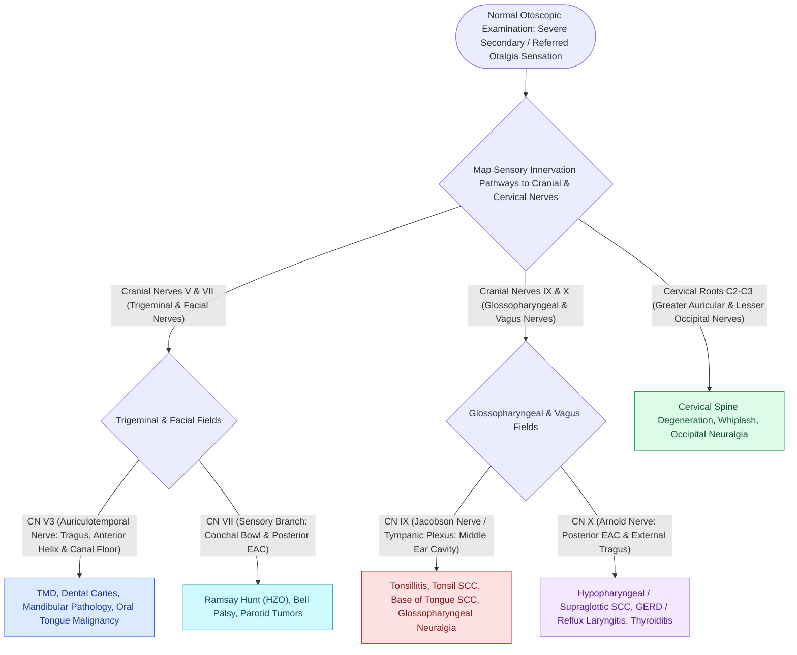

# Referred otalgia originates from shared sensory pathways of cranial nerves V, VII, IX, X, and cervical roots C2-C3

## Active Recall

> [!question]- Why does an oropharyngeal or tonsillar malignancy refer pain specifically to the middle ear?
> *Answer / Clinical Rationale*: Sensory innervation from the palatine tonsil and base of tongue travels via the **glossopharyngeal nerve (CN IX)**, which shares its sensory nucleus (nucleus ambiguus / tractus solitarius) with **Jacobson's nerve (tympanic branch of CN IX)** supplying the middle ear promontory.

> [!question]- What neural pathway mediates the reflex cough triggered when instrumenting the posterior ear canal wall?
> *Answer / Clinical Rationale*: **Arnold's nerve (auricular branch of CN X)** carries somatic sensation from the posterior EAC wall back to the vagal sensory nuclei, triggering the vagally mediated cough reflex.

> [!question]- What is the required clinical evaluation for an adult patient with unilateral otalgia and a normal otoscopic exam?
> *Answer / Clinical Rationale*: Comprehensive **flexible fiberoptic laryngoscopy and palpation of the oral cavity and neck** to rule out an occult mucosal squamous cell carcinoma of the tonsil, tongue base, hypopharynx, or larynx.

## Core Clinical & Mechanistic Principles
**Referred (secondary) otalgia** occurs when pathology remote from the ear produces pain localized to the auricle or external auditory canal (EAC) through shared neural pathways. The ear functions as the diagnostic **"dashboard of the upper aerodigestive tract and neck"** because its complex sensory innervation receives branches from five distinct neural conduits (**CN V3, CN VII, CN IX, CN X, and C2–C3**):

- **The Five Afferent Pathways of the Referred Otalgia Network**:
  1. **Auriculotemporal Nerve (CN V3 — Mandibular Branch of Trigeminal)**:
     - *Ear Territory*: Tragus, anterior helix, anterior superior EAC wall, anterior tympanic membrane.
     - *Referred Sources*: Temporomandibular joint (TMJ) dysfunction, mandibular dentition (molar caries / impacted 3rd molars), [[Transoral resection provides oncologic access for early-stage anterior oral cavity neoplasms|oral tongue and floor of mouth]] neoplasms, parotid gland disease.
  2. **Jacobson's Nerve (Tympanic Branch of CN IX — Glossopharyngeal)**:
     - *Ear Territory*: Tympanic cavity, promontory plexus, Eustachian tube mucosa, medial surface of tympanic membrane.
     - *Referred Sources*: Palatine tonsils ([[Peritonsillar abscess needle aspiration and incision and drainage require superior pole local anesthetic and landmark-guided needle guard protection|quinsy]], tonsillitis, post-tonsillectomy pain), **base of tongue**, and **HPV-mediated oropharyngeal carcinoma**.
     - *High-Stakes Rule*: Unilateral otalgia in an adult with a normal otoscopic exam is **HPV-positive oropharyngeal or [[Hypopharyngeal piriform sinus carcinoma requires partial or total laryngopharyngectomy|hypopharyngeal carcinoma]]** until fiberoptic laryngoscopy proves otherwise.
  3. **Arnold's Nerve (Auricular Branch of CN X — Vagus)**:
     - *Ear Territory*: Posterior and inferior cartilaginous EAC wall, posteroinferior tympanic membrane, concha.
     - *Referred Sources*: Larynx, hypopharynx, piriform sinus, and cervical esophagus ([[The paraglottic space facilitates transglottic tumor spread|laryngeal SCC]], GERD, foreign bodies).
     - *Reflex Correlation*: Stimulation of the posterior EAC wall triggers the **Arnold ear-cough reflex** mediated by vagal afferents.
  4. **Nervus Intermedius Sensory Twigs (CN VII — Facial Nerve)**:
     - *Ear Territory*: Posterior wall of EAC, concha, antihelix, lobule.
     - *Referred Sources*: Deep otalgia preceding facial palsy in [[Ramsay Hunt syndrome herpes zoster oticus presents with severe facial paralysis, otalgia, and auricular vesicles|Ramsay Hunt syndrome (Herpes Zoster Oticus)]] and Bell's palsy before vesicular eruption.
  5. **Cervical Plexus (C2–C3 — Great Auricular & Lesser Occipital Nerves)**:
     - *Ear Territory*: Lower two-thirds of the pinna, lobule, mastoid skin, and postauricular area.
     - *Referred Sources*: Cervical spine degenerative disc disease, cervical facet arthropathy, [[Corset platysmaplasty and lateral suspension restore the youthfulness of the cervicomental angle|cervical muscular spasm]], and carotidynia.

### Surgical Technique & Critical Safety Checks
- **Cancer Screening Mandate**: Any adult presenting with **unexplained persistent unilateral otalgia and a completely normal otoscopic examination** must undergo immediate in-office flexible fiberoptic nasopharyngolaryngoscopy to inspect the nasopharynx, base of tongue, tonsillar crypts, piriform sinuses, and endolarynx.

## Connected Concepts & Graph Traversal
- **Oropharyngeal Oncology**: [[HPV-positive oropharyngeal squamous cell carcinoma exhibits distinct biological behavior and staging|HPV Oropharyngeal Carcinoma]]
- **Facial Nerve Neuralgia**: [[Ramsay Hunt syndrome herpes zoster oticus presents with severe facial paralysis, otalgia, and auricular vesicles|Ramsay Hunt Syndrome]]
- **Tonsil Surgical Anatomy**: [[TORS radical tonsillectomy requires careful identification of the internal carotid artery posterolaterally|TORS Tonsillectomy]]
- **Laryngeal Malignancy**: [[The paraglottic space facilitates transglottic tumor spread|Paraglottic Space & Larynx Cancer]]
- **Great Auricular Nerve**: [[The great auricular nerve emerges at Erb's point and is vulnerable during rhytidectomy|Great Auricular Nerve Anatomy]]
- **Differential Diagnosis**: [[Internal derangement of the temporomandibular joint is staged by the Wilkes classification from reducing clicking to disc perforation|TMJ Internal Derangement & Wilkes Staging]]
