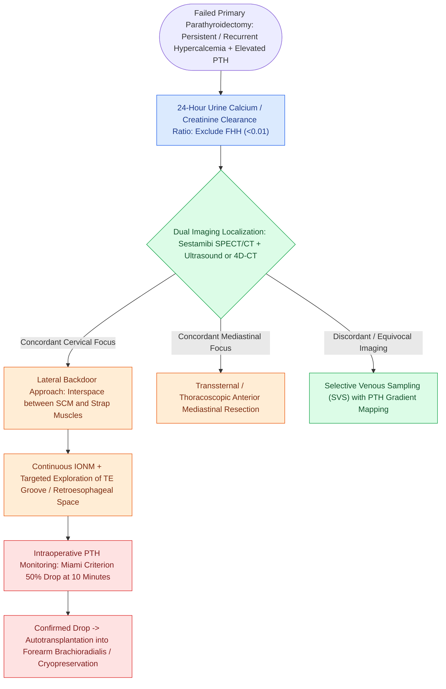

# Reoperative parathyroidectomy for persistent or recurrent hyperparathyroidism requires dual imaging concordance and a lateral backdoor approach to minimize nerve injury

## Active Recall

> [!question]- How is persistent hyperparathyroidism differentiated from recurrent disease, and what benign genetic condition must be excluded prior to surgical re-exploration?
> *Answer / Clinical Rationale*: **Persistent** hyperparathyroidism is defined as hypercalcemia occurring within 6 months of initial neck exploration; **recurrent** hyperparathyroidism occurs after a documented normocalcemic interval exceeding 6 months. **Familial Hypocalciuric Hypercalcemia (FHH)** must be excluded by measuring a 24-hour urinary calcium-to-creatinine clearance ratio; a ratio $<0.01$ signifies an inactivating mutation in the calcium-sensing receptor (CASR) for which neck re-exploration is ineffective and strictly contraindicated.
>
> [!question]- Why does the lateral 'backdoor' approach between the sternocleidomastoid muscle and strap muscles protect the recurrent laryngeal nerve during revision parathyroidectomy?
> *Answer / Clinical Rationale*: Anterior midline re-entry traverses dense, vascularized scar tissue that tethers the strap muscles directly to the trachea, thyroid capsule, and recurrent laryngeal nerve (RLN), inflating permanent vocal cord paralysis rates up to 5-fold (3% to 10%). The lateral backdoor approach enters an unviolated, virgin tissue plane between the anterior border of the SCM/carotid sheath laterally and the strap muscles medially, allowing safe identification of the RLN low in the neck before entering the retrothyroid and paratracheal spaces.

## Core Clinical & Mechanistic Principles

Revision parathyroid surgery is required in approximately 2% to 5% of patients treated for [[Primary hyperparathyroidism is caused by single adenomas, multigland hyperplasia, or parathyroid carcinoma|primary hyperparathyroidism]], representing one of the most challenging frontiers in endocrine surgery:
- **Mechanisms of Primary Operative Failure**:
  1. *Ectopic Anatomical Location*: The missing diseased gland resides in an aberrant embryologic position—most frequently the thymus/anterior mediastinum (inferior glands), tracheoesophageal groove, retroesophageal space (superior glands), carotid sheath, intrathyroidal parenchyma, or undescended submandibular triangle.
  2. *Unrecognized Multiglandular Hyperplasia*: Failure to identify double adenomas or 4-gland hyperplasia in patients with hereditary syndromes (MEN-1, MEN-2A, hyperparathyroidism-jaw tumor syndrome).
  3. *Parathyromatosis*: Iatrogenic capsular rupture and spillage of hyperplastic parathyroid tissue during initial surgery, resulting in multiple seeded functional implants across the cervical fascial planes.
- **Preoperative Localization Mandate (Dual Concordance)**:
  - Re-exploration is strictly prohibited without definitive preoperative localization; blind bilateral re-exploration yields cure rates $<60\%$ and unacceptable complication rates.
  - **Concordance of at least two non-invasive imaging modalities** is required: Technetium-99m sestamibi SPECT/CT combined with high-resolution neck ultrasonography or contrast-enhanced four-dimensional computed tomography (4D-CT).
  - When non-invasive modalities are discordant or negative, invasive **selective venous sampling (SVS)** with parathyroid hormone radioimmunoassay gradients across the internal jugular, innominate, and thymic veins directs the surgical corridor.

### Operative Craft, Lateral Backdoor Access, & Forearm Autotransplantation

1. **The Lateral "Backdoor" Technique**:
   - The previous collar scar is re-opened or extended laterally along the anterior border of the sternocleidomastoid muscle.
   - Dissection is carried down along the anterior border of the SCM, developing the virgin plane between the SCM/carotid sheath laterally and the sternohyoid/sternothyroid strap muscles medially.
   - The carotid sheath is mobilized laterally, and the middle thyroid vein is divided if present.
   - The thyroid lobe is rotated anteromedially without disrupting its anterior adhesions, providing direct, unscarred exposure of the tracheoesophageal groove, inferior thyroid artery branches, and the RLN entering the larynx behind the cricothyroid joint.
2. **Intraoperative Hormone Dynamics & Biochemical Verification**:
   - Rapid intraoperative PTH measurement is essential. A baseline draw is taken prior to incision, and serial draws are taken at 5, 10, and 20 minutes following adenoma excision.
   - Surgical success is confirmed by the [[The Miami criterion requires a fifty percent intraoperative PTH drop at ten minutes post-excision|Miami criterion]] ($\ge 50\%$ drop from baseline at 10 minutes post-excision) combined with a final absolute level falling into the normal physiological range.
3. **Forearm Brachioradialis Autotransplantation**:
   - If extensive re-exploration leaves the patient with a single remaining devascularized or resected parathyroid gland, a confirmed slice of viable tissue is autotransplanted.
   - In reoperative surgery, tissue must **never be autotransplanted into the neck SCM**, as recurrent hyperparathyroidism in a scarred neck creates severe surgical risk.
   - Instead, 10 to 15 one-millimeter parathyroid fragments are pocketed into separate intramuscular pockets in the **brachioradialis muscle of the non-dominant forearm**. If recurrent hyperplasia develops, resection is easily performed under local anesthesia in the outpatient setting.

## Connected Concepts & Graph Traversal

- **Diagnostic Preoperative Imaging**: [[Preoperative sestamibi SPECT and 4D-CT localize hyperfunctioning parathyroid glands|Sestamibi SPECT and 4D-CT Concordance]]
- **Embryologic Anatomical Reference**: [[Superior and inferior parathyroid glands maintain constant anatomical relationships to the RLN and ITA|Ectopic Gland Embryology]]
- **Intraoperative Neural Protection**: [[Intraoperative neuromonitoring of the RLN and EBSLN verifies nerve integrity and aids nerve identification|Recurrent Laryngeal Nerve Monitoring]]
- **Grafting & Rescue Management**: [[Devascularized parathyroid glands require confirmation biopsy and autotransplantation into the SCM|Forearm Autotransplantation Strategy]]
- **Postoperative Biochemical Sequelae**: [[Post-thyroidectomy hypocalcemia is managed with oral calcium, calcitriol, and intravenous calcium gluconate|Protracted Hypocalcemia Management]]
