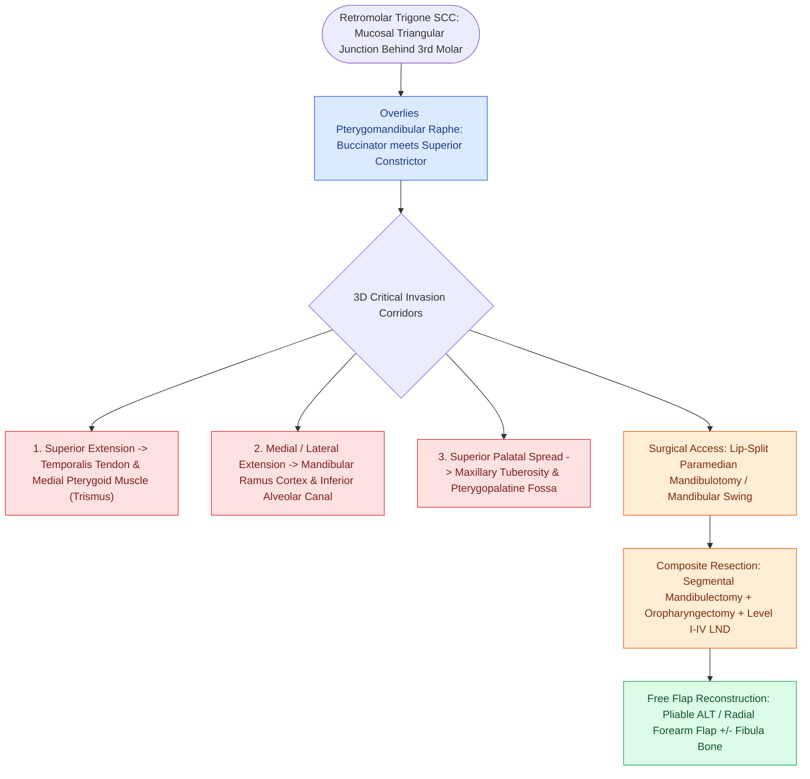

# Retromolar trigone carcinoma invades the pterygomandibular raphe and masticator space

## Active Recall

> [!question]- What clinical symptom indicates that an RMT carcinoma has invaded the masticator space?
> *Answer / Clinical Rationale*: **Trismus** (inability to open the jaw, caused by tumor infiltration of the medial pterygoid and temporalis muscles).

> [!question]- What anatomical structure connects the buccinator and superior constrictor muscles at the RMT?
> *Answer / Clinical Rationale*: The **pterygomandibular raphe**.

## Core Clinical & Mechanistic Principles
Carcinoma of the **retromolar trigone (RMT)** (the triangular mucosal region behind the third mandibular molar) exhibits aggressive local invasion due to its unique anatomical junction:
- **Anatomical Convergence**:
  - The mucosa overlies the ascending ramus of the mandible, the **pterygomandibular raphe** (junction of buccinator and superior pharyngeal constrictor muscles), and the temporalis tendon.
- **Routes of Spread**:
  1. **Masticator Space Invasion**: Spreads superiorly along the temporalis muscle and medial pterygoid muscle, presenting clinically with **trismus**.
  2. **Mandibular Bone Invasion**: Directly invades the cortical bone of the ascending ramus and enters the inferior alveolar canal.
  3. **Maxillary / Palatal Extension**: Spreads superiorly into the soft palate, maxillary tuberosity, and pterygopalatine fossa.
- **Surgical Management**: Typically requires a composite resection ([[Segmental mandibulectomy resects full-thickness bone for medullary invasion and irradiated bone recurrence|segmental mandibulectomy]] of the ramus/angle, partial pharyngectomy, and partial soft palate resection) via a [[Lip-split paramedian mandibulotomy provides wide exposure for posterior oral cavity and oropharyngeal tumors|lip-split mandibulotomy]], reconstructed with an **ALT or [[The radial forearm free flap provides thin, pliable fasciocutaneous tissue for oral and pharyngeal defects|RFFF]] free flap**.

### Surgical Technique & Critical Safety Checks
- **Adjuvant Therapy**: High rate of close/positive margins and perineural invasion necessitates postoperative radiation or chemoradiotherapy.

## Connected Concepts & Graph Traversal
- **Surgical Access Corridor**: [[Lip-split paramedian mandibulotomy provides wide exposure for posterior oral cavity and oropharyngeal tumors|Lip-Split Mandibulotomy]]
- **Full-Thickness Bone Resection**: [[Segmental mandibulectomy resects full-thickness bone for medullary invasion and irradiated bone recurrence|Segmental Mandibulectomy]]
- **Bulky / Pliable Soft Tissue Donor**: [[The anterolateral thigh flap provides versatile volume and can be harvested as a chimeric flap|ALT Free Flap]]
- **Thin Fasciocutaneous Alternative**: [[The radial forearm free flap provides thin, pliable fasciocutaneous tissue for oral and pharyngeal defects|Radial Forearm Free Flap]]
- **Oncologic Resection Margins**: [[Oncologic clear margins require at least five millimeters of histological normal tissue|Five-Millimeter Clear Margins]]
- **Oral Cavity T-Staging & DOI**: [[AJCC 8th edition incorporates depth of invasion into oral cavity T-staging|Oral Cavity Staging & DOI]]
