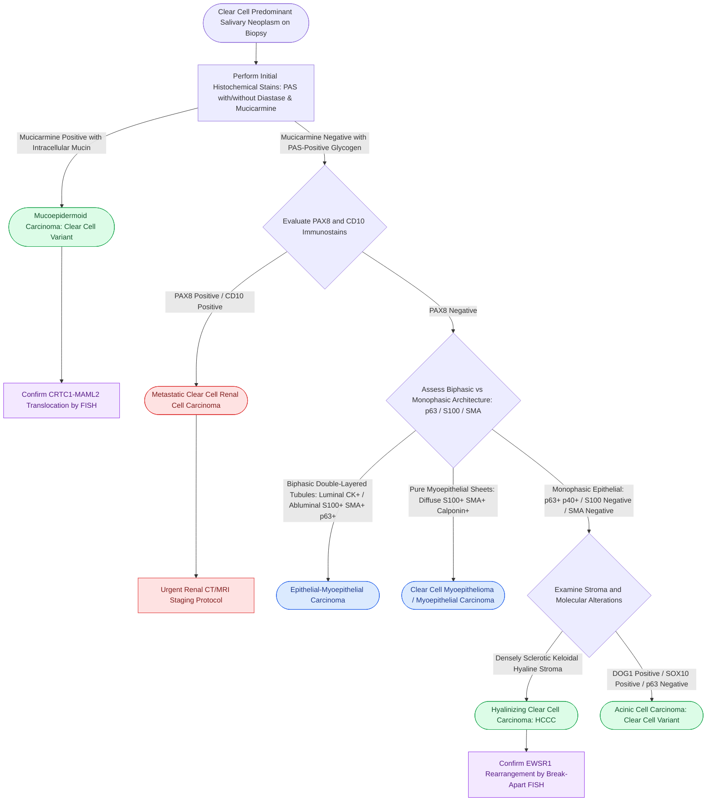

# Salivary clear cell neoplasms comprise a challenging diagnostic spectrum characterized by distinct immunohistochemical profiles and recurrent gene fusions

## Active Recall

> [!question]- What primary oncogenic gene fusion defines hyalinizing clear cell carcinoma (HCCC) of salivary origin?
> *Answer / Clinical Rationale*: **EWSR1-ATF1** recurrent gene fusion resulting from the chromosomal translocation **t(12;22)(q13;q12)**. In rare cases, *EWSR1-CREM* is identified. Detection of EWSR1 rearrangement by fluorescent in situ hybridization (FISH) or RT-PCR definitively establishes the diagnosis of HCCC and differentiates it from non-translocation clear cell mimics.

> [!question]- How does the biphasic immunohistochemical architecture of epithelial-myoepithelial carcinoma (EMC) differentiate it from monophasic clear cell carcinoma?
> *Answer / Clinical Rationale*: EMC is characterized by **dual-layered tubules** composed of: (1) an **inner luminal ductal layer** of small, cuboidal cells that stain positive for cytokeratins (AE1/AE3, CK7) and EMA; and (2) an **outer abluminal mantle** of prominent, glycogen-rich clear cells that stain positive for myoepithelial markers (**p63**, **SMA**, **calponin**, and **S100**). In contrast, hyalinizing clear cell carcinoma is a monophasic epithelial neoplasm that stains positive for p63 and cytokeratins but is **consistently negative for S100 and SMA**.

> [!question]- What key immunohistochemical stain definitively excludes metastatic clear cell renal cell carcinoma (ccRCC) when evaluating a clear cell parotid mass?
> *Answer / Clinical Rationale*: **PAX8** and **RCC Antigen (CD10 / CAIX)**. Metastatic ccRCC is strongly and diffusely **PAX8-positive**, **CD10-positive**, and **vimentin-positive**, while negative for salivary ductal keratins and p63. Primary salivary clear cell neoplasms (HCCC, clear cell MEC, EMC) are universally **PAX8-negative**.

## Core Clinical & Mechanistic Principles

Salivary neoplasms with prominent clear cell morphology represent one of the most formidable diagnostic challenges in head and neck pathology *(Cummings p.234–239)*. Clear cell change in salivary gland lesions occurs due to:
1. **Intracellular glycogen accumulation** (which dissolves during aqueous formalin fixation, leaving optically clear cytoplasm).
2. **Intracellular mucin accumulation** (hydrated carbohydrate content).
3. **Hydropic degeneration of cellular organelles** (mitochondria, endoplasmic reticulum).
4. **Fixation-induced clearing artifacts**.

Because clear cell morphology can appear in benign lesions, indolent low-grade carcinomas, aggressive high-grade malignancies, and metastatic deposits, diagnostic categorization requires rigorous histomorphology, histochemical staining (PAS with and without diastase, mucicarmine), multiplex immunohistochemistry (IHC), and molecular genetic confirmation *(Cummings p.237–239)*.

### Primary Differential Diagnostic Spectrum

#### 1. Hyalinizing Clear Cell Carcinoma (HCCC)
- **Clinical Presentation**: Arises predominantly in the minor salivary glands of the oral cavity (base of tongue, palate, floor of mouth) with female predilection; carries low-to-intermediate malignant potential.
- **Histopathology**: Cords, trabeculae, and solid nests of monomorphic polygonal cells with copious optically clear cytoplasm embedded in a densely **hyalinized, sclerotic, or keloidal fibrous stroma**.
- **Histochemistry**: Glycogen-rich; strongly **PAS-positive and diastase-labile** (digested by diastase). Negative for mucicarmine (absence of intracellular mucin).
- **IHC Profile**: Cytokeratin-positive (AE1/AE3, CK7), **p63-positive**, and **p40-positive**. Crucially, it is **negative for myoepithelial markers (S100, SMA, calponin, GFAP)** and negative for mucin-associated proteins.
- **Molecular Pathology**: Pathognomonic **EWSR1-ATF1** gene fusion [t(12;22)(q13;q12)].

#### 2. Epithelial-Myoepithelial Carcinoma (EMC)
- **Clinical Presentation**: Typically arises in the parotid gland of elderly females; low-grade indolent behavior but possesses a 30–40% recurrence rate and 10–15% distant metastasis rate.
- **Histopathology**: Classical **biphasic organoid architecture** with well-formed, dual-layered duct-like structures. The inner luminal layer is composed of small, dark eosinophilic ductal cells. The outer abluminal layer consists of expanded, clear, polygonal myoepithelial cells with distinct cell borders.
- **Histochemistry**: Outer myoepithelial clear cells contain abundant glycogen (PAS-positive, diastase-sensitive); luminal secretions may stain with mucicarmine.
- **IHC Profile**: Dual-population staining:
  - *Inner ductal cells*: AE1/AE3+, CK7+, CAM5.2+, EMA+.
  - *Outer clear cells*: **p63+, SMA+, calponin+, S100+, and vimentin+**.
- **Molecular Pathology**: Frequently harbors **HRAS mutations** (predominantly Q61R codon), lacking EWSR1 or MAML2 rearrangements.

#### 3. Mucoepidermoid Carcinoma (Clear Cell Variant)
- **Clinical Presentation**: Most common primary salivary gland malignancy; clear cell variants can cause significant diagnostic confusion with pure clear cell neoplasms.
- **Histopathology**: Triphasic cellular population composed of mucin-producing goblet cells, squamoid/epidermoid cells, and intermediate (basaloid) cells. In the clear cell variant, extensive glycogen-rich and hydropic clearing predominates.
- **Histochemistry**: Demonstration of true intracellular mucin using **Mucicarmine** or **PAS with diastase resistance** (highlighting magenta intracellular mucin droplets in goblet cells).
- **IHC Profile**: p63+, p40+, CK7+, CK5/6+; negative for myoepithelial markers (SMA-, calponin-, S100-).
- **Molecular Pathology**: **CRTC1-MAML2** [t(11;19)(q21;p13)] or *CRTC3-MAML2* translocation.

#### 4. Acinic Cell Carcinoma (Clear Cell Variant)
- **Clinical Presentation**: Predominantly parotid gland neoplasm; indolent with long-term recurrence potential.
- **Histopathology**: While classically demonstrating serous acinar cells with basophilic zymogen granules, acinic cell carcinoma frequently displays marked architectural and cytologic diversity, including solid sheets of clear vacuolated cells lacking granules.
- **Histochemistry**: Intracellular zymogen granules are **PAS-positive and diastase-resistant**. Clear variants may show faint PAS positivity.
- **IHC Profile**: **DOG1-positive** (apical membranous staining), **SOX10-positive**, **pan-cytokeratin-positive**; negative for p63, p40, and SMA.
- **Molecular Pathology**: Rearrangements involving **NR4A3** up-regulation.

#### 5. Metastatic Clear Cell Renal Cell Carcinoma (ccRCC)
- **Clinical Presentation**: Metastatic deposit to the parotid gland or cervical lymph nodes, often presenting years after initial nephrectomy or as the initial manifestation of an occult primary kidney tumor.
- **Histopathology**: Highly vascular neoplasm with delicate, branching sinusoidal "chicken-wire" capillary networks surrounding uniform clear cells with abundant glycogen and intracellular lipid. Extravasated erythrocytes and hemosiderin deposition are common.
- **Histochemistry**: PAS-positive, diastase-labile (glycogen); **Oil Red O-positive** (lipid). Negative for mucicarmine.
- **IHC Profile**: **PAX8-positive**, **CD10-positive**, **RCC Antigen-positive**, **Vimentin-positive**, **CAIX-positive**; **negative for p63, p40, and high-molecular-weight cytokeratins**.

### Diagnostic Immunohistochemical & Molecular Matrix

| Entity | Architectural Pattern | PAS / Diastase | Mucicarmine | p63 / p40 | S100 / SMA | Key Diagnostic Signature |
| :--- | :--- | :--- | :--- | :--- | :--- | :--- |
| **Hyalinizing Clear Cell Carcinoma (HCCC)** | Cords/nests in dense hyalinized fibrous bands | PAS+ / Diastase-labile | Negative | Positive (p63+/p40+) | Negative (S100- / SMA-) | **EWSR1-ATF1 fusion**; monophasic epithelial |
| **Epithelial-Myoepithelial Carcinoma (EMC)** | Biphasic double-layered ductal tubules | PAS+ (outer cells) | Negative in clear cells | Positive (outer clear cells) | **Positive** (outer clear cells) | **Biphasic ductal-myoepithelial**; HRAS mutation |
| **Mucoepidermoid Carcinoma (Clear variant)** | Sheets of clear cells with focal mucocytes | PAS+ / Diastase-resistant | **Positive** (mucin goblet cells) | Positive (squamoid/interm) | Negative (SMA- / S100-) | **CRTC1-MAML2 fusion**; intracellular mucin |
| **Acinic Cell Carcinoma (Clear variant)** | Microcystic, solid, intercalated duct-like | Variable PAS | Negative | Negative | Negative | **DOG1+**, **SOX10+**, NR4A3 rearrangement |
| **Metastatic Clear Cell RCC** | Sinusoidal network, extravasated RBCs | PAS+ (glycogen) | Negative | Negative | Negative | **PAX8+**, **CD10+**, **CAIX+**, Vimentin+ |
| **Myoepithelioma (Clear cell variant)** | Plasmacytoid, spindle, or clear cell sheets | PAS+ / Diastase-labile | Negative | Positive | **Positive** (S100+, SMA+, Calponin+) | Pure myoepithelial phenotype lacking ductal tubules |

### Surgical & Prognostic Considerations

1. **Hyalinizing Clear Cell Carcinoma**: Typically managed with wide surgical excision with negative histologic margins. Regional lymph node metastases occur in approximately 10–15% of cases, warranting selective neck dissection when clinical lymphadenopathy is present. Overall prognosis is favorable (>90% long-term survival).
2. **Epithelial-Myoepithelial Carcinoma**: Managed with [[Superficial parotidectomy dissects the facial nerve branches to resect the lateral salivary lobe|superficial]] or total parotidectomy with facial nerve preservation unless directly invaded. High rates of local recurrence mandate clear surgical margins. High-grade transformation can occur, characterized by loss of the biphasic immunophenotype and rapid disease progression.
3. **Metastatic Renal Cell Carcinoma**: Solitary metastases to the parotid gland may benefit from metastasectomy combined with systemic targeted therapy (tyrosine kinase inhibitors against VEGF or immune checkpoint blockade).

## Connected Concepts & Graph Traversal
- **Primary Mucin-Producing Mimic**: [[Mucoepidermoid carcinoma is graded by AFIP Brandwein criteria and driven by CRTC1-MAML2 translocation|Mucoepidermoid Carcinoma]]
- **Acinar Differentiation Diagnostic Target**: [[Acinic cell carcinoma presents as an indolent low-grade parotid neoplasm with serous acinar differentiation|Acinic Cell Carcinoma]]
- **Perineural High-Grade Malignancy**: [[Adenoid cystic carcinoma exhibits prominent perineural invasion and late distant hematogenous metastasis|Adenoid Cystic Carcinoma]]
- **High-Grade Mammary-Like Carcinoma**: [[Salivary duct carcinoma is an aggressive high-grade malignancy expressing androgen receptors and HER2|Salivary Duct Carcinoma]]
- **Benign Mixed Tumor Differential**: [[Pleomorphic adenoma requires superficial parotidectomy with a cuff of normal tissue to prevent pseudopod recurrence|Pleomorphic Adenoma]]
- **Surgical Resection Standards**: [[Total parotidectomy with facial nerve sacrifice is indicated for direct malignant nerve invasion|Total Parotidectomy with Facial Nerve Sacrifice]]
