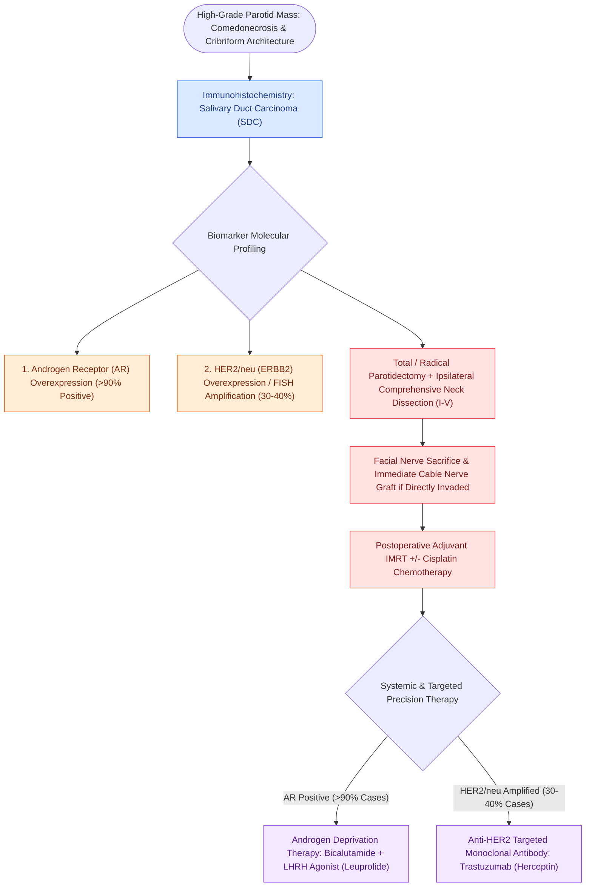

# Salivary duct carcinoma is an aggressive high-grade malignancy expressing androgen receptors and HER2

## Active Recall

> [!question]- What steroid hormone receptor is expressed in >90% of salivary duct carcinomas?
> *Answer / Clinical Rationale*: The **Androgen Receptor (AR)**.

> [!question]- What breast cancer targeted therapy is utilized in salivary duct carcinomas with ERBB2 amplification?
> *Answer / Clinical Rationale*: **Trastuzumab (Herceptin)**.

## Core Clinical & Mechanistic Principles
**Salivary Duct Carcinoma (SDC)** is one of the most aggressive and lethal primary salivary gland malignancies, occurring predominantly in older males in the parotid gland:
- **Histopathological Architecture**:
  - Closely resembles high-grade **ductal carcinoma of the breast**.
  - Features comedonecrosis, intraductal cribriform and micropapillary patterns, marked nuclear pleomorphism, and prominent vascular and perineural invasion.
- **Key Biomarkers & Molecular Targets**:
  1. **Androgen Receptor (AR) Positivity**: Present in **$>90\%$ of cases** on immunohistochemistry.
  2. **HER2/neu (ERBB2) Overexpression / Amplification**: Present in **$30\text{–}40\%$**.
- **Clinical Behavior**: Rapid local invasion, early facial nerve paralysis ($40\text{–}50\%$), high rate of early cervical lymph node metastasis ($>70\%$), and early distant metastasis (lungs, bone, brain).

### Surgical Technique & Critical Safety Checks
- **Treatment Protocol**: Radical [[The facial nerve main trunk is localized using the tragal pointer, tympanomastoid suture, and digastric ridge|parotidectomy]] + Comprehensive neck dissection + Postoperative concurrent chemoradiation; targeted **Androgen Deprivation Therapy (ADT)** or **Trastuzumab** for advanced/metastatic disease.

## Connected Concepts & Graph Traversal
- **Mucoepidermoid Carcinoma**: [[Mucoepidermoid carcinoma is graded by AFIP Brandwein criteria and driven by CRTC1-MAML2 translocation|Mucoepidermoid Carcinoma]]
- **Facial Nerve Sacrifice & Grafting**: [[Total parotidectomy with facial nerve sacrifice is indicated for direct malignant nerve invasion|Total Parotidectomy with CN VII Sacrifice]]
- **Immediate Cable Grafting**: [[Immediate facial nerve grafting with the great auricular or sural nerve restores facial reanimation|Immediate Cable Nerve Grafting]]
- **Acinic Cell Carcinoma**: [[Acinic cell carcinoma presents as an indolent low-grade parotid neoplasm with serous acinar differentiation|Acinic Cell Carcinoma]]
- **Adenoid Cystic Carcinoma**: [[Adenoid cystic carcinoma exhibits prominent perineural invasion and late distant hematogenous metastasis|Adenoid Cystic Carcinoma]]
- **Neck Dissection Standards**: [[Modified radical neck dissection types I, II, and III preserve non-lymphatic structures|Modified Radical Neck Dissection]]
- **Clear Cell Differential**: [[Salivary clear cell neoplasms comprise a challenging diagnostic spectrum characterized by distinct immunohistochemical profiles and recurrent gene fusions|Salivary Clear Cell Neoplasm Spectrum]]
