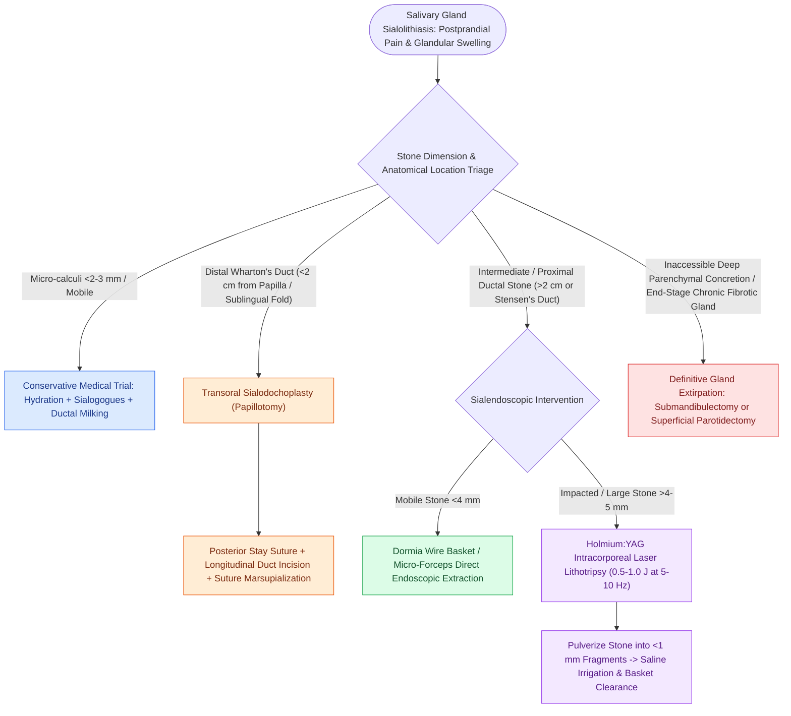

# Salivary gland sialolithiasis management ranges from manual massage to sialendoscopy based on stone size and location

## Active Recall

> [!question]- What anatomical relationship between Wharton's duct and the lingual nerve must be protected during posterior transoral sialodochoplasty?
> *Answer / Clinical Rationale*: The **lingual nerve courses from lateral to medial by diving underneath Wharton's duct** in the floor of the mouth; deep posterior dissection can transect the nerve, resulting in ipsilateral anterior tongue numbness and loss of taste (chorda tympani fibers).

> [!question]- Why are submandibular stones substantially more common than parotid stones?
> *Answer / Clinical Rationale*: Submandibular saliva travels **uphill against gravity** through a longer duct, has a **more alkaline pH**, and contains **higher concentrations of mucin, calcium, and phosphate**, creating an optimal milieu for stone precipitation.

## Core Clinical & Mechanistic Principles
**Sialolithiasis** is the formation of calcareous concretions within the ductal architecture of the major salivary glands. Approximately **80% to 90% of salivary calculi occur in the submandibular gland (Wharton's duct)**, 10% to 20% in the parotid gland (Stensen's duct), and <1% in the sublingual and minor salivary glands. Modern management prioritizes gland-preserving interventional techniques, utilizing an algorithm dictated by calculus size, mobility, and distance from the ductal punctum:

- **Pathophysiological Basis for Submandibular Predilection**:
  - **Antigravity Ductal Orientation**: Salivary flow in Wharton's duct runs in an upward, ascending direction over the mylohyoid muscle to the sublingual caruncle, promoting stasis.
  - **Ductal Dimensions**: Wharton's duct is substantially longer ($\approx 5\text{ cm}$) and wider than Stensen's duct.
  - **Salivary Viscosity & Mineral Composition**: Submandibular saliva contains higher mucin content, alkaline pH, and elevated concentrations of calcium and phosphate ions compared to the serous, acidic secretions of the parotid.

- **Stratified Management Decision Tree**:
  1. **Conservative Medical Trial (Calculi $<2–3\text{ mm}$)**:
     - Aggressive oral hydration ($>2\text{ L/day}$), sialogogues (sour lemon lozenges, citrus juices), warm compresses, and bimanual ductal massage to milk mobile micro-stones past the papilla.
  2. **Distal Wharton's Duct Stones ($<2\text{ cm}$ from Papilla)**:
     - **Transoral Sialodochoplasty (Papillotomy)**: Under local infiltration, place a temporary stay suture posterior to the palpable calculus to prevent retrograde migration into the neck. Make a longitudinal incision along the floor of mouth mucosa and duct roof over the stone, extract the stone with curettes, and **marsupialize the duct margins to the oral mucosa** with 5-0 absorbable sutures to prevent stricture.
  3. **Intermediate & Proximal Stones ($>2\text{ cm}$ from Papilla or Stensen's Duct)**:
     - **Interventional Sialendoscopy**:
       - *Small/Mobile Calculi ($<3–4\text{ mm}$)*: Cannulate the duct under local anesthesia, dilate the papilla with Marchal bougies, introduce a 0.8–1.3 mm semi-rigid sialendoscope, and retrieve the stone using a 4-to-6 wire **Dormia basket or micro-forceps**.
       - *Large/Impacted Calculi ($>4–5\text{ mm}$)*: Perform **Holmium:YAG laser lithotripsy** (energy $0.5–1.0\text{ J}$ at $5–10\text{ Hz}$) or pneumatic lithotripsy to pulverize the stone into $<1\text{ mm}$ gravel, followed by saline flush and basket extraction.
       - *Combined Approaches*: Endoscopic transoral duct slitting or transfacial parotid micro-incision with endoscopic light guidance for massive impacted stones.
  4. **Refractory Parenchymal Stones & End-Stage Fibrosis**:
     - **Gland Excision**: Submandibulectomy or [[Superficial parotidectomy dissects the facial nerve branches to resect the lateral salivary lobe|superficial parotidectomy]] reserved for intraglandular stones inaccessible to endoscopy or glands destroyed by recurrent suppurative [[Suppurative sialadenitis of the parotid and submandibular glands is treated with hydration, sialagogues, and anti-staphylococcal antibiotics|sialadenitis]].

## References
1. Abdel Razek, A.A.K., Mukherji, S. (2017). Imaging of sialadenitis. *Neuroradiol J*, 30(3):205-215.
2. Jackson, N.M., Mitchell, J.L., Walvekar, R.R. (2020). Inflammatory Disorders of the Salivary Glands. In Flint, P.W., et al. (Eds.), *Cummings Otolaryngology Head and Neck Surgery* 7e (pp. 1157-1170). Philadelphia, PA: Elsevier.
3. Roland, L.T., Skillington, S.A., Ogden, M.A. (2017). Sialendoscopy-assisted transfacial removal of parotid sialoliths: A systematic review and meta-analysis. *Laryngoscope*, 127(11):2510-2516.
4. Walvekar, R.R., Bowen, M.A. (2013). Nonneoplastic Disease of the Salivary Glands. In Johnson, J.J., Rosen, C.A. (Eds.), *Bailey’s Head and Neck Surgery-Otolaryngology* 5e (pp. 702-716). Baltimore, MD: Lippincott Williams & Wilkins.

## Connected Concepts & Graph Traversal
- **Glandular Infection**: [[Suppurative sialadenitis of the parotid and submandibular glands is treated with hydration, sialagogues, and anti-staphylococcal antibiotics|Suppurative Sialadenitis]]
- **Anterior Duct Craft**: [[Wharton duct sialolithiasis is managed with transoral sialodochoplasty or sialendoscopy|Wharton Duct Sialodochoplasty]]
- **Parotid Surgical Anatomy**: [[Superficial parotidectomy dissects the facial nerve branches to resect the lateral salivary lobe|Parotidectomy & Facial Nerve]]
- **Deep Space Spread**: [[The parapharyngeal space is an inverted pyramid connecting peritonsillar, masticator, parotid, and retropharyngeal spaces|Parotid and Submandibular Communications]]
- **Nerve Function Grading**: [[The House-Brackmann facial nerve grading system standardizes facial paralysis severity|Facial Nerve Grading]]
