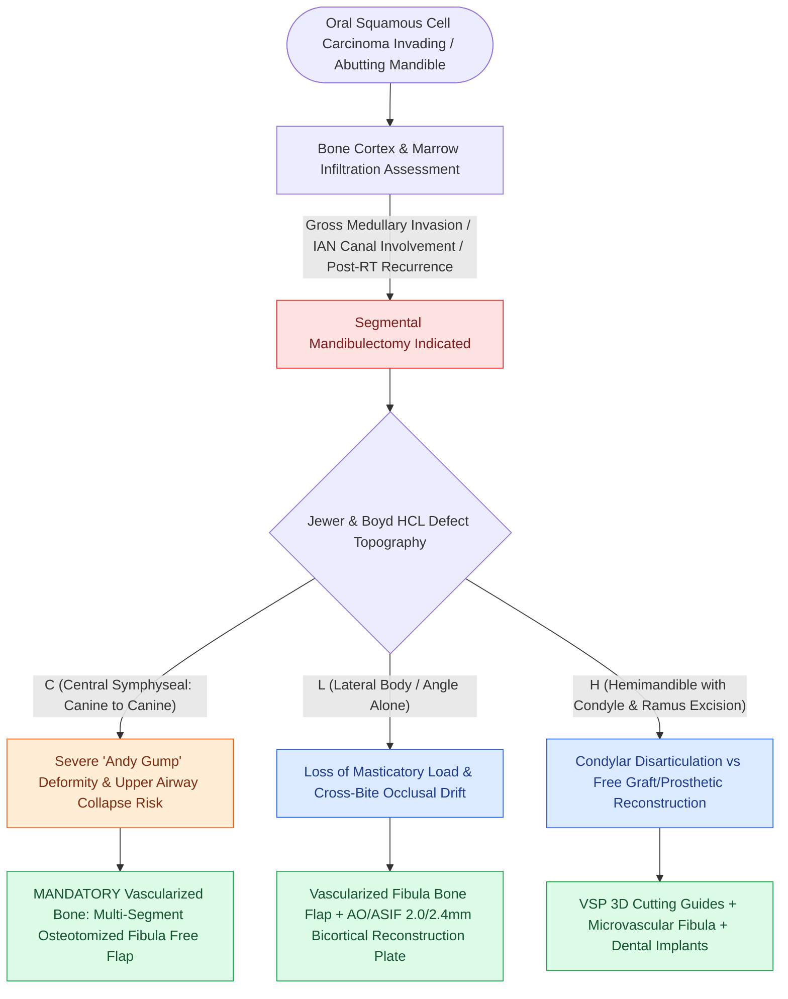

# Segmental mandibulectomy resects full-thickness bone for medullary invasion and irradiated bone recurrence

## Active Recall

> [!question]- What clinical and radiographic findings mandate a segmental mandibulectomy over a marginal mandibulectomy?
> *Answer / Clinical Rationale*: **Gross medullary bone marrow invasion**, **involvement of the inferior alveolar nerve canal**, or **tumor recurrence in irradiated bone**.

> [!question]- What functional deformity occurs if an anterior central (symphyseal) mandibular defect is left unreconstructed?
> *Answer / Clinical Rationale*: The **'Andy Gump' deformity**, characterized by severe retrognathia, loss of anterior tongue support, and catastrophic upper airway collapse.

## Core Clinical & Mechanistic Principles
**Segmental mandibulectomy** is the full-thickness en bloc resection of a complete segment of the mandibular bone (cortex and marrow):
- **Oncologic Indications**:
  1. Gross cortical erosion with medullary cancellous bone invasion on CT/MRI.
  2. Tumor involvement of the inferior alveolar neurovascular canal (facilitating perineural tumor extension).
  3. Recurrent carcinoma in a previously irradiated mandible.
  4. Extensive soft tissue tumor fixed to the outer and inner mandibular cortices.
- **Classification of Mandibular Defects (Jewer / Boyd HCL System)**:
  - **C (Central)**: Encompasses both canine teeth (symphyseal defect); causes 'Andy Gump' retrognathic deformity and tongue base airway collapse if unreconstructed.
  - **L (Lateral)**: Hemimandible defect excluding the central symphysis.
  - **H (Hemimandible)**: Includes the condyle, ramus, and lateral body.

### Surgical Technique & Critical Safety Checks
- **Reconstruction Standard**: Microvascular vascularized bone transfer (**Fibula Osteocutaneous Free Flap**) with rigid internal fixation using titanium reconstruction plates (see [[Marginal mandibulectomy preserves basilar bone height when tumor abuts but does not invade marrow|Marginal Mandibulectomy Technique]]).

## Connected Concepts & Graph Traversal
- **Marginal Mandibulectomy Alternative**: [[Marginal mandibulectomy preserves basilar bone height when tumor abuts but does not invade marrow|Marginal Mandibulectomy Technique]]
- **Fibula Free Flap Mastercraft**: [[The fibula osteocutaneous free flap provides up to twenty-five centimeters of vascularized bone for mandible reconstruction|Fibula Free Flap Harvest]]
- **Virtual CAD/CAM Planning**: [[Virtual surgical planning and 3D cutting guides optimize fibula contouring and dental implant rehabilitation|Virtual Surgical Planning & Guides]]
- **Rigid Plate Fixation**: [[Mandibular reconstruction plates require rigid bicortical screw fixation to withstand masticatory load|Mandibular Reconstruction Plates]]
- **Mandibular Pre-Plating**: [[Pre-plating the intact mandible before osteotomy preserves accurate dental occlusion and contour|Pre-Plating the Intact Mandible]]
- **Retromolar Trigone Infiltration**: [[Retromolar trigone carcinoma invades the pterygomandibular raphe and masticator space|Retromolar Trigone Carcinoma]]
- **Necrotic Bone Differential**: [[Medication-related osteonecrosis of the jaw is staged by the AAOMS system to direct antiresorptive conservative and surgical therapy|MRONJ Staging & Management]]
