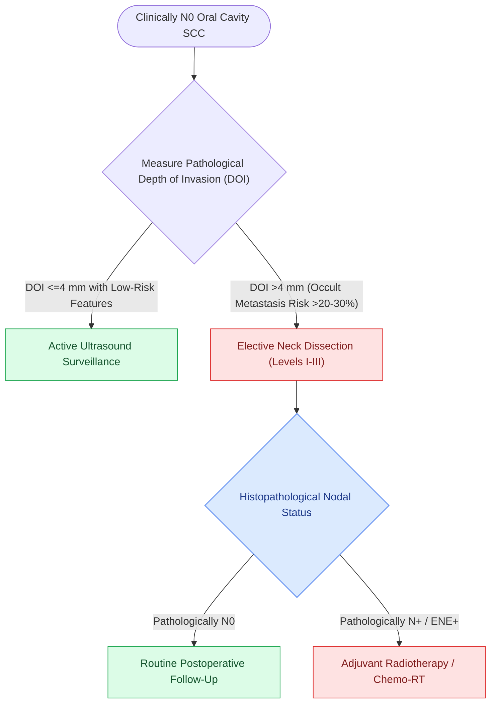

# Selective neck dissection targets high-risk nodal basins while sparing low-risk cervical levels

## Active Recall

> [!question]- What survival advantage did the prospective D'Cruz et al. (NEJM 2015) trial demonstrate for elective neck dissection over therapeutic salvage in T1-T2 cN0 oral cavity SCC?
> *Answer / Clinical Rationale*: Upfront elective neck dissection yielded a statistically significant **$12.5\%$ improvement in 3-year overall survival ($80.0\%$ vs $67.5\%$, $HR=0.64$)** and a dramatic reduction in disease recurrence.

> [!question]- Why does watchful waiting with ultrasound observation fail in early-stage oral cancer with occult nodal disease?
> *Answer / Clinical Rationale*: Occult metastases that progress clinically often develop **macroscopic extranodal extension (ENE), soft tissue invasion, and advanced N2-N3 stage**, rendering salvage surgical clearance far less effective.

> [!question]- What is the anatomical boundary separating Level IIA from Level IIB during neck dissection?
> *Answer / Clinical Rationale*: The **spinal accessory nerve (CN XI)**: Level IIB lies superior/posterior to the nerve in the submuscular recess, whereas Level IIA lies anterior/inferior to the nerve adjacent to the internal jugular vein.

## Core Clinical & Mechanistic Principles
**Selective Neck Dissection (SND)** preserves one or more lymph node levels routinely cleared in comprehensive dissections, systematically targeting only the lymphatic basins at highest risk for regional metastasis based on the primary tumor site:

- **The D'Cruz Landmark Evidence for Upfront Elective Neck Dissection (END)**:
  - *The Tata Memorial Trial (D'Cruz et al., New England Journal of Medicine 2015)*: A prospective randomized controlled trial of 500 patients with early-stage ($T1\text{–}T2,\ cN0$) oral cavity squamous cell carcinoma comparing **upfront Elective Neck Dissection (SND I–III)** vs **Therapeutic Neck Dissection (watchful waiting with serial ultrasound $\rightarrow$ salvage neck dissection only upon nodal relapse)**.
  - *Trial Results*:
    - **3-Year Overall Survival (OS)**: **$80.0\%$ in the Elective arm vs $67.5\%$ in the Therapeutic arm** ($HR=0.64,\ 95\%\ \text{CI}\ 0.45\text{–}0.92,\ p=0.01$).
    - **3-Year Disease-Free Survival (DFS)**: **$69.5\%$ in the Elective arm vs $45.9\%$ in the Therapeutic arm** ($HR=0.45,\ p<0.001$).
  - *Mechanistic Axiom*: Salvage surgery for nodal relapse fails because **occult metastases that recur under observation frequently exhibit bulky [[Extranodal extension in cervical lymph nodes upstages nodal disease and dictates adjuvant chemoradiotherapy|extranodal extension]] (ENE), soft tissue fixity, and distant seeding**, reducing salvage success by $>30\%$. Upfront elective neck dissection is mandatory whenever the occult metastasis risk exceeds **$15\text{–}20\%$** (or tumor [[AJCC 8th edition incorporates depth of invasion into oral cavity T-staging|Depth of Invasion (DOI)]] $\ge 3\text{–}4\text{ mm}$).

- **Anatomical Subtypes of Selective Neck Dissection**:
  - **Supraomohyoid Neck Dissection (SND I–III)**: Standard for **oral cavity carcinoma** ($cN0$ or selected $cN1$).
  - **Anterolateral / Lateral Neck Dissection (SND II–IV)**: Standard for **laryngeal, hypopharyngeal, and oropharyngeal carcinomas** (sparing Level I and Level V).
  - **Posterolateral Neck Dissection (SND II–V + Postauricular/Suboccipital)**: Indicated for **cutaneous carcinomas and melanomas of the posterior scalp and neck**.
  - **Central Compartment Neck Dissection (SND VI)**: Standard for **thyroid carcinomas, subglottic larynx, and cervical trachea**.

### Surgical Technique & Craft Nuances for SND I–III
1. **Level I Dissection (Submental & Submandibular)**:
   - Elevate [[Subplatysmal flap elevation and Martin's maneuver protect the marginal mandibular nerve|subplatysmal flaps]] to the inferior mandibular border. Employ **Martin's maneuver** (ligating the anterior facial vein at the lower mandibular border and elevating it superiorly) to lift the marginal mandibular nerve out of harm's way.
   - Clear submental fat (Level IA) between the anterior bellies of the digastric muscles.
   - Retract the [[Submandibular gland excision requires preservation of the marginal mandibular, lingual, and hypoglossal nerves|submandibular gland]] inferiorly, identify and ligate the facial artery at the superior and inferior borders of the gland, divide the submandibular ganglion to mobilize the lingual nerve, and preserve the hypoglossal nerve running deep to the hyoglossus muscle.
2. **Level II Dissection (Upper Jugular & CN XI)**:
   - Identify the [[The spinal accessory nerve is identified at the Erb point and anterior border of the SCM|spinal accessory nerve (CN XI)]] entering the anterior border of the SCM $2\text{ cm}$ below the mastoid tip.
   - Dissect Level IIB (submuscular triangle) superior and posterior to CN XI up to the skull base, retracting the nerve gently without traction stretch.
   - Clear Level IIA anterior and inferior to CN XI over the internal jugular vein and carotid bifurcation.
3. **Level III Dissection (Mid-Jugular)**:
   - Clear lymphoadipose tissue between the carotid bifurcation/hyoid bone superiorly and the intermediate tendon of the **omohyoid muscle** inferiorly.
   - Skeletonize the internal jugular vein and common carotid artery, maintaining dissection superficial to the **prevertebral fascia** to protect the phrenic nerve, sympathetic trunk, and brachial plexus roots.

## Connected Concepts & Graph Traversal
- **Cervical Basins**: [[Cervical lymph node levels I through VII define regional metastatic drainage basins|Cervical Lymph Levels]]
- **Marginal Mandibular Sparing**: [[Subplatysmal flap elevation and Martin's maneuver protect the marginal mandibular nerve|Martin's Maneuver & Marginal Mandibular Nerve]]
- **Submandibular Craft**: [[Submandibular gland excision requires preservation of the marginal mandibular, lingual, and hypoglossal nerves|Submandibular Gland & Lingual/Hypoglossal Nerves]]
- **Spinal Accessory Identification**: [[The spinal accessory nerve is identified at the Erb point and anterior border of the SCM|Spinal Accessory Nerve Anatomy]]
- **Comprehensive Dissection**: [[Modified radical neck dissection types I, II, and III preserve non-lymphatic structures|Modified Radical Neck Dissection]]
- **Perioperative Checkpoint Blockade**: [[KEYNOTE-689 establishes neoadjuvant and adjuvant pembrolizumab as standard for locally advanced head and neck squamous cell carcinoma|KEYNOTE-689 Trial in HNSCC]]
- **HPV De-escalation Surgery**: [[The ECOG-3311 and ORATOR trials establish pathological risk-stratified de-escalation and functional trade-offs in HPV-positive OPSCC|ECOG-3311 & ORATOR Trials in OPSCC]]
