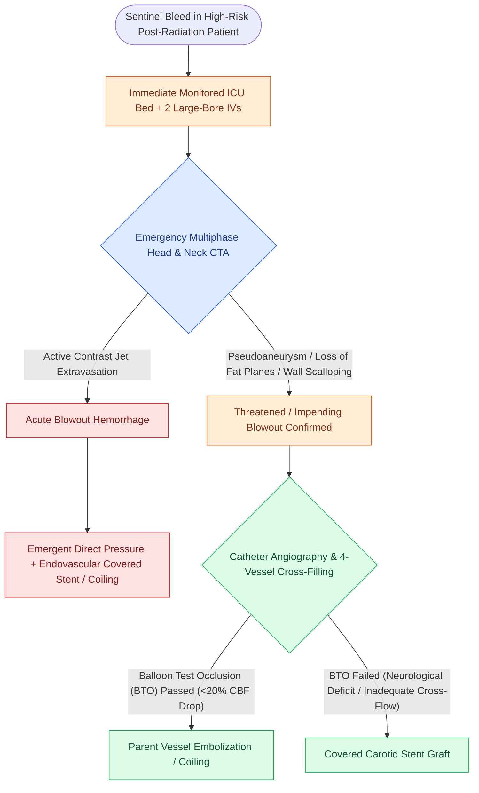

# Sentinel bleeding in head and neck cancer patients requires urgent CT angiography to evaluate for threatened carotid blowout

## Active Recall

> [!question]- Why is a limited, self-resolving bleed in a post-radiation head and neck cancer patient considered a high-acuity surgical priority?
> *Answer / Clinical Rationale*: Up to **60% of acute carotid blowouts are preceded by a self-limited sentinel bleed** caused by transient micro-rupture and unstable clot formation; definitive rupture with life-threatening exsanguination typically follows within 24 to 72 hours.

> [!question]- What specific CT angiography findings indicate an impending carotid blowout?
> *Answer / Clinical Rationale*: Presence of a **focal pseudoaneurysm**, carotid wall thinning or irregularity, **loss of intervening fascial fat planes** between the vessel and a necrotic cavity/fistula, or an active **contrast extravasation blush**.

## Core Clinical & Mechanistic Principles
In patients with advanced head and neck malignancies—particularly those with a history of prior neck dissection, high-dose external beam radiation therapy ($>60\text{–}70\text{ Gy}$), pharyngocutaneous fistulae, or gross wound breakdown—a self-limited episode of spontaneous bleeding ($5\text{ to }50\text{ mL}$) into the oral cavity, pharynx, tracheostoma, or neck wound is termed a **"Sentinel Bleed"**. A sentinel bleed represents the herald warning of an impending, catastrophic [[Carotid blowout syndrome management includes throat packing, endovascular embolization, and carotid stenting|Carotid Blowout Syndrome (CBS)]], preceding fulminant vascular rupture in up to **$60\%$ of cases**:

- **Pathophysiology of the Sentinel Bleed**:
  - Radiation and regional infection destroy the adventitial **vasa vasorum**, rendering the carotid arterial wall chronically ischemic and incapable of reparative collagen remodeling.
  - Salivary enzymes from a [[Pharyngocutaneous fistula is managed with wound care, nutritional support, and surgical flap closure|pharyngocutaneous fistula]] directly digest the exposed arterial media and elastica, culminating in a micro-perforation sealed temporarily by an unstable, friable fibrin clot.
  - Dissolution or physical dislodgement of this fresh clot within 24 to 72 hours triggers fatal exsanguination.

- **Mandatory Diagnostic Workup Sequence**:
  1. **Immediate Triage & ICU Monitoring**: Never dismiss minor bleeding as simple "granulation" or "dry mucus" in an at-risk head and neck cancer patient. Place the patient on telemetry in a monitored ICU or step-down bed, establish two large-bore IVs, draw a Type & Screen and coagulation panel, and maintain strict NPO status.
  2. **Emergency Multiphase CT Angiography (CTA)**:
     - The imaging modality of choice from skull base to aortic arch.
     - *Key Radiologic Signs of Threatened/Impending Blowout*:
       - **Focal Carotid Pseudoaneurysm**: A saccular, contrast-filled outpouching beyond the native arterial wall.
       - **Arterial Wall Irregularity / Thinning**: Focal scalloping or focal stenosis of the carotid lumen.
       - **Loss of Protective Fat Planes**: Complete absence of the normal cervical fat envelope separating the carotid artery from an adjacent necrotic tumor bed, irradiated ulcer, or air-filled fistulous tract.
       - **Active Contrast Extravasation ("Blush")**: High-attenuation contrast jet extravasating into soft tissue or pharyngeal lumen.
  3. **Diagnostic Catheter Angiography & Balloon Test Occlusion (BTO)**:
     - Performed in the angiography suite when CTA identifies high-risk vascular abnormalities.
     - *Circle of Willis Patency Assessment*: Four-vessel cerebral angiography assesses cross-filling through the anterior communicating artery (ACom) and posterior communicating arteries (PCom).
     - *Balloon Test Occlusion Protocol*: A temporary micro-balloon is inflated in the target common or internal carotid artery for 15 to 30 minutes while an awake patient undergoes continuous neurological and cognitive examinations, often coupled with hypotensive challenge and quantitative cerebral blood flow (CBF) mapping. Patients who tolerate BTO without neurological deficit ($<20\%$ drop in CBF) are candidates for **definitive endovascular parent vessel sacrifice (coiling/plugging)**.

## References
1. Medina, J.E., Vasan, N.R. (2013). Neck Dissection. In Johnson, J.J., Rosen, C.A. (Eds.), *Bailey’s Head and Neck Surgery-Otolaryngology* 5e (pp. 1807-1838). Baltimore, MD: Lippincott Williams & Wilkins.
2. Mydlarz, W.K., Eisele, D.W. (2020). Complications of Neck Surgery. In Flint, P.W., et al. (Eds.), *Cummings Otolaryngology Head and Neck Surgery* 7e (pp. 1831-1839). Philadelphia, PA: Elsevier.
3. Suárez, C., Fernández-Alvarez, V., Hamoir, M., et al. (2018). Carotid blowout syndrome: Modern trends in management. *Cancer Manag Res*, 10:5617-5628.
4. Manzoor, N.F., Pezaee, R.P., Ray, A., et al. (2017). Contemporary management of carotid blowout syndrome using endovascular techniques. *Laryngoscope*, 127(2):383-390.

## Connected Concepts & Graph Traversal
- **Classification & Staging**: [[Carotid blowout syndrome is classified into threatened, impending, and acute hemorrhage|Carotid Blowout Classification]]
- **Emergency Resuscitation**: [[Carotid blowout syndrome management includes throat packing, endovascular embolization, and carotid stenting|Carotid Blowout Management Protocol]]
- **Endovascular Techniques**: [[Preoperative embolization reduces intraoperative blood loss in hypervascular glomus jugulare tumors|Endovascular Embolization Craft]]
- **Neck Dissection Context**: [[Radical neck dissection removes levels I through V while sacrificing CN XI, the IJV, and the SCM|Carotid Sheath Skeletonization]]
- **Tracheal Counterpart**: [[Tracheoinnominate fistula presents with sentinel bleeding requiring hyperinflation tamponade and emergency surgical ligation|Tracheoinnominate Fistula Sentinel Bleed]]
