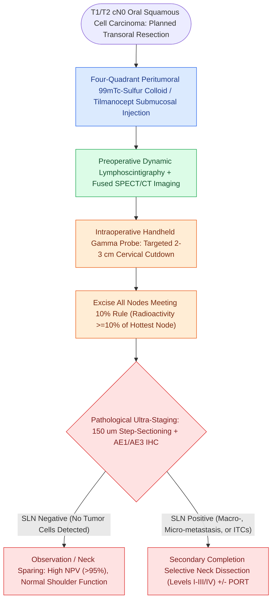

# Sentinel lymph node biopsy accurately stages the clinically negative neck in early oral squamous cell carcinoma while reducing shoulder morbidity

## Active Recall

> [!question]- What quantitative gamma probe rule defines a harvested lymph node as a true sentinel node during radioguided lymphadenectomy for oral cavity carcinoma?
> *Answer / Clinical Rationale*: The **10% Rule**: any lymph node demonstrating in-vivo radioactivity $\ge 3$ times the background count, or exhibiting an ex-vivo radioactivity count **$\ge 10\%$ of the hottest harvested node**, is defined as a sentinel node and must be excised. In addition, any blue-dyed node or palpably firm node encountered during exploration must be harvested regardless of radioactivity.
>
> [!question]- How does pathological ultra-staging with step-serial sectioning and cytokeratin immunohistochemistry improve the negative predictive value of sentinel node biopsy?
> *Answer / Clinical Rationale*: Standard routine single-slice H&E histology evaluates $<1\%$ of a lymph node's total volume, missing up to 20% of occult low-volume deposits. Pathological ultra-staging utilizes **step-serial sectioning at $150\ \mu\text{m}$ intervals** paired with **pan-cytokeratin (AE1/AE3) immunohistochemistry**, detecting micrometastases ($0.2\text{ to }2.0\text{ mm}$) and isolated tumor cells ($<0.2\text{ mm}$), driving the negative predictive value of SLNB to $>95\%$.

## Core Clinical & Mechanistic Principles

In early-stage ([[AJCC 8th edition incorporates depth of invasion into oral cavity T-staging|T1 to T2 oral cavity squamous cell carcinoma]]) with a clinically and radiographically negative neck (cN0), the incidence of occult cervical lymph node metastasis ranges between 20% and 30%:
- **The Overtreatment Dilemma in the cN0 Neck**:
  - The traditional gold standard has been routine upfront [[Elective neck dissection is indicated for oral cavity squamous cell carcinoma with depth of invasion exceeding four millimeters|elective neck dissection]] (END, clearing Levels I–III).
  - Consequently, 70% to 80% of patients without nodal disease undergo unnecessary neck dissection, incurring postoperative morbidity including shoulder pain, spinal accessory nerve neuropraxia, neck stiffness, and sensory loss.
- **The Sentinel Node Concept in Head and Neck Oncology**:
  - The sentinel lymph node (SLN) is the first echelon draining node that directly receives lymphatic channels from the primary tumor bed.
  - If the SLN is pathologically negative for micrometastatic disease, the remaining cervical lymph nodes are histologically tumor-free in $>95\%$ of cases.
- **Radiotracer Administration & Multimodal Mapping**:
  - On the day of surgery, $10\text{ to }40\text{ MBq}$ ($0.2\text{ to }1.0\text{ mCi}$) of Technetium-99m labeled sulfur colloid or tilmanocept is injected in **four equal quadrants submucosally around the periphery of the primary tumor**.
  - Preoperative dynamic planar lymphoscintigraphy combined with single-photon emission computed tomography fused with CT (**SPECT/CT**) provides 3D spatial mapping, distinguishing sentinel nodes from primary injection shine-through and identifying atypical drainage pathways (contralateral neck, Level IV, or facial nodes in 10% to 15% of cases).

### Surgical Technique, The 10% Rule, & Morbidity Reduction

1. **Intraoperative Radioguided Node Harvest**:
   - A collimated handheld gamma probe is placed over the neck before primary tumor excision to record background radioactivity.
   - Small, cosmetic 2.0 to 3.0 cm skin-crease incisions are placed directly over identified hotspots.
   - Nodes are dissected with meticulous bipolar hemostasis. The probe confirms the ex-vivo radioactivity of each node.
   - Dissection continues in that nodal basin until the surgical bed counts drop below 10% of the hottest node, verifying complete sentinel node clearance.
2. **Pathological Ultra-Staging Protocol**:
   - Harvested nodes undergo bisection along the longitudinal axis, formalin fixation, and paraffin embedding.
   - Serial sectioning is performed at $150\ \mu\text{m}$ intervals. Each level is evaluated with hematoxylin and eosin (H&E) and pan-cytokeratin (AE1/AE3) immunohistochemistry to identify isolated tumor cells ($<0.2\text{ mm}$) and micrometastases ($0.2\text{ to }2.0\text{ mm}$).
3. **Oncologic Efficacy & Functional Preservation**:
   - Multi-institutional prospective clinical trials (ACOSOG Z0360, European SENT trial) have confirmed a negative predictive value of **94% to 96%** and an overall survival and disease-free survival equivalent to elective neck dissection.
   - Patients undergoing SLNB demonstrate statistically significant reductions in neck dissection impairment scores, lower incidence of frozen shoulder syndrome, and preservation of the trapezius motor axis.

## Connected Concepts & Graph Traversal

- **Surgical Standard Comparison**: [[Selective neck dissection targets high-risk nodal basins while sparing low-risk cervical levels|Selective Neck Dissection Levels I-III]]
- **Histopathologic Upstaging**: [[Extranodal extension in cervical lymph nodes upstages nodal disease and dictates adjuvant chemoradiotherapy|Extranodal Extension Implications]]
- **Neurovascular Morbidity Sparing**: [[The spinal accessory nerve is identified at the Erb point and anterior border of the SCM|Spinal Accessory Nerve Preservation]]
- **Systemic Trial Validation**: [[The MSLT-1 and MSLT-2 trials establish sentinel lymph node biopsy utility and ultrasound surveillance safety in melanoma|MSLT Sentinel Node Precedents]]
- **Primary Tumor Resection Corridors**: [[Transoral resection provides oncologic access for early-stage anterior oral cavity neoplasms|Transoral Primary Resection]]
