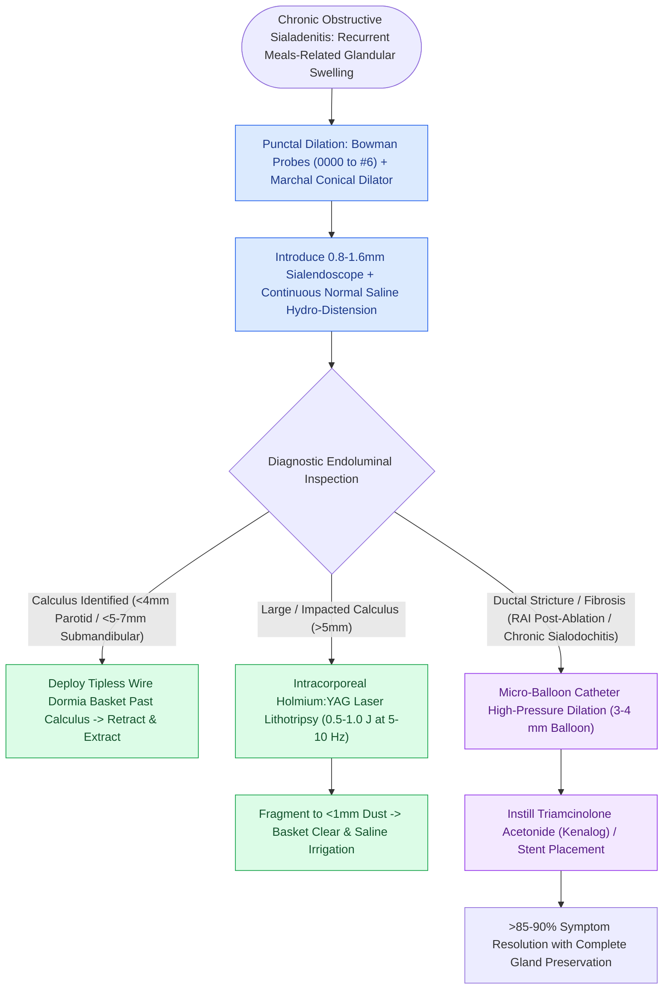

# Sialendoscopy enables diagnostic visualization and stone extraction in chronic obstructive sialadenitis

## Active Recall

> [!question]- What are the size limits for primary wire basket extraction of salivary stones via sialendoscopy without prior lithotripsy?
> *Answer / Clinical Rationale*: Stones **$\le 4\text{–}5\text{ mm}$ in the parotid (Stensen) duct** and **$\le 5\text{–}7\text{ mm}$ in the submandibular (Wharton) duct**.

> [!question]- What common post-ablation condition causes ductal strictures that respond well to sialendoscopic balloon dilation?
> *Answer / Clinical Rationale*: **Radioactive iodine ($^{131}\text{I}$)-induced sialadenitis** following thyroid cancer ablation.

## Core Clinical & Mechanistic Principles
**Sialendoscopy** is a minimally invasive, gland-preserving technique utilizing semi-rigid micro-endoscopes ($0.8\text{–}1.6\text{ mm}$ diameter) to diagnose and treat obstructive ductal disorders:
- **Etiological Distribution of Chronic Obstructive Sialadenitis**:
  - **Sialolithiasis (–70\%$)**: The predominant cause of mechanical ductal obstruction (most commonly in Wharton's duct due to viscous, alkaline, calcium-rich secretions and dependent, uphill flow).
  - **Ductal Stenosis / Strictures (–20\%$)**: Fibrotic strictures resulting from chronic recurrent infection, trauma, autoimmune ductitis (Sjögren syndrome), or post-radioactive iodine ({131}\text{I}$) therapy.
  - **Chronic Non-Calculous Sialodochitis (–10\%$)**: Mucous plugging, intraductal debris, and inflammatory ductal dysmotility without discrete stone or fibrotic web formation.
- **Core Interventional Indications**:
  - Sialolithiasis (calculi $\le 4–5\text{ mm}$ in [[Buccal mucosa carcinoma exhibits high rates of local recurrence and Stensen duct involvement|Stensen]]'s duct; $\le 5–7\text{ mm}$ in Wharton's duct amenable to primary endoscopic basket retrieval).
  - Sialodochitis and ductal strictures amenable to balloon dilation.
  - Diagnostic inspection for unexplained mealtime salivary colic.

- **Technical Steps**:
  1. **Papilla Dilation**: Sequential dilation of the ductal punctum using salivary probes (0000 to #6) or conical dilator under topical/local anesthesia.
  2. **Endoscope Insertion & Continuous Irrigation**: Introduce scope with continuous normal saline or lidocaine irrigation to distend the duct lumen.
  3. **Diagnostic Ductography**: Inspect main duct, comma, and tertiary branches.
  4. **Interventions**:
     - *Wire Basket Extraction*: Deploy tipless basket past stone, open, capture, and withdraw.
     - *Laser Lithotripsy*: Holmium:YAG laser fragmentation of large impacted stones.
     - *Stricture Balloon Dilation*: High-pressure micro-balloon dilation with steroid instillation.

### Surgical Technique & Critical Safety Checks
- **Gland Preservation Rate**: Successfully resolves obstructive symptoms in $>80\text{–}90\%$ of cases, avoiding open [[The facial nerve main trunk is localized using the tragal pointer, tympanomastoid suture, and digastric ridge|parotidectomy]] or submandibular excision.

## Connected Concepts & Graph Traversal
- **Sialolithiasis Management**: [[Salivary gland sialolithiasis management ranges from manual massage to sialendoscopy based on stone size and location|Sialolithiasis Management Tree]]
- **Wharton's Duct Surgical Craft**: [[Wharton duct sialolithiasis is managed with transoral sialodochoplasty or sialendoscopy|Wharton's Duct Sialodochoplasty]]
- **Submandibular Gland Excision**: [[Submandibular gland excision requires preservation of the marginal mandibular, lingual, and hypoglossal nerves|Submandibular Excision Technique]]
- **Superficial Parotidectomy**: [[Superficial parotidectomy dissects the facial nerve branches to resect the lateral salivary lobe|Superficial Parotidectomy]]
- **Acute Suppurative Sialadenitis**: [[Suppurative sialadenitis of the parotid and submandibular glands is treated with hydration, sialagogues, and anti-staphylococcal antibiotics|Suppurative Sialadenitis]]
- **Facial Nerve Trunk Localization**: [[The facial nerve main trunk is localized using the tragal pointer, tympanomastoid suture, and digastric ridge|Facial Nerve Trunk Localization]]
