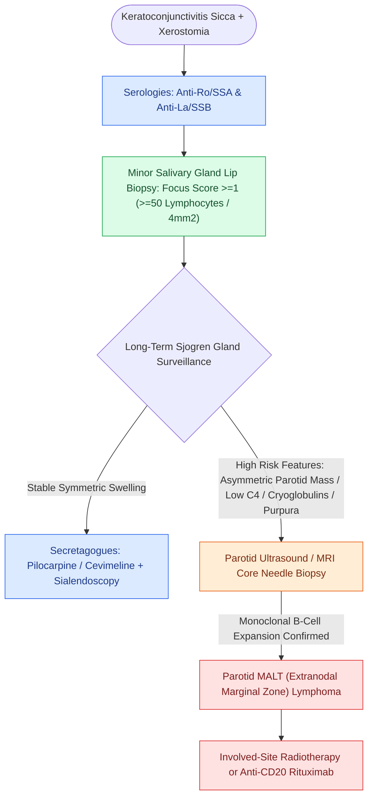

# Sjogren syndrome causes autoimmune sicca with parotid enlargement and markedly elevated MALT lymphoma risk

## Active Recall

> [!question]- State the histologic criterion on lip biopsy and what a 'focus' is.
> *Answer / Clinical Rationale*: Focus score ≥ 1: at least one aggregate of ≥ 50 lymphocytes per 4 mm² of minor salivary tissue.

> [!question]- Which clinical features flag the Sjogren patient at highest lymphoma risk?
> *Answer / Clinical Rationale*: Persistent asymmetric parotid enlargement, cryoglobulinemia/low C4, and palpable purpura — surveillance intensifies and thresholds for biopsy drop.

## Core Clinical & Mechanistic Principles
- Immunopathology: lymphocytic exocrinopathy → xerostomia and keratoconjunctivitis sicca; serology **anti-Ro/SSA (and La/SSB)**; tissue criterion is the **minor salivary (lip) biopsy with focus score of one or more** foci per 4 mm².
- The malignant shadow: substantially elevated **parotid MALT lymphoma** risk (relative risks in the double digits) — risk markers include persistent unilateral gland enlargement, cryoglobulinemia, low C4, and purpura.
- ENT presentations beyond dryness: recurrent sialadenitis, bilateral parotid swelling, dental collapse, dysphagia from xerostomia, hoarseness from dry laryngitis.
- Ultrasound of the glands (heterogeneous hypoechoic foci) has entered diagnosis and surveillance; [[Sialendoscopy enables diagnostic visualization and stone extraction in chronic obstructive sialadenitis|sialendoscopy]] with irrigation palliates ductal disease.

### Management & Critical Safety Checks
- Symptomatic care: secretagogues (pilocarpine/cevimeline), saliva substitutes, aggressive dental prophylaxis, ocular co-management; systemic immunomodulation for extraglandular disease belongs to rheumatology.
- **Any persistent, firm, or asymmetric parotid mass in Sjogren is a biopsy** — this population's 'chronic swelling' hides lymphoma.

## Connected Concepts & Graph Traversal
- **Diagnostic Biopsy Architecture**: [[Suspected cervical lymphoma requires excisional or core biopsy because cytology cannot assess architecture|Lymphoma Biopsy Architecture]]
- **Recurrent Infection Substrate**: [[Acute suppurative sialadenitis affects dehydrated patients and is dominated by Staphylococcus aureus|Suppurative Sialadenitis Risk]]
- **Sialendoscopic Intervention**: [[Sialendoscopy enables diagnostic visualization and stone extraction in chronic obstructive sialadenitis|Diagnostic & Interventional Sialendoscopy]]
- **Benign Parotid Neoplasm**: [[Warthin tumor presents as a cystic parotid neoplasm associated with smoking and bilateral occurrence|Warthin Tumor & Parotid Swelling]]
- **Granulomatous Salivary Disease**: [[Sarcoidosis of the upper respiratory tract causes non-caseating granulomas and mucosal cobblestoning|Sarcoidosis & Heerfordt Syndrome]]
