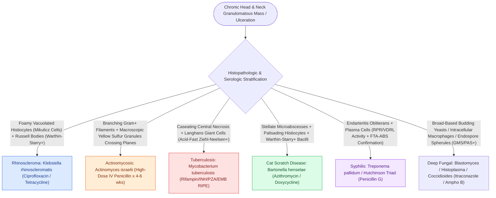

# Specific granulomatous diseases of the head and neck are diagnosed by pathognomonic histology and serological markers

## Active Recall

> [!question]- What are the pathognomonic histological features, diagnostic stains, and causative organisms for Rhinoscleroma, Actinomycosis, Cat Scratch Disease, and Tuberculosis?
> *Answer / Clinical Rationale*: - **Rhinoscleroma (*Klebsiella rhinoscleromatis*)**: Biopsy reveals **Mikulicz cells** (large, foamy, vacuolated histiocytes containing intracellular Gram-negative bacilli on Warthin-Starry silver stain) and **Russell bodies** (eosinophilic, immunoglobulin-packed degenerate plasma cells). - **Actinomycosis (*Actinomyces israelii*)**: Anaerobic, branching, filamentous Gram-positive bacteria forming macroscopic **yellow "sulfur granules"** within suppurative granulomatous abscesses with sinus tracts crossing tissue planes. - **Cat Scratch Disease (*Bartonella henselae*)**: Suppurative necrotizing granulomas with central microabscesses and palisading histiocytes; bacteria identified with **Warthin-Starry silver stain**. - **Tuberculosis (*Mycobacterium tuberculosis*)**: **Caseating granulomas** with central amorphous necrosis, Langhans multinucleated giant cells, and acid-fast bacilli on **Ziehl-Neelsen / Kinyoun stains**.

> [!question]- What are the classical clinical features of early and late congenital syphilis (Hutchinson triad), and how are treponemal vs non-treponemal serologic tests interpreted?
> *Answer / Clinical Rationale*: - **Hutchinson Triad (Late Congenital Syphilis)**: (1) **Hutchinson notched incisors / Mulberry molars**, (2) **Interstitial keratitis**, and (3) **Sensorineural hearing loss** (Hennebert sign positive). - **Serological Testing**: Non-treponemal tests (**RPR / VDRL**) reflect disease activity and correlate with treatment response, while treponemal tests (**FTA-ABS / TP-PA / Treponema IgG**) remain positive for life and confirm diagnostic specificity.

> [!question]- How do mucosal biopsies differentiate deep fungal granulomatous infections (Blastomycosis, Histoplasmosis, Coccidioidomycosis)?
> *Answer / Clinical Rationale*: - **Blastomycosis (*Blastomyces dermatitidis*)**: Large thick-walled spherical yeasts ($8\text{–}15\ \mu\text{m}$) exhibiting **broad-based budding** and pseudoepitheliomatous hyperplasia mimicking squamous cell carcinoma. - **Histoplasmosis (*Histoplasma capsulatum*)**: Small intracellular oval yeasts ($2\text{–}4\ \mu\text{m}$) clustered inside **macrophages** with narrow-based budding (GMS / PAS positive). - **Coccidioidomycosis (*Coccidioides immitis*)**: Large thick-walled **spherules ($20\text{–}100\ \mu\text{m}$) packed with endospores**.

## Core Clinical & Mechanistic Principles
Granulomatous diseases of the head and neck encompass infectious, autoimmune, and idiopathic chronic inflammatory disorders that mimic sinonasal or mucosal malignancy:

### High-Yield Clinical Pearls
- **Pseudoepitheliomatous Hyperplasia (PEH)**: Blastomycosis, granular cell tumor, and rhinoscleroma frequently produce severe PEH on superficial biopsy, often misdiagnosed as well-differentiated squamous cell carcinoma; always perform fungal GMS/PAS and acid-fast stains before radical oncologic resection (see [[Granulomatosis with polyangiitis presents with necrotizing sinonasal granulomas and saddle nose|GPA Wegener Granulomatosis]]).

## Connected Concepts & Graph Traversal
- **Vasculitic Granulomas**: [[Granulomatosis with polyangiitis presents with necrotizing sinonasal granulomas and saddle nose|GPA Wegener Granulomatosis]]
- **Sarcoidosis Syndromes**: [[Heerfordt syndrome uveoparotid fever manifests as a distinct acute presentation of systemic sarcoidosis|Heerfordt Syndrome]]
- **Sinonasal Mycotic Disease**: [[Acute invasive fungal rhinosinusitis requires emergent surgical debridement and systemic amphotericin B|Invasive Fungal Rhinosinusitis]]
- **HIV Manifestations**: [[Head and neck manifestations of HIV encompass Kaposi sarcoma, benign lymphoepithelial cysts of the parotid, and opportunistic infections|HIV in ENT]]
- **Antimicrobial Therapy**: [[Antimicrobial stewardship in otolaryngology selects targeted bactericidal agents based on tissue penetration and pathogen resistance|Antimicrobial Therapeutics]]
- **Autoimmune Mucosal Differential**: [[Oral pemphigus vulgaris, mucous membrane pemphigoid, and lichen planus are distinguished by suprabasilar versus subepithelial clefting and direct immunofluorescence patterns|Oral Pemphigus, MMP & Lichen Planus]]
