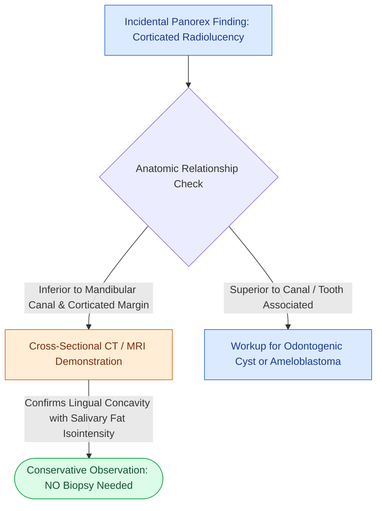

# Stafne bone defects represent asymptomatic cortical lingual mandibular concavities containing ectopic salivary gland tissue

## Active Recall

> [!question]- What is the classic radiographic appearance and anatomical relationship of a posterior Stafne bone defect relative to the inferior alveolar canal?
> *Answer / Clinical Rationale*: A Stafne bone defect appears as a **sharply circumscribed, unilocular, round-to-ovoid radiolucency with a dense corticated border**, located in the posterior body or angle of the mandible **strictly inferior to the mandibular (inferior alveolar) canal** and anterior to the angle of the jaw.

> [!question]- Why is surgical biopsy or exploration contraindicated in classic Stafne bone defects, and what tissue does the defect contain?
> *Answer / Clinical Rationale*: A Stafne bone defect is a benign non-neoplastic anatomical variant (pseudocyst without an epithelial lining) caused by focal cortical depression from the **submandibular gland (or rarely parotid/sublingual gland anteriorly)** containing normal salivary acinar tissue and fat. Because it is static, asymptomatic, and non-progressive, surgical intervention is unnecessary and risks unnecessary [[Level I dissection requires facial vessel ligation and preservation of the lingual and hypoglossal nerves|inferior alveolar or marginal mandibular nerve injury]]; diagnosis is confirmed non-invasively via CT or MRI showing lingual cortical invagination with salivary tissue continuity.

## Core Clinical & Mechanistic Principles
First described by Edward Stafne in 1942, the **Stafne bone defect** (also termed static bone cavity, latent bone cyst, or lingual mandibular salivary gland depression) is an anatomical pseudocyst resulting from developmental remodeling of the lingual cortical plate around lobules of adjacent salivary parenchyma.

### Anatomic Variations and Differential Diagnosis
1. **Anatomic Subtypes**:
   - **Posterior Variant (Classic, >90%)**: Located on the medial/lingual surface of the posterior mandible between the first molar and the mandibular angle, below the inferior alveolar nerve canal, housing [[Suppurative sialadenitis of the parotid and submandibular glands is treated with hydration, sialagogues, and anti-staphylococcal antibiotics|submandibular salivary gland tissue]].
   - **Anterior Variant (Rare)**: Located in the canine-premolar region above the mylohyoid muscle attachment, housing sublingual gland tissue.
   - **Ramus Variant (Extremely Rare)**: Located on the medial aspect of the ascending ramus, housing deep parotid lobe tissue.
2. **Key Radiographic Differentiators**:
   - [[Dentigerous cysts arise from the follicular epithelium surrounding the crown of an unerupted third molar|Dentigerous Cyst]]: Always pericoronal, superior to the alveolar ridge/canal, surrounding an impacted crown.
   - [[Ameloblastoma exhibits multilocular soap-bubble radiolucency and requires segmental resection with one-centimeter bony margins|Ameloblastoma]] & [[Odontogenic keratocysts arise from PTCH1 mutations in Gorlin syndrome and exhibit high recurrence after simple enucleation|OKC]]: Centered superior to the mandibular canal, expansile, non-corticated or multilocular, and progressive.
   - **Traumatic (Simple) Bone Cavity**: Lacks a thick sclerotic rim, scallops between roots of vital teeth, located superior to the canal.

## Connected Concepts & Graph Traversal
- **Odontogenic Pericoronal Differentials**: [[Dentigerous cysts arise from the follicular epithelium surrounding the crown of an unerupted third molar|Dentigerous Cysts]]
- **Neoplastic Jaw Multiloculars**: [[Ameloblastoma exhibits multilocular soap-bubble radiolucency and requires segmental resection with one-centimeter bony margins|Ameloblastoma of the Mandible]]
- **Involved Salivary System**: [[Suppurative sialadenitis of the parotid and submandibular glands is treated with hydration, sialagogues, and anti-staphylococcal antibiotics|Submandibular Gland Physiology]]
- **Adjacent Bony Architecture**: [[Segmental mandibulectomy resects full-thickness bone for medullary invasion and irradiated bone recurrence|Mandibular Cortical & Medullary Anatomy]]
- **Surgical Margin Principles**: [[Level I dissection requires facial vessel ligation and preservation of the lingual and hypoglossal nerves|Submandibular Triangle Landmarks]]
