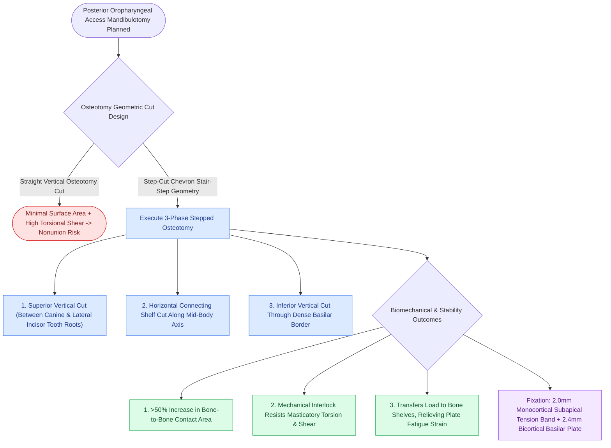

# Step-cut chevron mandibulotomy maximizes bone surface contact and rotational stability

## Active Recall

> [!question]- Why does a step-cut mandibulotomy provide superior stability compared to a straight vertical cut?
> *Answer / Clinical Rationale*: The **interlocking bone shelves** provide intrinsic resistance to torsional forces and increase bone contact surface area for primary healing.

> [!question]- What dual-plate fixation strategy is commonly used for step-cut mandibulotomies?
> *Answer / Clinical Rationale*: An **alveolar tension-band plate** (monocortical) combined with an **inferior basilar border plate** (bicortical).

## Core Clinical & Mechanistic Principles
The geometric design of the mandibulotomy osteotomy significantly influences bone healing and complication rates:
- **Straight Vertical Osteotomy Limitations**: Has minimal bone-to-bone contact area and is prone to rotational slippage and torsional displacement under the powerful forces of the masticatory muscles, increasing non-union rates.
- **Step-Cut (Chevron / Stair-Step) Geometry**:
  - The osteotomy is performed in a stepped fashion: a vertical cut through the superior alveolar bone, a horizontal cut through the mid-body, and a second vertical cut through the inferior basilar cortex.
  - **Biomechanical Advantages**:
    1. **Increased Surface Area**: Expands bone-to-bone contact surface by $>50\%$, accelerating osteogenesis and primary bone union.
    2. **Inherent Rotational Interlock**: The stepped bone shelves mechanically interlock, resisting rotational and vertical shear forces during chewing.
    3. **Decreased Plate Strain**: Transfers mechanical load directly across bone shelves rather than relying solely on the titanium plate.

### Surgical Technique & Critical Safety Checks
- **Fixation Protocol**: Fix with two miniplates (an upper 2.0-mm tension-band plate below the tooth roots and a lower 2.4-mm bicortical basilar plate) or a single heavy reconstruction plate (see [[Lip-split paramedian mandibulotomy provides wide exposure for posterior oral cavity and oropharyngeal tumors|Lip-Split Paramedian Mandibulotomy]]).

## Connected Concepts & Graph Traversal
- **Surgical Approach**: [[Lip-split paramedian mandibulotomy provides wide exposure for posterior oral cavity and oropharyngeal tumors|Lip-Split Paramedian Mandibulotomy]]
- **Dental Occlusion Preservation**: [[Pre-plating the intact mandible before osteotomy preserves accurate dental occlusion and contour|Pre-Plating the Intact Mandible]]
- **AO/ASIF Fixation Standards**: [[Mandibular reconstruction plates require rigid bicortical screw fixation to withstand masticatory load|Mandibular Reconstruction Plates]]
- **Segmental Mandibulectomy**: [[Segmental mandibulectomy resects full-thickness bone for medullary invasion and irradiated bone recurrence|Segmental Mandibulectomy]]
- **Marginal Mandibulectomy**: [[Marginal mandibulectomy preserves basilar bone height when tumor abuts but does not invade marrow|Marginal Mandibulectomy]]
- **Fibula Flap Reconstruction**: [[The fibula osteocutaneous free flap provides up to twenty-five centimeters of vascularized bone for mandible reconstruction|Fibula Free Flap]]
