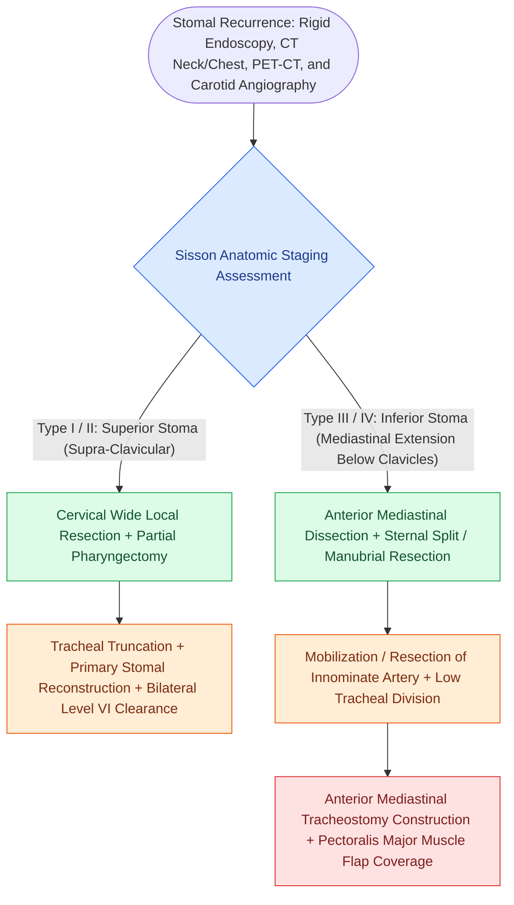

# Stomal recurrence after total laryngectomy is staged by the Sisson classification and requires mediastinal resection with vascularized tissue coverage

## Active Recall

> [!question]- What are the four Sisson classification types for post-laryngectomy stomal recurrence, and what anatomical landmark separates low-risk from mediastinal disease?
> *Answer / Clinical Rationale*: **Type I** involves the superior half of the stoma without esophageal invasion; **Type II** involves the superior half with esophageal or skin involvement; **Type III** involves the inferior half of the stoma extending into the superior mediastinum beneath the clavicles; **Type IV** represents deep mediastinal extension beneath the sternal manubrium. The **clavicular/manubrial plane** marks the boundary where disease transitions from cervical resection to anterior mediastinal dissection.
>
> [!question]- Why does emergency preoperative tracheostomy dramatically escalate the risk of subsequent stomal recurrence, and what surgical countermeasure is indicated?
> *Answer / Clinical Rationale*: Violating the tumor bed during emergency tracheostomy seeds malignant squamous clonogens directly into the peristomal soft tissue, paratracheal lymphatics, and peritracheal fascia, driving stomal recurrence rates from under 5% to over 25% to 40%. Whenever feasible, awake fiberoptic or rigid bronchoscopic intubation or immediate emergency **awake total laryngectomy** should be performed to resect the tumor without violative tracheocutaneous seeding.

## Core Clinical & Mechanistic Principles

**Stomal recurrence** represents the malignant development of tumor at the junction of the amputated trachea and the cutaneous neostoma following [[Total laryngectomy achieves en bloc laryngeal resection with permanent end-stoma|total laryngectomy]], with an incidence of 5% to 15%:
- **Etiological Drivers & Risk Stratification**:
  1. *Subglottic Tumor Extension*: [[Subglottic carcinoma spreads to level VI central compartment lymphatics and mediastinal nodes|subglottic tumors]] directly invade the cricoid cartilage and paratracheal soft tissue, draining into paratracheal (Level VI) lymph nodes abutting the tracheostomal suture line.
  2. *Violative Preoperative Tracheostomy*: Emergency cut-down through obstructive subglottic or transglottic tumor seeds neoplastic cells directly into the peristomal wound bed.
  3. *Inadequate Tracheal Margin*: Resection with $<2.0\text{ cm}$ of gross normal tracheal margin below tumor or microscopic mucosal/cartilaginous margin positivity.
- **The Sisson Staging System**:
  - *Sisson Type I*: Confined to the superior half of the stoma; no esophageal involvement; 5-year survival ~45%.
  - *Sisson Type II*: Involves the superior half of the stoma with esophageal or cutaneous extension; 5-year survival ~35%.
  - *Sisson Type III*: Originates or involves the inferior half of the stoma with direct extension into the superior mediastinum below the level of the clavicles; 5-year survival ~15%.
  - *Sisson Type IV*: Extensive mediastinal involvement extending deeply beneath the manubrium and behind the clavicles, frequently encasing the innominate vessels or tracheal bifurcation; 5-year survival $<5\%$.

### Surgical Technique, Mediastinal Dissection, & Vascular Protection

1. **Anterior Mediastinal Dissection & Manubrial Resection**:
   - Access to Sisson Type III and IV disease requires resection of the manubrium sterni and medial heads of both clavicles (sternoclavicular joints) with an oscillating saw.
   - The retrosternal space is exposed, skeletonizing the brachiocephalic (innominate) veins and the innominate artery.
   - Paratracheal and superior mediastinal (Level VII) fibrofatty nodal basins are dissected en bloc down to the aortic arch and carina.
2. **Construction of the Mediastinal Stoma**:
   - The trachea is divided at least 1.5 cm below gross tumor, often just above the carina.
   - The posterior membranous wall of the tracheal stump is beveled and sutured directly to the prevertebral fascia using heavy 3-0 polyglactin or polydioxanone sutures.
   - The anterior tracheal cartilage is matured to lower pectoral or anterior chest wall cutaneous flaps.
3. **Obliteration of Dead Space & Great Vessel Protection**:
   - Exposed innominate and common carotid arteries must **never be left unprotected** under thin irradiated skin or near tracheal secretions.
   - A bulky, vascularized **pectoralis major muscle flap** or microvascular anterolateral thigh (ALT) / latissimus dorsi free flap is interposed between the tracheal stump and the great vessels to prevent secondary erosion, salivary digestion, and fatal arterial blowout.

## Connected Concepts & Graph Traversal

- **Anatomic Subsite & Spread**: [[Central compartment neck dissection clears level VI nodes between the carotid sheaths and suprasternal notch|Paratracheal Nodal Clearance]]
- **Surgical Staging & Corridors**: [[Superior mediastinal level VII dissection clears paratracheal lymph nodes below the sternal notch|Superior Mediastinal Lymphadenectomy]]
- **Reconstructive Salvage**: [[Pectoralis major muscle flap reinforcement prevents pharyngocutaneous fistula in salvage laryngectomy|Pectoralis Major Flap Reconstruction]]
- **Catastrophic Vascular Risk**: [[Carotid blowout syndrome is classified into threatened, impending, and acute hemorrhage|Great Vessel Blowout]]
- **Pathology & Cartilage Invasion**: [[Hypopharyngeal piriform sinus carcinoma requires partial or total laryngopharyngectomy|Advanced Laryngopharyngeal Carcinoma]]
