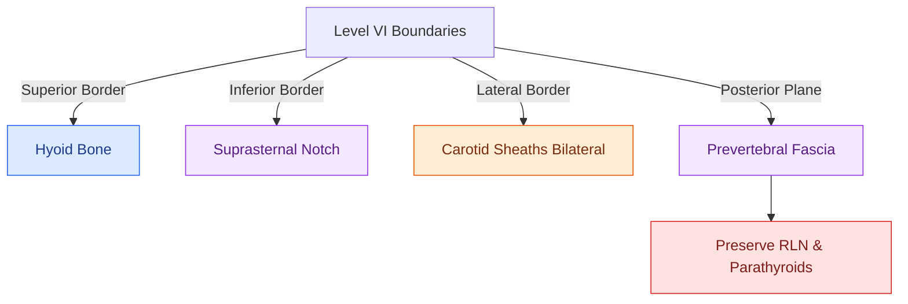

# Subglottic carcinoma spreads to level VI central compartment lymphatics and mediastinal nodes

## Active Recall

> [!question]- What lymph node groups receive direct lymphatic drainage from a subglottic carcinoma?
> *Answer / Clinical Rationale*: The **Delphian (prelaryngeal) nodes**, **Level VI paratracheal nodes**, and **Level VII superior mediastinal nodes**.

> [!question]- Why is subglottic carcinoma frequently diagnosed at an advanced stage?
> *Answer / Clinical Rationale*: Because it produces no early dysphonia or pain, presenting only after the subglottic lumen is $>50\text{–}75\%$ obstructed, causing stridor.

## Core Clinical & Mechanistic Principles
Primary **subglottic squamous cell carcinoma** is rare ($<2\%$ of laryngeal cancers), extending from $5\text{ mm}$ below the true vocal cords down to the inferior border of the cricoid cartilage:
- **Pathophysiology & Presentation**:
  - Symptoms appear late because the subglottis lacks sensory innervation and does not impair phonation until the cricovocal membrane or vocal cords are involved.
  - Presents with progressive inspiratory/biphasic stridor and dyspnea, often misdiagnosed as adult-onset asthma.
- **Lymphatic Drainage Patterns**:
  - Pierces the cricothyroid membrane to drain directly into the **prelaryngeal (Delphian) lymph nodes** and [[Central compartment neck dissection clears level VI nodes between the carotid sheaths and suprasternal notch|Level VI paratracheal nodes]].
  - Drains inferiorly along the trachea into [[Superior mediastinal level VII dissection clears paratracheal lymph nodes below the sternal notch|Level VII superior mediastinal lymph nodes]].
- **Surgical Management**:
  - [[Total laryngectomy achieves en bloc laryngeal resection with permanent end-stoma|Total laryngectomy]] with total thyroidectomy, bilateral Level VI central compartment neck dissection, and superior mediastinal (Level VII) clearance.

### Surgical Technique & Critical Safety Checks
- **Stomal Recurrence Risk**: Highest stomal recurrence rate among all laryngeal cancers; requires wide mediastinal tracheostoma creation and postoperative radiation.

## Connected Concepts & Graph Traversal
- **Central Compartment**: [[Central compartment neck dissection clears level VI nodes between the carotid sheaths and suprasternal notch|Level VI Dissection]]
- **Level VII Dissection**: [[Superior mediastinal level VII dissection clears paratracheal lymph nodes below the sternal notch|Level VII Dissection]]
- **Total Laryngectomy**: [[Total laryngectomy achieves en bloc laryngeal resection with permanent end-stoma|Total Laryngectomy]]
- **Anatomical Foundation**: [[Cervical lymph node levels I through VII define regional metastatic drainage basins]]
- **Surgical Lymphadenectomy**: [[Radical neck dissection removes levels I through V while sacrificing CN XI, the IJV, and the SCM]]
- **Oncologic Resection & Margins**: [[Retromolar trigone carcinoma invades the pterygomandibular raphe and masticator space]]
- **Aerodigestive / Pharyngolaryngeal**: [[Lingual artery branches require clip ligation during TORS base of tongue resection]]
