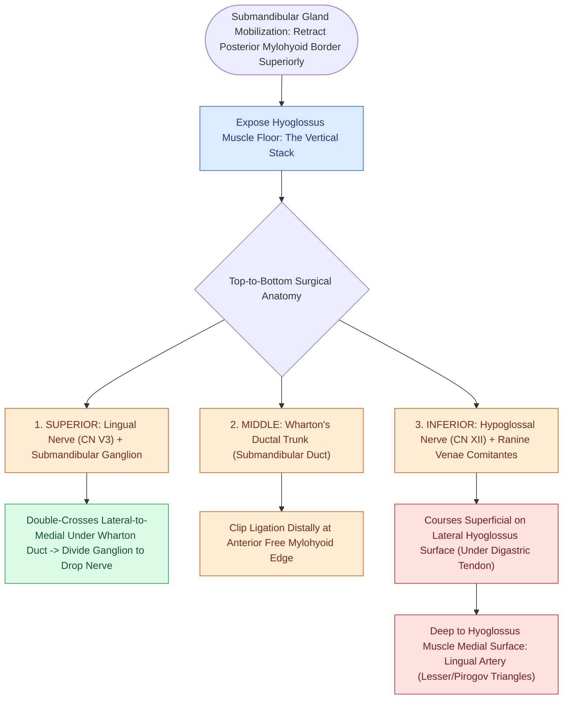

# Submandibular gland excision requires preservation of the marginal mandibular, lingual, and hypoglossal nerves

## Active Recall

> [!question]- Describe the spatial relationship between the lingual nerve and Wharton's duct.
> *Answer / Clinical Rationale*: The lingual nerve **double-crosses Wharton's duct**, beginning **lateral** to the duct, diving **inferior/under** it, and ascending **medial** to it into the floor of mouth musculature.

> [!question]- What muscle separates the hypoglossal nerve from the lingual artery in the submandibular triangle?
> *Answer / Clinical Rationale*: The **hyoglossus muscle**; the hypoglossal nerve (CN XII) and ranine veins run on its superficial lateral surface, while the lingual artery courses deep to its medial surface.

> [!question]- What anatomical boundaries define Pirogov's triangle for lingual artery ligation?
> *Answer / Clinical Rationale*: The **hypoglossal nerve superiorly**, the **posterior free border of the mylohyoid anteriorly**, and the **intermediate tendon of the digastric muscle inferiorly**.

## Core Clinical & Mechanistic Principles
Excision of the **submandibular salivary gland** (for sialolithiasis, chronic sialadenitis, or benign/malignant neoplasms) requires precise mastery of the surgical planes and neural relationships in Level IB:

- **The Vertical Anatomical Stack on the Floor (Hyoglossus Muscle)**:
  - When the submandibular gland is mobilized and the posterior free border of the **mylohyoid muscle** is retracted anteriorly (the "diving board" maneuver), three structures present in a strict vertical stack from superior to inferior:
    1. **Lingual Nerve (CN V3)** (Superior): Lies superiorly, giving off secretomotor fibers through the **submandibular parasympathetic ganglion**. The lingual nerve performs a classic **double-cross** around Wharton's duct (crossing lateral to the duct, dipping under it, and ascending medial to it into the tongue). Dividing the submandibular ganglion drops the lingual nerve safely away from the gland.
    2. **Wharton's (Submandibular) Duct** (Middle): Emerges from the deep lobe, runs anteriorly between mylohyoid and hyoglossus to empty at the sublingual caruncle.
    3. **Hypoglossal Nerve (CN XII)** (Inferior): Runs inferiorly along the surface of the **hyoglossus muscle**, deep to the intermediate tendon of the digastric muscle, accompanied by the **vena comitans (ranine veins)**.

- **Lingual Artery Ligation Windows (Surgical Triangles)**:
  - The **hyoglossus muscle** acts as an anatomical sandwich: **CN XII and ranine veins lie superficial** on its lateral surface, while the **lingual artery lies deep** to its medial surface.
  - Two named surgical triangles provide rapid access to ligate the lingual artery deep to the hyoglossus for severe tongue or transoral hemorrhage:
    - **Lesser's Triangle**: Bounded superiorly by the **hypoglossal nerve (CN XII)** and inferiorly by the **anterior and posterior bellies of the digastric muscle**. Splitting hyoglossus fibers in this triangle exposes the deep lingual artery.
    - **Pirogov's Triangle**: Bounded superiorly by the **hypoglossal nerve (CN XII)**, anteriorly by the **posterior free border of the mylohyoid muscle**, and inferiorly by the **intermediate tendon of the digastric muscle**.

### Surgical Technique & Critical Safety Checks
- **Facial Artery Double Ligation**: The facial artery enters the submandibular triangle deep to the posterior belly of the digastric, grooves the posterior aspect of the gland, and emerges over the mandibular margin. It must be ligated twice: once proximally as it enters the deep surface of the gland, and once distally as it crosses the inferior border of the mandible.
- **Neural Deficits**:
  - *Marginal Mandibular (VII)*: Asymmetric smile (depressor paralysis).
  - *Lingual (V3)*: Ipsilateral anterior tongue numbness and taste loss (chorda tympani).
  - *Hypoglossal (XII)*: Ipsilateral tongue deviation on protrusion (genioglossus weakness) (see [[Level I dissection requires facial vessel ligation and preservation of the lingual and hypoglossal nerves|Level I Dissection]]).

## Connected Concepts & Graph Traversal
- **Level I Dissection**: [[Level I dissection requires facial vessel ligation and preservation of the lingual and hypoglossal nerves|Level I Dissection]]
- **Martin's Maneuver**: [[Subplatysmal flap elevation and Martin's maneuver protect the marginal mandibular nerve|Martin's Maneuver & MMN Protection]]
- **Wharton's Duct**: [[Wharton duct sialolithiasis is managed with transoral sialodochoplasty or sialendoscopy|Wharton's Duct Sialolithiasis]]
- **Facial Nerve Landmarks**: [[The facial nerve main trunk is localized using the tragal pointer, tympanomastoid suture, and digastric ridge|Parotidectomy & CN VII Landmarks]]
- **Selective Neck Dissection**: [[Selective neck dissection targets high-risk nodal basins while sparing low-risk cervical levels|Selective Neck Dissection & Level IB]]
