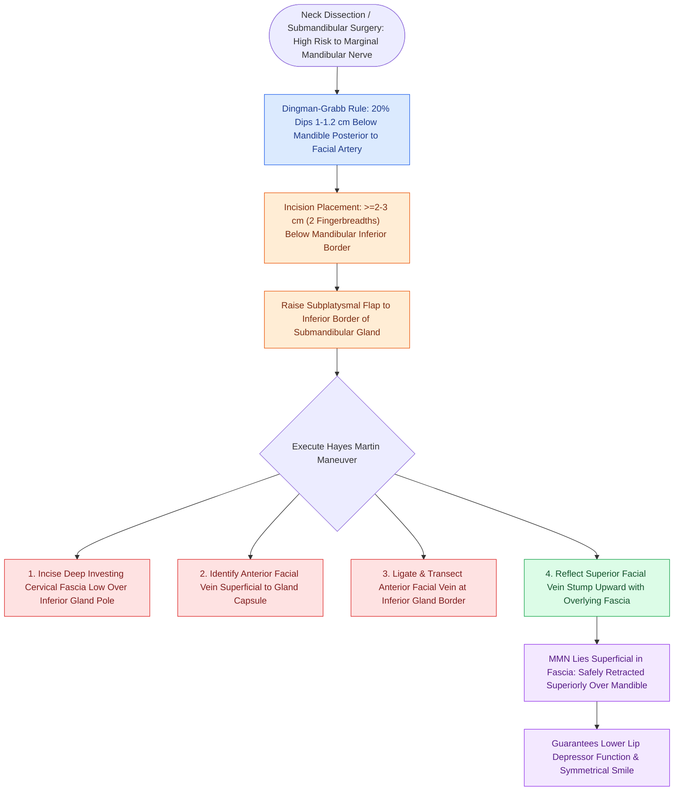

# Subplatysmal flap elevation and Martin's maneuver protect the marginal mandibular nerve

## Active Recall

> [!question]- According to Dingman and Grabb, where does the marginal mandibular nerve dip below the mandibular border?
> *Answer / Clinical Rationale*: In $\sim 20\%$ of individuals, the nerve dips up to $1.0\text{–}1.2\text{ cm}$ below the mandibular border **posterior to the facial artery**; anterior to the facial artery, it is **always above the mandibular border**.

> [!question]- How does Hayes Martin's maneuver anatomically protect the marginal mandibular branch of the facial nerve?
> *Answer / Clinical Rationale*: The nerve lies superficial to the **anterior facial vein**; ligating the vein inferiorly and reflecting its superior stump upward retracts the nerve safely above the mandibular border.

> [!question]- What is the functional deficit resulting from transection of the marginal mandibular nerve?
> *Answer / Clinical Rationale*: Paralysis of the depressor labii inferioris and depressor anguli oris, causing an **asymmetrical 'crooked' smile** due to failure of lower lip depression and eversion on the affected side.

## Core Clinical & Mechanistic Principles
During neck dissection and submandibular surgery, the **marginal mandibular branch of the facial nerve (CN VII)** is at high risk of iatrogenic injury during flap elevation and Level I clearance:
- **Dingman and Grabb Dissection Data (Quantitative Anatomy)**:
  - **Posterior to the Facial Artery**: In **$\sim 19\text{–}20\%$ (1 in 5) of individuals**, the marginal mandibular nerve dips below the inferior border of the mandible (within $1.0\text{–}1.2\text{ cm}$ below).
  - **Anterior to the Facial Artery**: In **$100\%$ of cases**, all marginal mandibular nerve branches course **superior to the inferior border of the mandible**.
  - *Surgical Calibration*: The danger zone is strictly posterior. Submandibular incisions must be placed at least **$2\text{ to }3\text{ cm}$ (two fingerbreadths) below the mandibular border** in a natural skin crease. A nerve found below the border anterior to the facial artery is almost certainly the cervical branch.
- **Facial Vessel Asymmetry**:
  - The **anterior facial vein** runs straight and superficial to the submandibular gland capsule; it is the anatomical handle for Martin's maneuver.
  - The **facial artery** is tortuous, looping from deep to superficial and often grooving or traversing the substance of the submandibular gland before crossing the mandibular border.
- **Martin's Maneuver (Hayes Martin Venous Elevation Technique)**:
  1. Incise the deep investing cervical fascia at the inferior margin of the submandibular gland.
  2. Identify the **anterior facial vein** crossing the lateral surface of the gland.
  3. Ligate and divide the anterior facial vein low at the inferior border of the gland.
  4. Elevate and reflect the superior venous stump upward with the fascia overlying the mandibular border.
  5. Because the marginal mandibular nerve lies superficial to the facial vein within this fascial sheet, this maneuver carries the nerve superiorly out of the dissection field without requiring direct nerve skeletonization.

### Surgical Technique & Critical Safety Checks
- **Subplatysmal Dissection Plane**: Maintain dissection strictly in the loose areolar plane immediately deep to the platysma muscle and superficial to the anterior jugular veins and investing fascia.
- **Clinical Deficit**: Injury causes paralysis of the depressor labii inferioris and depressor anguli oris, resulting in an asymmetrical smile with inability to evert/depress the lower lip (see [[Level I dissection requires facial vessel ligation and preservation of the lingual and hypoglossal nerves|Level I Dissection & Facial Vessels]]).

## Connected Concepts & Graph Traversal
- **Level I Dissection Standards**: [[Level I dissection requires facial vessel ligation and preservation of the lingual and hypoglossal nerves|Level I Dissection & Facial Vessels]]
- **Submandibular Sialoadenectomy**: [[Submandibular gland excision requires preservation of the marginal mandibular, lingual, and hypoglossal nerves|Submandibular Gland Excision]]
- **Facial Nerve Trunk Localization**: [[The facial nerve main trunk is localized using the tragal pointer, tympanomastoid suture, and digastric ridge|Parotidectomy & CN VII Trunk]]
- **Selective Lymphadenectomy**: [[Selective neck dissection targets high-risk nodal basins while sparing low-risk cervical levels|Selective Neck Dissection]]
- **Elective Neck Dissection Indications**: [[Elective neck dissection is indicated for oral cavity squamous cell carcinoma with depth of invasion exceeding four millimeters|Elective Neck Dissection]]
- **Superficial Parotidectomy**: [[Superficial parotidectomy dissects the facial nerve branches to resect the lateral salivary lobe|Superficial Parotidectomy]]
