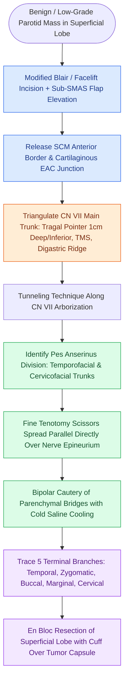

# Superficial parotidectomy dissects the facial nerve branches to resect the lateral salivary lobe

## Active Recall

> [!question]- What anatomical structure defines the plane between the superficial and deep lobes of the parotid gland?
> *Answer / Clinical Rationale*: The branching arborization of the **facial nerve (CN VII)**.

> [!question]- What surgical maneuver is used to dissect along the facial nerve branches without causing traction injury?
> *Answer / Clinical Rationale*: The **tunneling technique**, spreading fine scissors parallel and directly superficial to the nerve before dividing overlying parenchyma with bipolar cautery.

## Core Clinical & Mechanistic Principles
**Superficial (lateral) parotidectomy** involves the en bloc resection of all parotid tissue lateral to the plane of the facial nerve:
- **Anatomical Dividing Plane**: The parotid gland has no true anatomical capsule dividing it into lobes; the **facial nerve branches define the artificial surgical plane** separating the superficial lobe ($80\%$ of volume) from the deep lobe ($20\%$).
- **Surgical Step-by-Step Execution**:
  1. **Modified Blair or Facelift Incision**: Preauricular crease extending around the lobule into the upper cervical skin crease.
  2. **Anterior Flap Elevation**: Elevate [[The superficial musculoaponeurotic system divides facial fat into distinct surgical planes|superficial musculoaponeurotic system (SMAS)]] / skin flap in the sub-SMAS or pre-parotid fascia plane.
  3. **Posterior & Inferior Mobilization**: Separate anterior SCM border and cartilaginous external auditory canal off the parotid capsule.
  4. **Main Trunk Identification**: Triangulate CN VII using the tympanomastoid suture, tragal pointer, and digastric muscle.
  5. **Branch Dissection (Tunneling Technique)**: Spread fine tenotomy scissors directly on top of each nerve branch, divide overlying parenchyma with bipolar cautery, and trace all five terminal branches (temporal, zygomatic, buccal, marginal mandibular, cervical) to the anterior border of the gland.

### Surgical Technique & Critical Safety Checks
- **Technical Hazards**:
  - *Thermal Injury*: Use micro-bipolar cautery with cold saline irrigation near nerve branches.
  - *Tumor Spillage*: Avoid dissecting directly on a [[Pleomorphic adenoma requires superficial parotidectomy with a cuff of normal tissue to prevent pseudopod recurrence|pleomorphic adenoma]] capsule; maintain a cuff of normal parotid tissue.

## Connected Concepts & Graph Traversal
- **Main Trunk Localization**: [[The facial nerve main trunk is localized using the tragal pointer, tympanomastoid suture, and digastric ridge|CN VII Truncal Landmarks]]
- **Pleomorphic Adenoma Pseudopods**: [[Pleomorphic adenoma requires superficial parotidectomy with a cuff of normal tissue to prevent pseudopod recurrence|Pleomorphic Adenoma Craft]]
- **Total Parotidectomy**: [[Total parotidectomy with facial nerve sacrifice is indicated for direct malignant nerve invasion|Total Parotidectomy with CN VII Sacrifice]]
- **Warthin Tumor**: [[Warthin tumor presents as a cystic parotid neoplasm associated with smoking and bilateral occurrence|Warthin Tumor]]
- **Mucoepidermoid Carcinoma**: [[Mucoepidermoid carcinoma is graded by AFIP Brandwein criteria and driven by CRTC1-MAML2 translocation|Mucoepidermoid Carcinoma]]
- **Frey Syndrome Prevention**: [[Frey syndrome results from aberrant auriculotemporal reinnervation of sweat glands after parotidectomy|Frey Syndrome Pathophysiology]]
