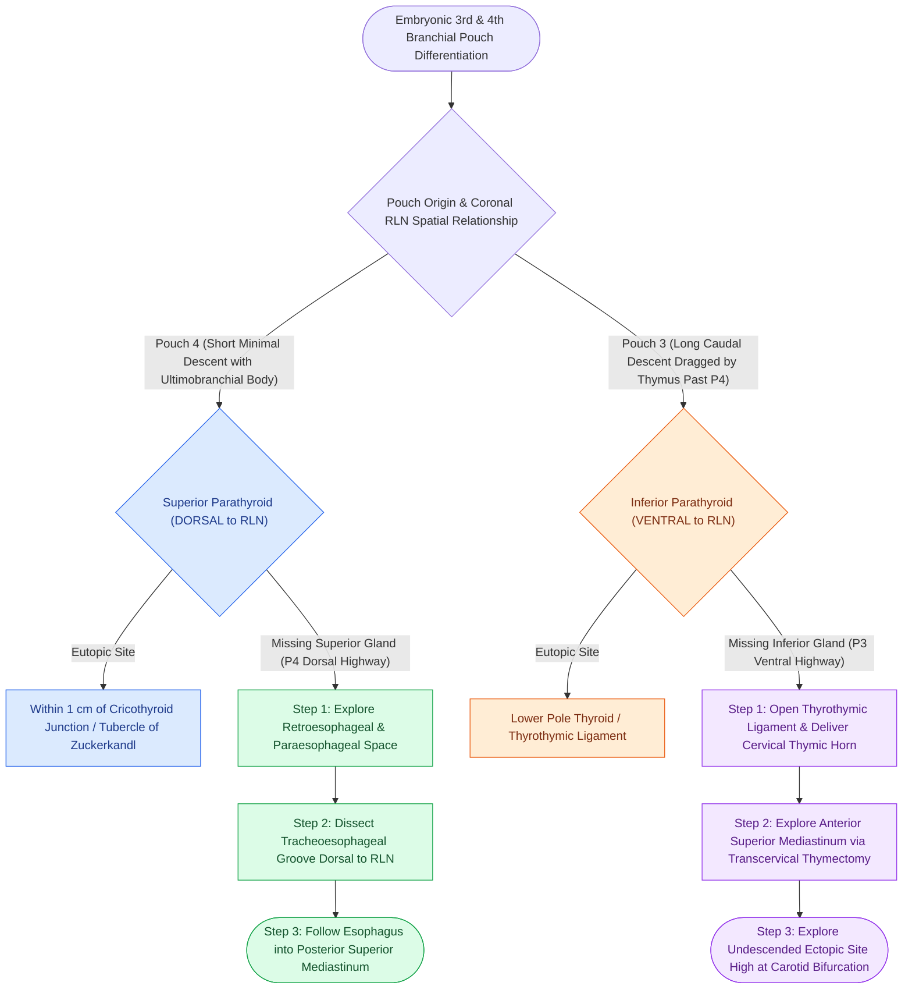

# Superior and inferior parathyroid glands maintain constant anatomical relationships to the RLN and ITA

## Active Recall

> [!question]- How does the coronal plane of the recurrent laryngeal nerve distinguish superior from inferior parathyroid glands?
> *Answer / Clinical Rationale*: **Superior parathyroid glands (4th pouch)** lie **dorsal (posterior)** to the coronal plane of the RLN, whereas **inferior parathyroid glands (3rd pouch)** lie **ventral (anterior)** to the RLN plane.

> [!question]- What is the stepwise search algorithm when an inferior parathyroid adenoma cannot be identified eutopically?
> *Answer / Clinical Rationale*: Follow the P3 migration highway: (1) inspect the **thyrothymic ligament**, (2) deliver the **cervical thymus**, (3) explore the **anterior mediastinum**, and (4) check for an **undescended gland at the carotid bifurcation**.

> [!question]- What three anatomical structures co-cluster at the tubercle of Zuckerkandl?
> *Answer / Clinical Rationale*: The **superior parathyroid gland**, the **recurrent laryngeal nerve** (passing medial/deep to it), and **parafollicular C-cells** (marking the ultimobranchial fusion scar).

## Core Clinical & Mechanistic Principles
The four parathyroid glands exhibit highly predictable anatomical locations governed by the **pouch migration rule**: *the farther an embryonic structure migrates, the more variable its final adult position*:

- **The Coronal Plane of the RLN & Pouch Derivation**:
  - **Superior Parathyroid Glands (Pouch 4 / Parathyroid IV)**:
    - *Embryology*: Arise from the dorsal wing of the **4th branchial pouch** alongside the ultimobranchial body (**parafollicular C-cells**).
    - *Migration*: Short, minimal caudal migration; remains constant in position.
    - *Spatial Plane*: Always lie **dorsal (posterior) to the coronal plane of the recurrent laryngeal nerve**, typically within $1.0\text{ cm}$ of the cricothyroid junction and posterolateral to the thyroid lobe.
    - *Tubercle of Zuckerkandl*: Represents the fusion scar of the lateral ultimobranchial body and median thyroid anlage. Three critical structures co-cluster here: **parafollicular C-cells** (explaining [[Medullary thyroid carcinoma arises from parafollicular C cells and mandates RET testing with calcitonin surveillance|medullary thyroid carcinoma]] geography in the upper two-thirds), the **superior parathyroid gland**, and the **RLN** ducking medial/deep to the tubercle.
  - **Inferior Parathyroid Glands (Pouch 3 / Parathyroid III)**:
    - *Embryology*: Arise from the dorsal wing of the **3rd branchial pouch** alongside the developing thymus (thymopharyngeal duct).
    - *Migration*: Long caudal descent dragged by the migrating thymus past Pouch 4 derivatives; highly variable final position.
    - *Spatial Plane*: Always lie **ventral (anterior) to the coronal plane of the recurrent laryngeal nerve**, typically near the inferior thyroid pole or within the thyrothymic ligament.

- **The Missing-Parathyroid Algorithm (Applied Embryology)**:
  - When an adenoma is not found in its eutopic position during parathyroidectomy, the surgeon executes a structured search along the embryologic highway:
  - **Missing Inferior Gland (P3 Algorithm — Ventral & Caudal Track)**:
    1. Dissect and open the **thyrothymic ligament**.
    2. Mobilize and deliver the **cervical thymic horn** into the neck.
    3. Explore the **anterior superior mediastinum** via transcervical thymectomy.
    4. Explore the **undescended ectopic position** high at the carotid bifurcation (failure of P3 migration).
  - **Missing Superior Gland (P4 Algorithm — Dorsal & Posterior Track)**:
    1. Explore the **retroesophageal / paraesophageal space** (behind the pretracheal fascia).
    2. Dissect into the **tracheoesophageal groove** dorsal to the RLN.
    3. Follow the esophagus into the **posterior superior mediastinum**.
  - **Intrathyroidal Location**: The final resort for either gland, addressed via thyroidotomy or lobectomy if ultrasound/sestamibi confirms an intraparenchymal adenoma.

### Surgical Technique & Critical Safety Checks
- **Dominant Arterial Supply & Capsular Dissection**:
  - *Inferior Thyroid Artery (ITA) Dominance*: The **inferior thyroid artery provides the predominant arterial blood supply to both parathyroid pairs**—nourishing $>90\%$ of inferior parathyroid glands and approximately $80\%$ of superior parathyroid glands (via an ascending branch of the ITA, with only $20\%$ supplied primarily by the superior thyroid artery).
  - *Capsular Dissection Technique*: Meticulous capsular dissection hugging the true thyroid capsule medial to the parathyroid glands preserves these delicate, end-arterial terminal branches and prevents postoperative devascularization and transient/permanent hypoparathyroidism.
- **Parathyroid Vitality Check**: A devascularized gland turns dark brown/black. Confirm parathyroid tissue by biopsy (sinks in saline, unlike fat which floats), finely mince into $1\text{-mm}$ fragments, and reimplant into individual pockets in the sternocleidomastoid muscle.

## Connected Concepts & Graph Traversal
- **Branchial Apparatus Generative Code**: [[Each branchial arch packages one nerve, one artery, one cartilage bar, and one muscle group|Branchial Apparatus Generative Code]]
- **RLN Identification**: [[The recurrent laryngeal nerve is identified within Simon's triangle and followed through Berry's ligament|RLN Simon's Triangle]]
- **Parathyroid Autotransplantation**: [[Devascularized parathyroid glands require confirmation biopsy and autotransplantation into the SCM|Parathyroid Autotransplantation]]
- **Primary Hyperparathyroidism**: [[Primary hyperparathyroidism is caused by single adenomas, multigland hyperplasia, or parathyroid carcinoma|Primary Hyperparathyroidism]]
- **Miami Criteria**: [[The Miami criterion requires a fifty percent intraoperative PTH drop at ten minutes post-excision|Miami Criteria]]
- **Medullary Thyroid Carcinoma**: [[Medullary thyroid carcinoma arises from parafollicular C cells and mandates RET testing with calcitonin surveillance|Medullary Thyroid Carcinoma & C-Cells]]
