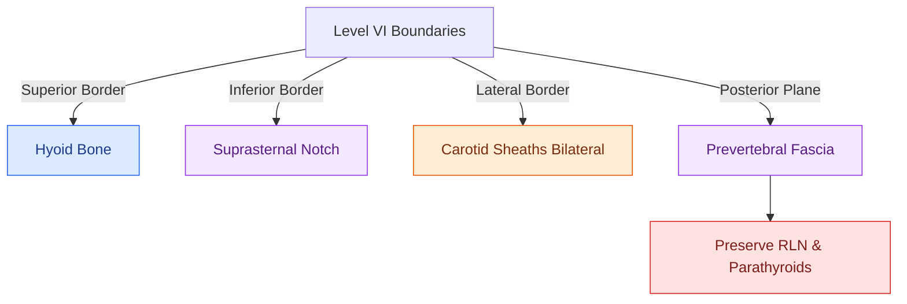

# Superior mediastinal level VII dissection clears paratracheal lymph nodes below the sternal notch

## Active Recall

> [!question]- What anatomical structure marks the inferior boundary of Level VII lymph nodes?
> *Answer / Clinical Rationale*: The **innominate (brachiocephalic) artery**.

> [!question]- Under what conditions is a manubriotomy or sternotomy required for Level VII dissection?
> *Answer / Clinical Rationale*: When bulky, fixed metastatic nodes extend deep into the mediastinum below the aortic arch or cannot be safely mobilized transcervically.

## Core Clinical & Mechanistic Principles
**Level VII (Superior Mediastinal Lymph Nodes)** encompasses the paratracheal and pretracheal lymph nodes situated below the suprasternal notch:
- **Anatomical Boundaries**:
  - **Superior Boundary**: Superior border of the manubrium / suprasternal notch.
  - **Inferior Boundary**: Innominate (brachiocephalic) artery bifurcation / aortic arch.
  - **Lateral Boundaries**: Mediastinal pleural reflections and common carotid arteries.
  - **Anterior Boundary**: Posterior surface of the sternal manubrium.
  - **Posterior Boundary**: Trachea and esophagus over the vertebral bodies (T1–T4).
- **Indications**: Advanced papillary/[[Medullary thyroid carcinoma arises from parafollicular C cells and mandates RET testing with calcitonin surveillance|medullary thyroid carcinoma]] with gross inferior paratracheal extension, subglottic laryngeal SCC, and cervical esophageal cancer.
- **Surgical Approach**: Can often be accessed via a transcervical collar incision with blunt and sharp dissection into the anterior mediastinum; manubriotomy or median sternotomy is required for bulky, fixed disease.

### Surgical Technique & Critical Safety Checks
- **Technical Hazards**:
  - **Innominate Artery**: Crosses anterior to the trachea; must be protected from traction injury.
  - **Recurrent Laryngeal Nerves**: The left [[The recurrent laryngeal nerve is identified within Simon's triangle and followed through Berry's ligament|RLN]] loops around the aortic arch in the mediastinum; the right loops around the subclavian artery at the thoracic inlet.

## Connected Concepts & Graph Traversal
- **Central Compartment**: [[Central compartment neck dissection clears level VI nodes between the carotid sheaths and suprasternal notch|Level VI Dissection]]
- **Thyroid Cancer**: [[Papillary thyroid carcinoma spreads via cervical lymphatics to central and lateral neck compartments|Papillary Thyroid Carcinoma]]
- **Subglottic SCC**: [[Subglottic carcinoma spreads to level VI central compartment lymphatics and mediastinal nodes|Subglottic Carcinoma]]
- **Anatomical Foundation**: [[The danger space permits unrestricted infection spread from skull base to posterior mediastinum]]
- **Surgical Lymphadenectomy**: [[Cervical chyle leaks are managed with MCT diet, octreotide, or surgical thoracic duct ligation]]
- **Oncologic Resection & Margins**: [[Retromolar trigone carcinoma invades the pterygomandibular raphe and masticator space]]
- **Aerodigestive / Pharyngolaryngeal**: [[Lingual artery branches require clip ligation during TORS base of tongue resection]]
