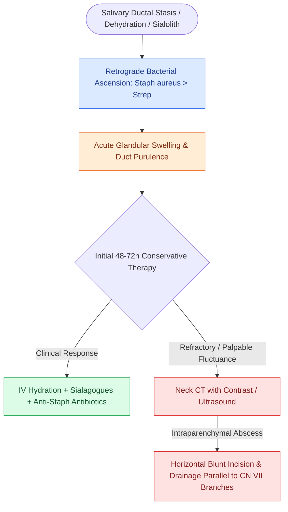

# Suppurative sialadenitis of the parotid and submandibular glands is treated with hydration, sialagogues, and anti-staphylococcal antibiotics

## Active Recall

> [!question]- Why is the parotid gland more frequently affected by acute suppurative bacterial sialadenitis than the submandibular gland?
> *Answer / Clinical Rationale*: The parotid gland secretes purely **serous saliva**, which contains lower concentrations of protective mucins, lysozymes, and IgA antibodies compared to the mixed seromucous secretion of the submandibular gland. Furthermore, Stensen's duct is wider, facilitating easier retrograde ascension of oral bacteria during periods of systemic dehydration and decreased salivary flow rate.

> [!question]- In what direction must blunt dissection be oriented when draining an intra-parotid abscess, and why?
> *Answer / Clinical Rationale*: In a **horizontal direction parallel to the peripheral branches of the facial nerve (CN VII)**. Spreading bluntly with a hemostat along the horizontal axis of the nerve branches prevents accidental transection of the temporal, zygomatic, buccal, marginal mandibular, or cervical branches.

## Core Clinical & Mechanistic Principles

**Acute suppurative sialadenitis** is an acute bacterial infection of the major salivary glands, most commonly involving the **parotid gland** (acute [[Acute suppurative sialadenitis affects dehydrated patients and is dominated by Staphylococcus aureus|suppurative parotitis]]) and less frequently the **submandibular gland**. Pathophysiologically, the parotid gland produces purely serous secretions that have lower baseline mucin and lysozyme content than the mixed mucous secretions of the submandibular gland, rendering it more vulnerable to retrograde bacterial ascension from the oral cavity.

The primary predisposing etiology is **salivary stasis and ductal hyposecretion** triggered by dehydration, debilitation, general anesthesia, anticholinergic medications, ductal obstruction (**sialolithiasis**), or autoimmune disease ([[Sarcoidosis of the upper respiratory tract causes non-caseating granulomas and mucosal cobblestoning|Sjögren syndrome]]). The predominant pathogen is **Staphylococcus aureus** (~50–70%, including community-acquired MRSA), followed by *Streptococcus viridans*, *Streptococcus pneumoniae*, and anaerobes.

Clinically, patients present with rapid-onset unilateral preauricular or submandibular pain, severe warmth, overlying erythema, and marked glandular tenderness. Diagnostic physical examination involves gentle bimanual massage of the involved gland along the ductal axis toward the papilla:
- **Stensen's duct** (opposite the upper second maxillary molar) for the parotid.
- **Wharton's duct** (sublingual caruncle adjacent to the lingual frenulum) for the submandibular gland.
Exudation of frank, cloudy **purulence from the duct orifice** confirms suppurative sialadenitis and provides specimen for Gram stain and culture.

### Surgical Technique & Craft Nuance: Medical Escalation & Abscess Drainage

1. **Conservative Medical Regimen**:
   - **Hydration**: Aggressive intravenous or oral fluid resuscitation to restore salivary flow volume.
   - **Antimicrobial Therapy**: Intravenous **Ampicillin-sulbactam (Unasyn 1.5–3.0 g IV q6h)** or **Cefazolin (1–2 g IV q8h)**; add **Vancomycin** if MRSA is suspected or in hospital-acquired infections. Transition to oral amoxicillin-clavulanate or cephalexin once improving.
   - **Sialagogues & Physical Therapy**: Sour lemon drops, sugar-free tart candy, or ascorbic acid tablets to chemically stimulate saliva production. Apply warm moist compresses to the cheek/neck followed by gentle milking/massage along the duct from posterior to anterior. Discontinue any anticholinergic drugs.
2. **Imaging Evaluation**: Contrast-enhanced CT or ultrasound is indicated if the patient fails to improve after 48–72 hours of medical therapy, or if fluctuance is palpable, to distinguish diffuse cellulitis from discrete **intra-parenchymal parotid abscess**.
### Key Consultation Supplies
- Coaxial surgical headlight
- Wooden tongue depressors
- Sterile culture swabs and collection traps (for aerobic and anaerobic cultures)
- Lemon drops / sour candy / ascorbic acid packets (sialagogues)
- Ultrasound machine with high-frequency linear probe and sterile sheath / acoustic gel
- 18-gauge and 27-gauge needles with 10 mL Luer-lock control syringe for aspiration
- 1% lidocaine with 1:100,000 epinephrine
- Alcohol and betadine prep pads

## References
1. Abdel Razek, A.A.K., Mukherji, S. (2017). Imaging of sialadenitis. *Neuroradiol J*, 30(3):205-215.
2. Jackson, N.M., Mitchell, J.L., Walvekar, R.R. (2020). Inflammatory Disorders of the Salivary Glands. In Flint, P.W., et al. (Eds.), *Cummings Otolaryngology Head and Neck Surgery* 7e (pp. 1157-1170). Philadelphia, PA: Elsevier.
3. Roland, L.T., Skillington, S.A., Ogden, M.A. (2017). Sialendoscopy-assisted transfacial removal of parotid sialoliths: A systematic review and meta-analysis. *Laryngoscope*, 127(11):2510-2516.
4. Walvekar, R.R., Bowen, M.A. (2013). Nonneoplastic Disease of the Salivary Glands. In Johnson, J.J., Rosen, C.A. (Eds.), *Bailey’s Head and Neck Surgery-Otolaryngology* 5e (pp. 702-716). Baltimore, MD: Lippincott Williams & Wilkins.

## Connected Concepts & Graph Traversal

- **Anatomical Facial Nerve Protection**: [[The facial nerve main trunk is localized using the tragal pointer, tympanomastoid suture, and digastric ridge|Facial Nerve Landmarks in Parotid]]
- **Neoplastic Differential**: [[Pleomorphic adenoma requires superficial parotidectomy with a cuff of normal tissue to prevent pseudopod recurrence|Pleomorphic Adenoma]]
- **Cystic Salivary Neoplasm**: [[Warthin tumor presents as a cystic parotid neoplasm associated with smoking and bilateral occurrence|Warthin Tumor]]
- **Autoimmune Ductal Hyposecretion**: [[Sarcoidosis of the upper respiratory tract causes non-caseating granulomas and mucosal cobblestoning|Sjögren & Sarcoidosis]]
- **Deep Space Spread**: [[Deep neck space infections spread along cervical fascial planes between the pharynx, mediastinum, and skull base|Parapharyngeal Space Infection]]
