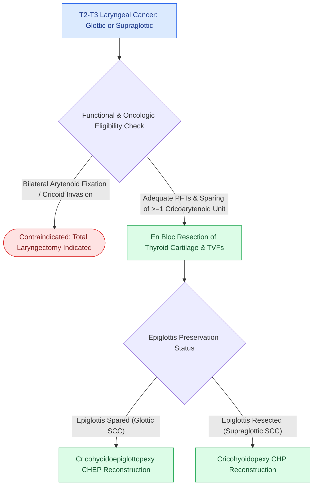

# Supracricoid partial laryngectomy achieves organ preservation for T2 to T3 laryngeal cancer by resecting the thyroid cartilage while preserving at least one cricoarytenoid unit

## Active Recall

> [!question]- What anatomical structures are resected versus preserved in a supracricoid partial laryngectomy (SCPL), and what reconstructive pexy options are used?
> *Answer / Clinical Rationale*: SCPL resects the entire **thyroid cartilage, both true vocal folds, both false vocal folds, and the paraglottic spaces**. Preservation of the **complete cricoid ring, hyoid bone, at least one functional cricoarytenoid unit (arytenoid cartilage, recurrent and superior laryngeal nerves, and cricoarytenoid musculature)** is mandatory. Reconstruction is performed via **cricohyoidoepiglottopexy (CHEP)** when the suprahyoid epiglottis is preserved (for glottic cancer) or **cricohyoidopexy (CHP)** when the entire epiglottis and pre-epiglottic space are resected (for supraglottic cancer).

> [!question]- What are the absolute contraindications to supracricoid partial laryngectomy?
> *Answer / Clinical Rationale*: Absolute contraindications include **fixation/invasion of both cricoarytenoid joints or bilateral arytenoid cartilage involvement**, **subglottic tumor extension involving the cricoid ring (>5–10 mm anteriorly or >3 mm posteriorly)**, **thyroid cartilage extralaryngeal soft tissue extension (T4a)**, **hyoid bone invasion**, and **severe baseline pulmonary dysfunction (FEV1 <50%)** due to obligatory postoperative aspiration during deglutition rehabilitation.

## Core Clinical & Mechanistic Principles
**Supracricoid partial laryngectomy (SCPL)** is an open organ-preservation surgical procedure bridging the gap between conservative transoral laser microsurgery and total laryngectomy. It permits oncologic en bloc resection of advanced [[AJCC 8th edition incorporates depth of invasion into oral cavity T-staging|T2 and selected T3 glottic or supraglottic squamous cell carcinomas]] while sparing natural speech, deglutition, and a permanent stoma.

### Biomechanics, Swallowing Rehabilitation & Craft Nuance
1. **The Neoglottis Biomechanics**:
   - Phonatory function and airway protection rely entirely on the preserved cricoarytenoid unit swinging forward against the base of tongue and preserved hyoid/epiglottic remnant to create a vibrating neoglottis.
2. **Reconstruction Anchoring (The Pexy Sutures)**:
   - Three heavy, non-absorbable (#1 or #2 braided) sutures are placed submucosally around the cricoid cartilage rings and anchored through the hyoid bone (and epiglottic base in CHEP), bringing the cricoid into direct contact with the hyoid to eliminate dead space and elevate the subglottis.
3. **Postoperative Functional Course**:
   - Temporary tracheotomy and nasogastric feeding tube are mandatory. Aspiration is universal in the immediate postoperative period; decannulation occurs once the patient achieves functional supraglottic swallow coordination under intensive speech-language pathology guidance.

## Connected Concepts & Graph Traversal
- **Conventional Staging**: [[AJCC 8th edition incorporates depth of invasion into oral cavity T-staging|AJCC Laryngeal Staging]]
- **Chemoradiation Alternative**: [[Intensity-modulated radiation therapy and cisplatin radiosensitization form the standard definitive chemoradiation regimen|Definitive Chemoradiotherapy Regimens]]
- **Total Laryngectomy Bailout**: [[Radical neck dissection removes levels I through V while sacrificing CN XI, the IJV, and the SCM|Comprehensive Neck Dissection]]
- **Anatomical Boundaries**: [[The carotid sheath is composed of all three layers of deep cervical fascia and forms a vertical neurovascular conduit|Deep Neck Fascia & Spaces]]
- **Nerve Preservation**: [[The recurrent laryngeal nerve is identified within Simon's triangle and followed through Berry's ligament|Recurrent Laryngeal Nerve Anatomy]]
