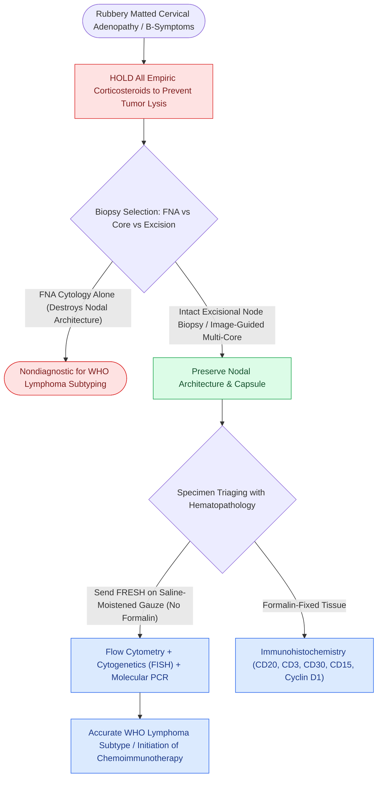

# Suspected cervical lymphoma requires excisional or core biopsy because cytology cannot assess architecture

## Active Recall

> [!question]- Why does FNA fail lymphoma even when it 'sees lymphocytes'?
> *Answer / Clinical Rationale*: Subclassification requires nodal architecture (follicular pattern, capsular relationships) and comprehensive immunophenotyping — cytology destroys the architecture the diagnosis lives in.

> [!question]- What perioperative instruction protects the diagnostic yield of the specimen?
> *Answer / Clinical Rationale*: No corticosteroids before biopsy, and the node travels fresh (not in formalin) for flow cytometry and molecular studies.

## Core Clinical & Mechanistic Principles
- The principle: lymphoma classification is **architectural and immunophenotypic** — FNA cytology can suggest but cannot subtype; the diagnostic specimen is an **excisional node** (or generous cores with flow cytometry when excision is impractical).
- Suspicion profile: rubbery matted nodes, B symptoms (fever, night sweats, weight loss), generalized or supraclavicular adenopathy, Waldeyer ring asymmetry, alcohol-induced nodal pain (classic if rare).
- **Hold the steroids**: empiric corticosteroids before biopsy lyse lymphoma and can render the specimen nondiagnostic — the well-meaning 'trial of prednisone' is a diagnostic self-sabotage.
- Node selection matters: choose the largest accessible abnormal node (avoid inguinal when alternatives exist), send **fresh** for flow cytometry, cytogenetics, and molecular studies — formalin forecloses half the workup.

### Management & Critical Safety Checks
- The otolaryngologist's job is a clean, complete, fresh-tissue excision with basin awareness (XI in level V, marginal branch in Ib) and coordination with hematopathology before the incision.
- Waldeyer-ring presentations (unilateral tonsil asymmetry in the wrong-age patient) are biopsied as tissue, not swabbed as pharyngitis (see [[Cervical lymph node levels I through VII define regional metastatic drainage basins|Cervical Node Basin Mapping]]).

## Connected Concepts & Graph Traversal
- **Cervical Nodal Drainage**: [[Cervical lymph node levels I through VII define regional metastatic drainage basins|Cervical Node Basin Mapping]]
- **Squamous Metastatic Counterpart**: [[HPV-positive carcinoma of unknown primary is localized by palatine tonsillectomy and TORS lingual mucosectomy|Carcinoma of Unknown Primary Workup]]
- **Autoimmune MALT Lymphoma**: [[Sjogren syndrome causes autoimmune sicca with parotid enlargement and markedly elevated MALT lymphoma risk|Sjogren and MALT Lymphoma]]
- **Rapidly Growing Thyroid Mass**: [[Anaplastic thyroid carcinoma is an airway and molecular emergency requiring immediate BRAF testing|Thyroid Lymphoma vs Anaplastic Carcinoma]]
- **Spinal Accessory Nerve Protection**: [[Level V dissection requires skeletonization of the prevertebral fascia while protecting the phrenic nerve|Level V Dissection & Spinal Accessory Nerve]]
- **🔗 Pediatric Staging System (Pediatrics)**: [[Pediatric head and neck lymphomas present as painless cervical lymphadenopathy staged by Ann Arbor and St Jude systems|Pediatric Ann Arbor/St Jude Staging]]
