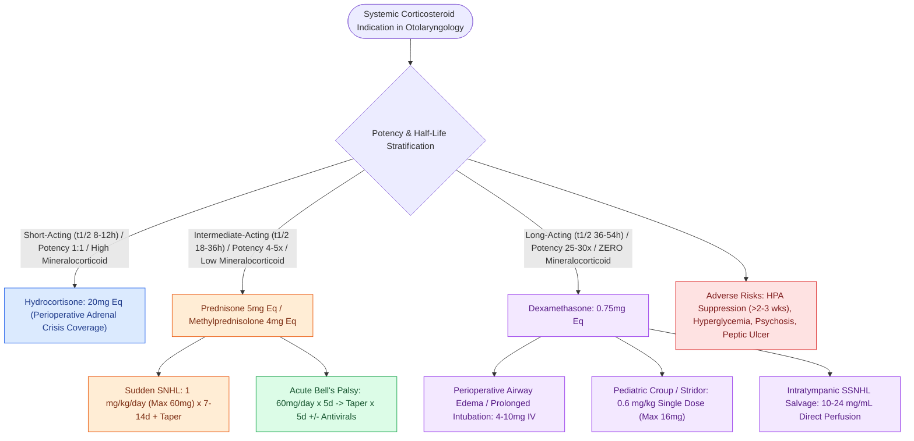

# Systemic corticosteroid equivalencies and anti-inflammatory potencies guide perioperative airway edema and sudden SNHL management

## Active Recall

> [!question]- What are the equivalent anti-inflammatory doses, biological half-lives, and mineralocorticoid potencies of hydrocortisone, prednisone, methylprednisolone, and dexamethasone?
> *Answer / Clinical Rationale*: - **Hydrocortisone (Short-acting, $t_{1/2} = 8\text{–}12\text{ h}$)**: Equivalent dose **$20\text{ mg}$**; Anti-inflammatory potency **$1$**; Mineralocorticoid potency **$1$**. - **Prednisone / Prednisolone (Intermediate-acting, $t_{1/2} = 18\text{–}36\text{ h}$)**: Equivalent dose **$5\text{ mg}$**; Anti-inflammatory potency **$4$**; Mineralocorticoid potency **$0.8$**. - **Methylprednisolone (Intermediate-acting, $t_{1/2} = 18\text{–}36\text{ h}$)**: Equivalent dose **$4\text{ mg}$**; Anti-inflammatory potency **$5$**; Mineralocorticoid potency **$0.5$**. - **Dexamethasone (Long-acting, $t_{1/2} = 36\text{–}54\text{ h}$)**: Equivalent dose **$0.75\text{ mg}$**; Anti-inflammatory potency **$25\text{–}30$**; Mineralocorticoid potency **$0$** (zero sodium/water retention).

> [!question]- What are the evidence-based steroid protocols for idiopathic sudden sensorineural hearing loss (SSNHL) versus acute Bell's palsy?
> *Answer / Clinical Rationale*: - **Sudden SNHL**: Oral **Prednisone $1\text{ mg/kg/day}$ (max $60\text{ mg/day}$) for 7–14 days**, followed by a 5-day taper (or oral Dexamethasone $10\text{ mg/day}$), combined with or followed by intratympanic Dexamethasone ($10\text{–}24\text{ mg/mL}$) rescue. - **Acute Bell's Palsy**: Oral **Prednisone $60\text{ mg/day}$ for 5 days**, then tapered by $10\text{ mg/day}$ over the next 5 days (total 10 days) initiated within 72 hours of onset $\pm$ oral Valacyclovir ($1000\text{ mg}$ tid for 7 days) in severe paralysis (House-Brackmann IV–VI).

> [!question]- How does perioperative Dexamethasone mitigate post-extubation airway edema, PONV, and pain in head and neck surgery?
> *Answer / Clinical Rationale*: A single pre-incision or intraoperative IV dose of **Dexamethasone ($4\text{–}10\text{ mg}$ IV)** stabilizes endothelial capillary membranes, inhibits phospholipase A2 and pro-inflammatory cytokine release (IL-1, IL-6, TNF-$\alpha$), substantially reduces **postoperative nausea and vomiting (PONV)**, blunts glottic/subglottic edema following prolonged endotracheal intubation, and reduces opioid consumption without increasing surgical site infection rates.

## Core Clinical & Mechanistic Principles
Corticosteroids exert genomic and non-genomic anti-inflammatory and immunosuppressive actions across head and neck mucosa, auditory hair cells, and cranial nerves:

### Safety & Endocrine Precautions
- **HPA-Axis Suppression**: Courses exceeding $2\text{–}3\text{ weeks}$ of supra-physiological doses suppress the hypothalamic-pituitary-adrenal axis, mandating gradual dose tapering to prevent acute adrenal crisis.
- **Hyperglycemia & Psychiatric Reactions**: Screen blood glucose in diabetics (steroids induce hepatic gluconeogenesis and peripheral insulin resistance) and monitor for steroid-induced psychosis or mood lability (see [[Idiopathic sudden sensorineural hearing loss requires prompt systemic corticosteroids and intratympanic salvage injection|Sudden SNHL Management]]).

## Connected Concepts & Graph Traversal
- **Sudden SNHL Salvage**: [[Idiopathic sudden sensorineural hearing loss requires prompt systemic corticosteroids and intratympanic salvage injection|Sudden SNHL Management]]
- **Bell's Palsy**: [[Acute Bell's palsy presents with unilateral lower motor neuron facial paralysis treated with early oral steroids|Bell's Palsy Protocol]]
- **Pediatric Croup**: [[Nebulized racemic epinephrine and oral dexamethasone provide rapid treatment for acute croup|Pediatric Croup Management]]
- **Airway Fire & Safety**: [[Airway fire prevention requires FiO2 below 30 percent and laser-safe tubes|Airway Fire Protocol]]
- **Reflux Therapeutics**: [[Laryngopharyngeal reflux presents with globus and throat clearing but responds inconsistently to empiric PPIs|Acid Suppression Pharmacotherapy]]
