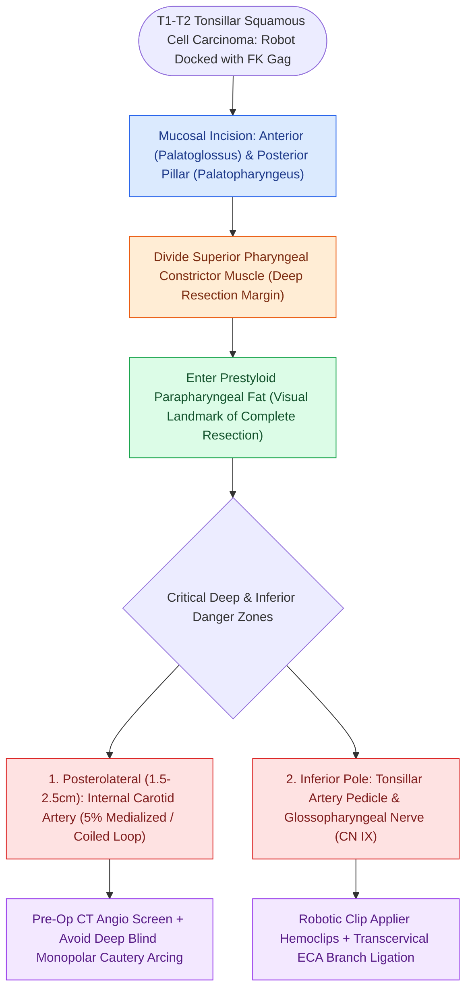

# TORS radical tonsillectomy requires careful identification of the internal carotid artery posterolaterally

## Active Recall

> [!question]- What is the average distance from the palatine tonsillar bed to the internal carotid artery, and what vascular variation increases surgical risk?
> *Answer / Clinical Rationale*: Approximately **$1.5\text{–}2.5\text{ cm}$**; a **tortuous or medialized retropharyngeal internal carotid artery** (present in up to 5% of patients) brings the artery directly adjacent to the constrictor.

> [!question]- Which cranial nerve is vulnerable to injury at the inferior pole of the palatine tonsil bed?
> *Answer / Clinical Rationale*: The **glossopharyngeal nerve (CN IX)**, which runs along the stylopharyngeus and courses deep to the inferior constrictor at the lower pole of the tonsil.

> [!question]- Prior to what pharyngeal procedures is a routine screening for a medialized internal carotid artery essential?
> *Answer / Clinical Rationale*: Prior to **TORS radical tonsillectomy**, **superiorly-based pharyngeal flaps for VPI**, **adenoidectomy**, and **quinsy/parapharyngeal abscess incision**.

## Core Clinical & Mechanistic Principles
During a **TORS radical (lateral) tonsillectomy**, the surgical resection encompasses the palatoglossus anteriorly, palatopharyngeus posteriorly, and superior pharyngeal constrictor muscle deep down to the buccopharyngeal fascia and prestyloid parapharyngeal fat:
- **The Internal Carotid Artery (ICA) Hazard & The Medialized ICA Screen**:
  - The internal carotid artery lies in the poststyloid [[Deep neck space infections spread along cervical fascial planes between the pharynx, mediastinum, and skull base|parapharyngeal space]] **$1.5\text{–}2.5\text{ cm}$ posterolateral to the tonsillar fossa**.
  - *Tortuous / Aberrant ICA (Retropharyngeal Carotid)*: In up to **$5\%$ of patients**, the ICA exhibits medial loop or coiling that brings the vessel directly against the superior constrictor muscle within millimeters of the tonsillar capsule.
  - *Universal Pharyngeal Rule*: A pre-operative visual, manual palpation, and contrast CT screening for a **medialized / pulsating retropharyngeal ICA** is mandatory before every TORS resection, pharyngeal flap for velopharyngeal insufficiency, pediatric adenoidectomy, and revision tonsillectomy.
- **Superior Constrictor & Glossopharyngeal Nerve Relationships**:
  - The **superior pharyngeal constrictor** forms the backstop of the tonsillar fossa, lined on its outer surface by buccopharyngeal fascia abutting the prestyloid fat.
  - The **glossopharyngeal nerve (CN IX)** descends along the lateral pharyngeal wall, curving forward across the stylopharyngeus and passing deep to the lower pole of the superior constrictor near the tonsillar bed. Aggressive deep cautery at the inferior tonsillar pole injures CN IX, causing ipsilateral tongue base sensory loss and loss of the gag reflex.

### Surgical Technique & Critical Safety Checks
- **Vascular Clip Rule**: Apply titanium hemoclips to all arterial feeders (tonsillar branches of the facial and ascending pharyngeal arteries) at the inferior pole; avoid unipolar cautery deep to the constrictor to prevent thermal arc blowout injury to the carotid wall.
- **Prophylactic ECA Branch Ligation**: In high-risk TORS resections, concurrent transcervical ligation of the facial, lingual, and ascending pharyngeal arteries dramatically reduces fatal secondary postoperative hemorrhage.

## Connected Concepts & Graph Traversal
- **TORS Principles**: [[Transoral robotic surgery TORS achieves en bloc resection of tonsillar and base of tongue neoplasms|TORS Principles & Indications]]
- **TORS Lingual Hemostasis**: [[Lingual artery branches require clip ligation during TORS base of tongue resection|TORS Lingual Artery Control]]
- **Prophylactic Ligation**: [[Prophylactic transcervical external carotid ligation reduces fatal secondary hemorrhage after TORS|Transcervical ECA Ligation]]
- **Carotid Blowout Emergency**: [[Carotid blowout syndrome is classified into threatened, impending, and acute hemorrhage|Carotid Blowout Management]]
- **Parapharyngeal Topography**: [[The parapharyngeal space is an inverted pyramid connecting peritonsillar, masticator, parotid, and retropharyngeal spaces|Parapharyngeal Space Boundaries]]
- **HPV Oropharynx Staging**: [[HPV-positive oropharyngeal squamous cell carcinoma exhibits distinct biological behavior and staging|HPV Oropharynx SCC]]
