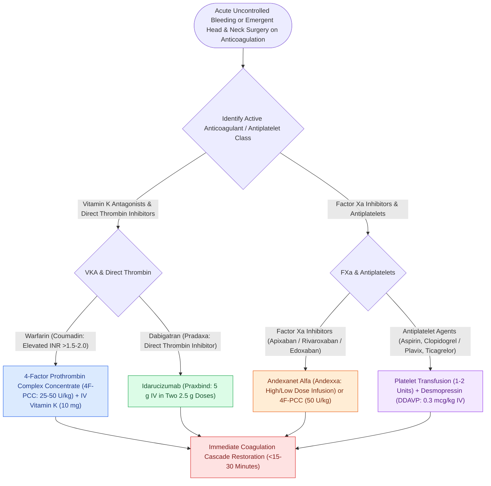

# Targeted reversal of direct oral anticoagulants and antiplatelet agents is required for emergent head and neck surgery

## Active Recall

> [!question]- What specific reversal agents are indicated for dabigatran, direct factor Xa inhibitors (rivaroxaban, apixaban), and warfarin in life-threatening surgical bleeding?
> *Answer / Clinical Rationale*: - **Dabigatran (Direct Thrombin Inhibitor)**: **Idarucizumab (Praxbind)** $5\text{ g}$ IV ($2 \times 2.5\text{ g}$ vials given IV bolus 15 minutes apart); specifically binds free and thrombin-bound dabigatran with 350-fold higher affinity than thrombin. - **Factor Xa Inhibitors (Rivaroxaban, Apixaban, Edoxaban)**: **Andexanet alfa (Andexxa)** (recombinant decoy factor Xa) OR **4-Factor Prothrombin Complex Concentrate (4F-PCC / Kcentra)** $25\text{–}50\text{ units/kg}$ IV. - **Warfarin (Vitamin K Antagonist)**: **4-Factor PCC (Kcentra)** $25\text{–}50\text{ units/kg}$ IV (providing rapid normalization of INR in $<15\text{–}30\text{ minutes}$) PLUS **IV Vitamin K1 (Phytonadione)** $5\text{–}10\text{ mg}$ slow IV infusion to promote sustained endogenous factor synthesis.

> [!question]- What are the reversal dosing rules for unfractionated heparin (UFH) versus low-molecular-weight heparin (LMWH) with protamine sulfate?
> *Answer / Clinical Rationale*: - **UFH**: **Protamine sulfate $1\text{ mg}$ neutralizes $100\text{ units}$ of UFH** remaining in circulation (calculated based on heparin infusion rate and half-life of 60 minutes; maximum single dose $50\text{ mg}$ infused slowly over 10 minutes to prevent hypotension and bradycardia). - **LMWH (Enoxaparin)**: If given within 8 hours, **$1\text{ mg}$ protamine per $1\text{ mg}$ ($100\text{ anti-Xa units}$) of enoxaparin** ($0.5\text{ mg}$ protamine per $1\text{ mg}$ enoxaparin if last dose was 8–12 hours prior). Protamine neutralizes $\sim 60\text{–}75\%$ of LMWH anti-Xa activity.

> [!question]- What are the mandatory perioperative holding times and bridging guidelines for elective vs emergent high-bleeding-risk head and neck procedures?
> *Answer / Clinical Rationale*: - **Aspirin / Clopidogrel**: Hold **$7\text{–}10\text{ days}$** before major elective high-risk operations (tonsillectomy, thyroidectomy, neck dissection, free tissue transfer). In patients with **recent coronary stents** (bare-metal $<4\text{ weeks}$ or drug-eluting $<12\text{ months}$), dual antiplatelet therapy MUST be continued or elective surgery deferred due to catastrophic in-stent thrombosis risk. - **Warfarin**: Hold **5 days** prior; bridge with therapeutic LMWH in high-thrombotic-risk patients (stop LMWH 24h pre-op). - **DOACs**: Hold **$48\text{–}72\text{ hours}$** preoperatively for high-bleeding-risk surgery ($>72\text{ hours}$ in renal impairment).

## Core Clinical & Mechanistic Principles
Emergent surgical hemorrhage or impending airway compromise from expanding neck hematomas requires rapid, targeted reversal tailored to the specific pharmacological mechanism:

### Urgent Surgical Triage in the Compromised Airway
- In the setting of a tense, rapidly expanding **postoperative cervical hematoma**, surgical decompression and bedside suture release must **NEVER be delayed for laboratory turnaround or complete pharmacological reversal**; immediate evacuation relieves venous congestion and restores the glottic aperture while reversal agents are infused simultaneously (see [[The coagulation cascade is organized into extrinsic, intrinsic, and common pathways evaluated by PT and aPTT|Coagulation Pathways & Mixing Studies]]).

## Connected Concepts & Graph Traversal
- **Coagulation Cascade**: [[The coagulation cascade is organized into extrinsic, intrinsic, and common pathways evaluated by PT and aPTT|Coagulation Pathways & Mixing Studies]]
- **Bleeding Disorders**: [[Congenital bleeding disorders in otolaryngology encompass hemophilia A, hemophilia B, and von Willebrand disease subtypes|Hemophilia & vWD Subtypes]]
- **Post-Surgical Hematoma**: [[Postoperative neck hematoma after thyroidectomy or neck dissection requires emergent bedside wound opening for airway decompression|Cervical Hematoma Bedside Decompression]]
- **Anesthesia Crisis**: [[Local anesthetic systemic toxicity LAST is managed with airway stabilization and twenty percent intravenous lipid emulsion|LAST Emergency Management]]
- **Refractory Epistaxis**: [[Posterior epistaxis from sphenopalatine artery arborization requires endoscopic ligation or embolization|Posterior Epistaxis Management]]
