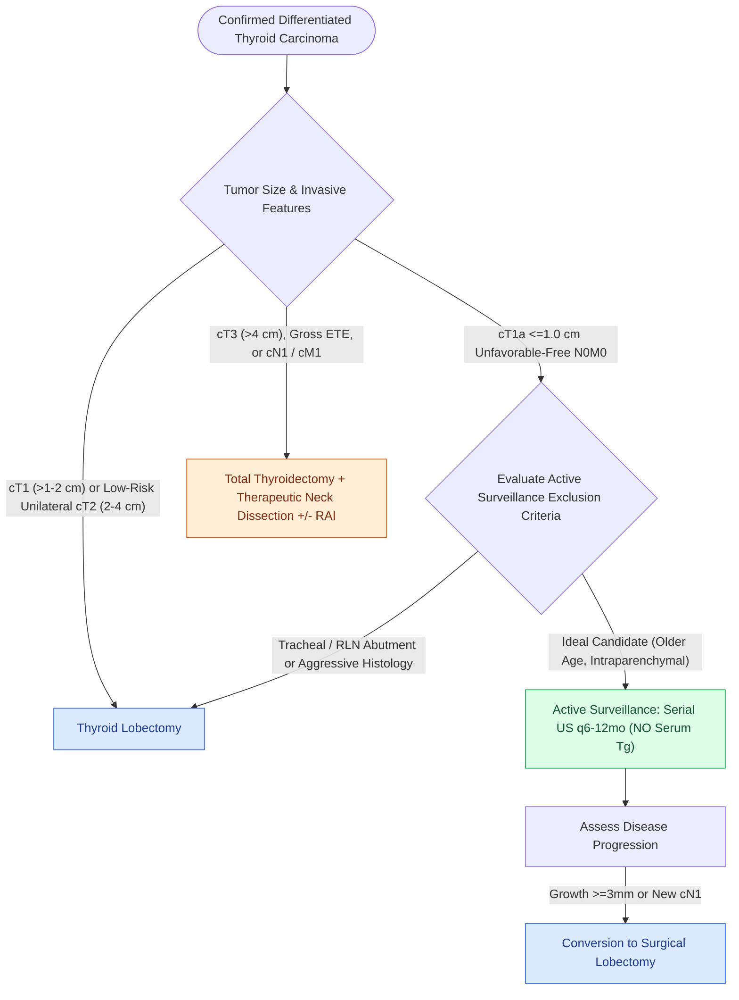

# The 2025 ATA guidelines establish active surveillance criteria and lobectomy preference for low-risk differentiated thyroid cancer

## Active Recall

> [!question]- What are the anatomical exclusion criteria for active surveillance of a cT1a papillary thyroid microcarcinoma under the 2025 ATA guidelines?
> *Answer / Clinical Rationale*: Aggressive histology (tall cell/hobnail), **sonographic abutment/proximity to the trachea or posterior capsule (recurrent laryngeal nerve)**, presence of **extrathyroidal extension (ETE)**, and **regional or distant metastases ($cN1/cM1$)**.

> [!question]- Why does the 2025 ATA guideline prefer thyroid lobectomy over total thyroidectomy for low-risk unilateral 2–4 cm (cT2) tumors?
> *Answer / Clinical Rationale*: Lobectomy achieves equivalent overall and disease-specific survival while **significantly reducing lifelong complications**, specifically permanent hypoparathyroidism ($<1\%$) and bilateral recurrent laryngeal nerve injury.

> [!question]- Why is routine serum thyroglobulin (Tg) monitoring contraindicated during active surveillance?
> *Answer / Clinical Rationale*: Because the normal intact contralateral and ipsilateral thyroid parenchyma produces physiological thyroglobulin, rendering **serum Tg levels uninterpretable for tracking microcarcinoma progression**.

## Core Clinical & Mechanistic Principles
The **2025 American Thyroid Association (ATA) Guidelines for Differentiated Thyroid Cancer (DTC)** represent a paradigm shift from mandatory upfront total thyroidectomy toward individualized risk-adapted de-escalation, establishing formal protocols for **active surveillance**, **extent of surgical resection**, **low-risk neoplasm classification (NIFTP)**, and **germline/somatic molecular profiling**:

- **Active Surveillance for Papillary Microcarcinoma ($cT1aN0M0 \le 1.0\text{ cm}$)**:
  - *Eligibility & Biology*: Offered as a primary management option for select patients with confirmed $cT1aN0M0$ papillary thyroid carcinoma (PTC). Multi-institutional registries demonstrate that active surveillance and immediate resection yield identical, near-zero rates of thyroid cancer-specific mortality ($<0.1\%$) and distant metastasis.
  - *Candidate Stratification*: Older patients ($>60\text{ years}$) experience lower rates of tumor progression than younger adults ($<40\text{ years}$).
  - *Strict Exclusion Criteria*:
    1. Evidence of aggressive histological subtypes (tall cell, columnar cell, hobnail variants).
    2. Sonographic proximity / abutment to the trachea or posterior thyroid capsule along the course of the [[The recurrent laryngeal nerve is identified within Simon's triangle and followed through Berry's ligament|recurrent laryngeal nerve]].
    3. Clinical or radiographic evidence of extrathyroidal extension (ETE), regional lymph node metastases ($cN1$), or distant metastases ($cM1$).
  - *Surveillance Protocol*: High-resolution neck ultrasound every 6 months for the first 1–2 years, then annually. **Serum thyroglobulin (Tg) and Tg antibody (TgAb) testing is NOT recommended** during active surveillance (serum Tg is uninterpretable with an intact thyroid gland).
  - *Triggers for Surgical Conversion*: Confirmed tumor growth $\ge 3\text{ mm}$ in any dimension, development of new lymph node metastases, emergence of extrathyroidal extension, or patient preference.

- **Extent of Surgery: Lobectomy as the Standard for Low-Risk Disease**:
  - *$cT1\ (\le 2.0\text{ cm},\ cN0M0)$*: Thyroid **lobectomy** is the mandatory initial surgical procedure unless bilateral nodularity or prior head/neck irradiation dictates total removal.
  - *$cT2\ (>2.0\text{ cm to } 4.0\text{ cm},\ cN0M0)$*: Thyroid **lobectomy is the preferred initial surgery** for low-risk unilateral tumors, drastically reducing rates of permanent [[Post-thyroidectomy hypocalcemia is managed with oral calcium, calcitriol, and intravenous calcium gluconate|hypoparathyroidism]] ($<1\%$ vs $2\text{–}5\%$) and bilateral vocal fold paralysis while maintaining equivalent disease-specific survival. Total thyroidectomy is reserved for cases requiring adjuvant radioactive iodine (RAI) or with suspicious contralateral disease.
  - *$cT3\ (>4.0\text{ cm})$ or $cT4$ / $cN1$ / $cM1$*: Mandates **total thyroidectomy** with macroscopic clearance of gross disease and therapeutic central/lateral neck dissection.

- **NIFTP & Low-Risk Neoplasm Reclassification**:
  - *Noninvasive Follicular Thyroid Neoplasm with Papillary-like Nuclear Features (NIFTP)*, Follicular Tumor of Uncertain Malignant Potential (FTUMP), and Hyalinizing Trabecular Tumors (HTT) have negligible metastatic potential.
  - *Management*: Treated definitively with lobectomy; completion thyroidectomy, lymphadenectomy, and adjuvant RAI are strictly contraindicated.

- **Germline & Somatic Genetic Testing Criteria**:
  - *Germline Panel Testing*: Indicated for clinical suspicion of Cowden syndrome (*PTEN* mutation), Familial Adenomatous Polyposis (*APC*), Werner syndrome (*WRN*), Carney complex (*PRKAR1A*), *DICER1* syndrome, familial non-medullary thyroid cancer ($\ge 3$ affected first-degree relatives), or young age of onset ($<18\text{ years}$ for PTC, $<30\text{ years}$ for FTC).
  - *Somatic Testing*: Not recommended routinely for determining extent of surgery in low-risk $cT1\text{–}T2$ disease, but reserved for indeterminate cytopathology ([[Bethesda cytology and molecular testing stratify thyroid nodule malignancy risk before surgery|Bethesda III/IV]]) or advanced invasive disease.

### Surgical Technique & Critical Safety Checks
- **Pathology Reporting Standards**: The 2025 guidelines require synoptic reporting of: (1) exact number of invaded blood vessels (focal $<4$ vs extensive $\ge 4$ vascular invasion); (2) total number of lymph nodes harvested and positive; (3) millimeter size of largest nodal metastasis; (4) extranodal extension (ENE); and (5) histological subtype (unfavorable: tall cell, columnar cell, hobnail, widely invasive FTC vs favorable: minimally invasive FTC, encapsulated follicular variant).

## Connected Concepts & Graph Traversal
- **Cytopathology & Molecular Stratification**: [[Bethesda cytology and molecular testing stratify thyroid nodule malignancy risk before surgery|Bethesda Cytology & Molecular Diagnostics]]
- **Postoperative Calcium Protocol**: [[Post-thyroidectomy hypocalcemia is managed with oral calcium, calcitriol, and intravenous calcium gluconate|Post-Thyroidectomy Calcium & Calcitriol Protocol]]
- **RLN Surgical Anatomy**: [[The recurrent laryngeal nerve is identified within Simon's triangle and followed through Berry's ligament|Recurrent Laryngeal Nerve & Berry's Ligament]]
- **EBSLN Preservation**: [[The superior thyroid artery branches are divided flush on the thyroid capsule to protect the EBSLN|Superior Thyroid Artery & EBSLN Preservation]]
- **Papillary Cancer Lymphatics**: [[Papillary thyroid carcinoma spreads via cervical lymphatics to central and lateral neck compartments|Papillary Thyroid Cancer Lymphatic Spread]]
- **Anaplastic Emergency**: [[Anaplastic thyroid carcinoma is an airway and molecular emergency requiring immediate BRAF testing|Anaplastic Thyroid Carcinoma Emergency]]
- **Legacy Prognostic Scoring**: [[Differentiated thyroid carcinoma prognostic scoring systems AMES, AGES, and MACIS stratify low and high risk disease to guide the extent of thyroidectomy|AMES, AGES & MACIS Scoring]]
