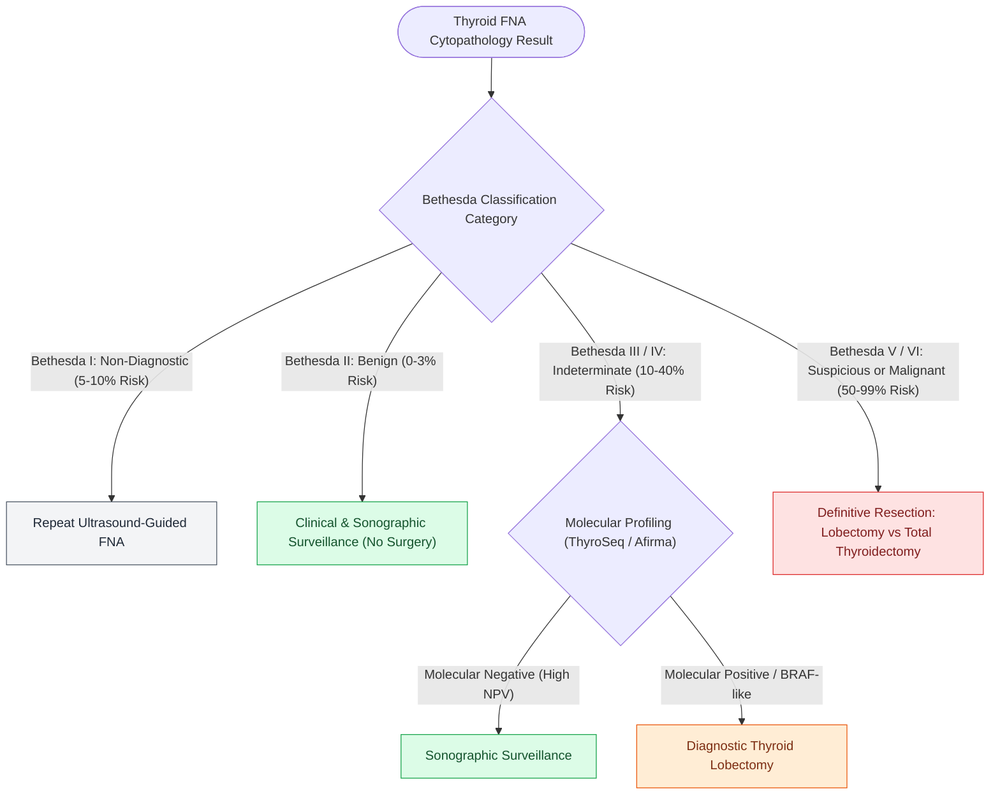

# The Bethesda system for reporting thyroid cytopathology stratifies malignancy risk and guides surgical decision-making

## Active Recall

> [!question]- What is the recommended management for a Bethesda III (AUS/FLUS) thyroid nodule?
> *Answer / Clinical Rationale*: **Molecular testing** (ThyroSeq or Afirma) or **repeat ultrasound-guided FNA**.

> [!question]- What is the malignancy risk associated with a Bethesda VI (Malignant) cytology result?
> *Answer / Clinical Rationale*: **$97\text{ to }99\%$**.

## Core Clinical & Mechanistic Principles
The **Bethesda System for Reporting Thyroid Cytopathology (TBSRTC)** standardizes fine-needle aspiration (FNA) interpretation and stratifies malignancy risk:
- **The Six Diagnostic Categories**:
  - **Bethesda I (Non-diagnostic / Unsatisfactory)**: Malignancy risk $5\text{–}10\%$. Management: Repeat ultrasound-guided FNA.
  - **Bethesda II (Benign)**: Macrofollicular nodules, colloid, Hashimoto thyroiditis. Malignancy risk $0\text{–}3\%$. Management: Clinical and sonographic surveillance.
  - **Bethesda III (Atypia of Undetermined Significance / Follicular Lesion of Undetermined Significance - AUS/FLUS)**: Malignancy risk $10\text{–}30\%$. Management: Molecular testing (ThyroSeq / Afirma) or repeat FNA.
  - **Bethesda IV (Follicular Neoplasm / Suspicious for Follicular Neoplasm - FN/SFN)**: Malignancy risk $25\text{–}40\%$. Management: Molecular testing or diagnostic lobectomy.
  - **Bethesda V (Suspicious for Malignancy - SFM)**: Malignancy risk $50\text{–}75\%$. Management: Total thyroidectomy or lobectomy.
  - **Bethesda VI (Malignant)**: Papillary, medullary, or anaplastic carcinoma. Malignancy risk $97\text{–}99\%$. Management: Definitive surgical resection.

### Surgical Technique & Critical Safety Checks
- **Molecular Testing Integration**: Next-generation sequencing (NGS, e.g. ThyroSeq v3) identifies point mutations (*BRAF*, *RAS*, *TERT*), fusions (*RET/PTC*, *NTRK*), and copy number alterations in Bethesda III/IV nodules to rule in or rule out malignancy (see [[BRAF V600E and TERT promoter mutations drive aggressive papillary thyroid carcinoma behavior|Thyroid Molecular Drivers]]).

## Connected Concepts & Graph Traversal
- **Molecular Drivers**: [[BRAF V600E and TERT promoter mutations drive aggressive papillary thyroid carcinoma behavior|Thyroid Molecular Drivers]]
- **Total Thyroidectomy**: [[The recurrent laryngeal nerve is identified within Simon's triangle and followed through Berry's ligament|Total Thyroidectomy]]
- **Papillary Carcinoma**: [[Papillary thyroid carcinoma spreads via cervical lymphatics to central and lateral neck compartments|Papillary Thyroid Carcinoma]]
- **Anatomical Foundation**: [[Cervical necrotizing fasciitis requires emergent surgical debridement and broad-spectrum antimicrobial coverage]]
- **Surgical Lymphadenectomy**: [[Central compartment neck dissection clears level VI nodes between the carotid sheaths and suprasternal notch]]
- **Oncologic Resection & Margins**: [[Segmental mandibulectomy resects full-thickness bone for medullary invasion and irradiated bone recurrence]]
- **Aerodigestive / Pharyngolaryngeal**: [[Prophylactic transcervical external carotid ligation reduces fatal secondary hemorrhage after TORS]]
