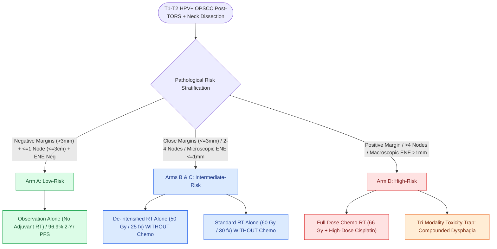

# The ECOG-3311 and ORATOR trials establish pathological risk-stratified de-escalation and functional trade-offs in HPV-positive OPSCC

## Active Recall

> [!question]- How did the ECOG-3311 trial challenge the traditional Bernier/Cooper definition of Extranodal Extension (ENE) as an absolute indication for concurrent chemoradiotherapy?
> *Answer / Clinical Rationale*: E3311 demonstrated that **minimal microscopic ENE ($\le 1.0\text{ mm}$)** in HPV+ OPSCC can be safely managed with **de-intensified radiotherapy ($50\text{ Gy}$) WITHOUT concurrent cisplatin**, achieving a $95\%$ 2-year progression-free survival.

> [!question]- What was the primary conclusion of the ORATOR trial regarding swallowing quality of life between primary TORS and primary IMRT?
> *Answer / Clinical Rationale*: Primary IMRT achieved slightly superior 1-year MDADI swallowing scores ($86.9$ vs $80.4$), primarily because **$71\%$ of patients in the surgical arm required adjuvant radiation or chemoradiation** (the "triple-modality trap"), compounding treatment toxicities.

> [!question]- Under ECOG-3311 criteria, what patients qualify for observation alone without any adjuvant radiotherapy following TORS?
> *Answer / Clinical Rationale*: Low-risk patients with **negative surgical margins ($>3\text{ mm}$)**, **$\le 1$ involved lymph node $\le 3\text{ cm}$**, and **complete absence of extranodal extension (ENE-)**.

## Core Clinical & Mechanistic Principles
The explosive rise of **Human Papillomavirus-associated Oropharyngeal Squamous Cell Carcinoma (HPV+ OPSCC)** in younger, healthier patients created a critical imperative to **de-intensify therapy**—maintaining exceptional survival ($>85\text{–}90\%$) while minimizing debilitating lifelong dysphagia, xerostomia, and osteoradionecrosis. Two prospective multi-institutional trials established the modern evidence base for transoral surgery and adjuvant radiotherapy de-escalation:

- **The ECOG-3311 Phase II Trial (Ferris et al., *Journal of Clinical Oncology* 2022)**:
  - *Study Paradigm*: Evaluated transoral surgery ([[Transoral robotic surgery TORS achieves en bloc resection of tonsillar and base of tongue neoplasms|TORS]] or TLM) + neck dissection followed by **pathological risk-directed postoperative management** in resectable $cT1\text{–}T2,\ cN0\text{–}N2b$ (AJCC 7th ed) / Stage I–II (AJCC 8th ed) p16+ OPSCC.
  - *Pathological Risk Arms & Outcomes*:
    1. **Low-Risk Arm (Arm A)**: Negative margins ($>3\text{ mm}$), $0\text{–}1$ metastatic lymph node $\le 3\text{ cm}$, and **no extranodal extension (ENE-)** $\rightarrow$ **Observation alone** (No adjuvant RT). **2-Year Progression-Free Survival (PFS): $96.9\%$**.
    2. **Intermediate-Risk Arms (Arms B & C)**: Close margins ($\le 3\text{ mm}$), $2\text{–}4$ positive lymph nodes, or **minimal microscopic ENE ($\le 1.0\text{ mm}$)**. Randomized to **de-intensified RT ($50\text{ Gy}$ / 25 fractions)** vs **standard RT ($60\text{ Gy}$ / 30 fractions)**, *both delivered WITHOUT concurrent chemotherapy*. **2-Year PFS: $95.0\%$ in the $50\text{ Gy}$ arm vs $96.0\%$ in the $60\text{ Gy}$ arm**.
    3. **High-Risk Arm (Arm D)**: Positive surgical margins, $>4$ positive lymph nodes, or **extensive macroscopic ENE ($>1.0\text{ mm}$)** $\rightarrow$ Full-dose chemoradiotherapy (**$66\text{ Gy} + \text{concurrent high-dose cisplatin}$**). **2-Year PFS: $90.7\%$**.
  - *Key Paradigm Shift (The $1\text{-mm}$ ENE Threshold)*: E3311 proved that **microscopic ENE $\le 1.0\text{ mm}$ in HPV+ OPSCC does NOT mandate concurrent cisplatin chemoradiotherapy**, achieving $>95\%$ regional control with reduced-dose radiotherapy alone ($50\text{ Gy}$).

- **The ORATOR Phase II Trial (Nichols et al., *Lancet Oncology* 2019) & Functional Trade-offs**:
  - *Study Design*: Head-to-head randomized trial comparing **TORS + Neck Dissection** vs **Primary Radiotherapy (IMRT $\pm$ Cisplatin)** in $T1\text{–}T2,\ N0\text{–}N2$ ($\le 4\text{ cm}$ nodes) OPSCC.
  - *Primary Endpoint (Swallowing QoL)*: Evaluated via the **MD Anderson Dysphagia Inventory (MDADI)** at 1 year.
  - *Results & The "Triple-Modality Trap"*:
    - Swallowing QoL scores were statistically superior in the primary radiotherapy arm (MDADI total score: $86.9$ for RT vs $80.4$ for TORS, $p=0.042$), though both arms represented clinically acceptable swallowing function.
    - *The Triple-Modality Trap*: In the surgical arm, **$71\%$ of patients required postoperative radiation ($47\%$) or full chemoradiotherapy ($24\%$)** due to adverse pathologic features, compounding acute surgical healing with radiation fibrosis and mucosal toxicity.

### Surgical Technique & Critical Safety Checks
- **Patient Selection for Upfront TORS**: To avoid the triple-modality trap, carefully pre-screen patients for TORS candidacy: exclude patients with encasement of the internal carotid artery, fixation to prevertebral fascia, trismus, or radiographic frank extranodal extension ($>1\text{ cm}$ or matted nodes) who are pre-destined for full chemoradiation.

## Connected Concepts & Graph Traversal
- **TORS Surgical Execution**: [[Transoral robotic surgery TORS achieves en bloc resection of tonsillar and base of tongue neoplasms|TORS Resection Craft & Margins]]
- **TORS Bleeding Prevention**: [[Prophylactic transcervical external carotid ligation reduces fatal secondary hemorrhage after TORS|Transcervical ECA Ligation for TORS]]
- **CUP Diagnostic Algorithm**: [[HPV-positive carcinoma of unknown primary is localized by palatine tonsillectomy and TORS lingual mucosectomy|Carcinoma of Unknown Primary & HPV Workup]]
- **Elective Neck Dissection**: [[Selective neck dissection targets high-risk nodal basins while sparing low-risk cervical levels|Selective Neck Dissection & D'Cruz Trial]]
- **Perioperative Immunotherapy**: [[KEYNOTE-689 establishes neoadjuvant and adjuvant pembrolizumab as standard for locally advanced head and neck squamous cell carcinoma|KEYNOTE-689 Perioperative Pembrolizumab]]
- **Radiation Toxicity**: [[Post-radiation carotid vasculopathy and osteoradionecrosis represent severe late radiotherapy sequelae|Osteoradionecrosis & Late Radiation Complications]]
